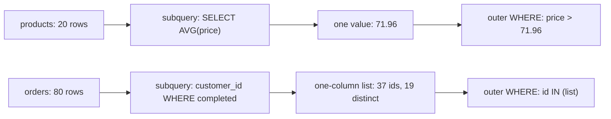

# Subqueries in WHERE

The stock team wants every product priced above the average price. You type `WHERE price > AVG(price)`, exactly what the request says, and PostgreSQL refuses to run it. The report stalls on one clause, and the data is not the problem.

The refusal is fair. A filter visits one row at a time, and `AVG` cannot answer until it has seen every row. The question needs two passes, and one `WHERE` clause only offers one.

A subquery is how SQL writes two passes in one statement. It is an ordinary `SELECT` inside a larger query, and PostgreSQL evaluates it first. The outer query then uses the answer as though you had typed it yourself. This chapter takes the three shapes that answer can take, the clause each one can sit in, and why the outer query keeps its own row count throughout.

## The question one WHERE cannot answer

Here is the attempt, and the error it produces.

```sql
-- Fails with: aggregate functions are not allowed in WHERE
SELECT name, price
FROM products
WHERE price > AVG(price);
```

The message names the rule, not the reason. The reason is ordering. `WHERE` decides row by row: read a row, test it, keep or drop it.

`AVG` needs the whole set before it can produce a number, so the two jobs cannot happen at the same moment. PostgreSQL keeps aggregates in `SELECT` and `HAVING`, and out of `WHERE`.

That ordering rule sets the cost. A typed-in `71.96` satisfies the filter today and rots at the next price change, so the average has to come from the statement itself.

Run the average on its own and it gives one number:

```sql
SELECT AVG(price) FROM products;
```

| avg |
| --- |
| 71.96 |

That is 71.9645 rounded to two decimals, and it is all the filter needs. So compute it first, in parentheses, and compare against the result:

```sql
SELECT name, price
FROM products
WHERE price > (SELECT AVG(price) FROM products)
ORDER BY price DESC, name;
```

Two terms worth fixing now. The statement you keep is the outer query. The parenthesised `SELECT` inside it is the subquery. Both are plain `SELECT` statements. Only the position differs.

There is a reading habit in the query above. Say it as a sentence: products priced above the average product price. The phrase "the average product price" is the subquery, and the rest is the outer query. Practise that translation and most subqueries stop looking clever.

## A subquery collapses to one of three shapes

The outer query never inspects the subquery's rows. It receives what the subquery collapses to, and that collapsed thing is one value, one list, or one table.

| The subquery returns | The outer query sees | Where it can sit | Operator |
| --- | --- | --- | --- |
| one row, one column | a single value | `WHERE`, `SELECT`, `ORDER BY` | `=`, `>`, `<` |
| one column, many rows | a list | `WHERE` | `IN` |
| many columns, many rows | a table | `FROM` | `AS alias` |

The shape decides the placement, not the other way round. Put a two-column subquery in `WHERE` and PostgreSQL reports that a subquery there must return only one column. Put a many-row subquery beside `=` and you get the error from the next section, because `=` has no slot for a list.



Before you write a subquery, ask what it returns. If you cannot say the answer in one of those three words, the outer clause has nothing to accept.

## One value: the scalar subquery

A scalar subquery returns exactly one row and one column. That makes it interchangeable with a constant, so it can stand in `WHERE`, in the `SELECT` list, and in `ORDER BY`.

Walk through the price query in steps.

```text
products                -> 20 rows, prices from 0.00 to 210.00
(SELECT AVG(price))     -> 71.96
WHERE price > 71.96     -> 9 rows survive
ORDER BY price DESC     -> most expensive first
```

```sql
SELECT name, price
FROM products
WHERE price > (SELECT AVG(price) FROM products)
ORDER BY price DESC, name;
```

| name | price |
| --- | --- |
| Granite Cookware Set | 210.00 |
| Trail Runner Jacket | 139.00 |
| Nimbus Headphones | 129.00 |
| Harbor Rain Shell | 118.00 |
| Summit Hiking Poles | 96.40 |
| Vertex Mechanical Keyboard | 89.50 |
| Linen Duvet Cover | 84.00 |
| Pulse Fitness Tracker | 74.25 |
| Bamboo Shelf | 72.30 |

Nine products clear 71.96. The subquery ran once, produced a single value, and every row of the outer table met that same value. Nothing in the inner query knows or cares which product is being tested.

The rule that keeps this safe: compared with `=`, `<`, `>` and their friends, a scalar subquery must return at most one row. Pose the same question with a looser inner filter and watch the rule bite.

```sql
-- Fails with: more than one row returned by a subquery used as an expression
SELECT name, price
FROM products
WHERE price > (SELECT price FROM products WHERE category = 'Outdoor');
```

`Outdoor` holds six products, so the inner query returns six prices. `>` compares one value with one value, and PostgreSQL has no rule for picking which of the six you meant. It stops and tells you.

The fix is to make the inner query return one row again. An aggregate does that without you having to know the data:

```sql
SELECT name, price
FROM products
WHERE price > (SELECT MAX(price) FROM products WHERE category = 'Outdoor')
ORDER BY price DESC;
```

| name | price |
| --- | --- |
| Granite Cookware Set | 210.00 |

The dearest Outdoor product is the Trail Runner Jacket at 139.00, so only the 210.00 cookware set clears it. The count is low, and every row in it is correct.

Prefer `MAX(price)` over `ORDER BY price DESC LIMIT 1` inside a subquery. Both return one row here, but the aggregate always returns exactly one, even when the filter matches nothing. The ordered form depends on the filter matching something.

Zero rows are the other half of the rule, and they fail quietly. Take the same query with a category that does not exist.

```sql
SELECT name, price
FROM products
WHERE price = (SELECT MAX(price) FROM products WHERE category = 'Garden');
```

The result is no rows, and no error. The four categories are Electronics, Home, Kitchen and Outdoor, so the inner `MAX` sees an empty set and returns `NULL`. Then `price = NULL` answers unknown rather than true, and `WHERE` keeps only true rows. Run the scalar on its own to see the `NULL` directly.

```sql
SELECT (SELECT MAX(price) FROM products WHERE category = 'Garden') AS best_garden_price;
```

| best_garden_price |
| --- |
| NULL |

Two rows are an error. No rows are silence. Both follow from the same requirement: a scalar comparison needs one value, and `NULL` is not a value it can match.

## A list: IN tests membership

`IN (subquery)` expects one column of many rows. It asks whether each outer value appears somewhere in that column.

```sql
SELECT name
FROM customers
WHERE id IN (
    SELECT customer_id FROM orders WHERE status = 'completed'
)
ORDER BY name;
```

Nineteen of the thirty customers qualify. The first five by name:

| name |
| --- |
| Ada Whitfield |
| Bruno Sala |
| Chidi Okafor |
| Emi Tanaka |
| Farid Lindqvist |

Follow the row counts, because they explain why the answer is nineteen and not thirty-seven.

```text
orders                       -> 80 rows
inner WHERE completed        -> 37 rows, one column of customer ids
IN tests membership          -> 19 of 30 customers pass
outer SELECT name            -> 19 rows, one per customer
```

Those 37 completed orders belong to 19 people, so the inner column repeats ids. `IN` does not mind. It tests membership, so a duplicated id costs nothing and changes nothing. The outer query still returns one row per customer, which is the grain the question asked for.

`IN` is the flexible shape, and it has one trap worth knowing now. Written the other way round, `NOT IN` splits into a chain of `<>` comparisons joined by `AND`. A `NULL` anywhere in that chain makes the whole chain unknown, so the query can return nothing at all.

The schema declares `orders.customer_id` as `NOT NULL`, so this example is safe. Chapter 3 takes the trap apart with a query that returns zero rows for no visible reason.

## A table: the derived table

A subquery with more than one column is neither a value nor a list. It is a table, and the only clause that accepts a table is `FROM`. Written there, it is called a derived table.

Start with a per-category summary you want to reason about.

```sql
SELECT category, round(AVG(price), 2) AS avg_price
FROM products
GROUP BY category
ORDER BY avg_price DESC;
```

| category | avg_price |
| --- | --- |
| Electronics | 83.33 |
| Kitchen | 79.94 |
| Outdoor | 69.32 |
| Home | 57.40 |

`round(value, 2)` trims the decimals so the table is readable. The `Outdoor` average sits at 69.32 partly because the discontinued camp stove in that category costs 0.00. Averages notice cheap rows.

Now the question "which categories average above 70". You cannot add `WHERE avg_price > 70` to that query: `WHERE` runs before `GROUP BY`, so the alias does not exist yet, the same ordering rule that keeps `WHERE` from seeing an output alias. Wrap the summary in `FROM` and filter outside it:

```sql
SELECT m.category, m.avg_price
FROM (SELECT category, round(AVG(price), 2) AS avg_price
      FROM products
      GROUP BY category) AS m
WHERE m.avg_price > 70
ORDER BY m.avg_price DESC;
```

| category | avg_price |
| --- | --- |
| Electronics | 83.33 |
| Kitchen | 79.94 |

The inner query collapses 20 rows into 4. `AS m` gives that result a name. The outer `WHERE` then drops two of the four rows, and the outer query needed no knowledge of how the average was computed.

Try this: lower `70` to `60` in the outer `WHERE` and run it again. `Outdoor` joins the result at 69.32, because the outer filter reads the summary and never the rows behind it.

The alias earns its place. Without a name, the outer query has no prefix to qualify `category` with, and nothing to distinguish that column when the derived table is joined to another one. Every PostgreSQL version accepts the aliased form, and the name costs one short token.

A derived table is also a debugging aid. You can paste the inner `SELECT` into a new window and run it alone. When the outer query looks wrong, that usually tells you whether the fault is in the summary or in the filter above it. Once a subquery grows past a line or two, give it a proper name with a `WITH` block instead; that form gets its own chapter.

## Subquery or join: the grain decides

Both tools remove rows, so the choice looks like taste. The difference is grain, meaning how many rows come back and what one row stands for.

The `IN` query returns one row per customer. A join answers the same question at a different grain:

```sql
SELECT c.name, o.id AS order_id
FROM customers c
JOIN orders o ON o.customer_id = c.id
ORDER BY c.name, o.id
LIMIT 4;
```

| name | order_id |
| --- | --- |
| Ada Whitfield | 1001 |
| Ada Whitfield | 1002 |
| Ada Whitfield | 1005 |
| Ada Whitfield | 1006 |

Ada Whitfield fills the whole first page because she placed five orders. Count the joined rows and the grain change becomes visible.

```sql
SELECT count(*) AS joined_rows
FROM customers c
JOIN orders o ON o.customer_id = c.id;
```

| joined_rows |
| --- |
| 80 |

Eighty rows from a question about customers. The join answers "which order belongs to which customer", so one row per order is correct for that question. The subquery answers "which customers ordered", which is one row per customer. Neither is wrong. One of them matches the question you were asked.

Use a subquery when you only need to keep or drop outer rows. Use a join when the answer needs columns from the other table. If you find yourself adding `DISTINCT` to a join just to get back to one row per customer, read that as a sign the subquery would have said it directly.

## What the exercise asks for

The exercise asks for the name and price of every product priced above the most expensive Outdoor product, most expensive first, ties broken by name. You have every piece of it: a scalar subquery in `WHERE`, two sort keys in `ORDER BY`.

Do not hard-code 139.00 into the comparison. A literal passes today and lies as soon as the Outdoor catalogue changes, while the subquery recomputes the maximum every time the query runs. That is the point of the shape.

Write the outer query first with a placeholder in the comparison, then replace the placeholder with the parenthesised `SELECT`. Keep the two separate in your head and the query almost writes itself.

## What to remember

What I would do: say the subquery's shape out loud, one value, one list or one table, before you type it. Match the shape to the clause instead of bending the clause. When a join needs `DISTINCT` to return one row per customer, read that as the sign the question wanted a subquery.

- A subquery is an ordinary `SELECT` in a larger statement. The outer query receives what it collapses to.
- Three shapes exist: one value, a list, and a table. The shape decides where you may put it.
- A scalar subquery beside `=` or `>` must return at most one row. Two rows raise an error, zero rows give `NULL`.
- `IN` accepts one column of many rows and tests membership. Duplicates in that column change nothing.
- A derived table is a subquery in `FROM`. Give it an alias so the outer query has a name to qualify.
- A subquery keeps the outer grain. A join multiplies rows when the relationship is one-to-many.

## Check yourself

**1. Why can `AVG(price)` sit in `HAVING` but not in `WHERE`?**

<details>
<summary>Answer</summary>

Because the two clauses run at different moments. `WHERE` tests one row and moves on, so it cannot hold the full set an aggregate needs. `HAVING` runs after `GROUP BY` has collected the rows, so the aggregate has something to work on.

</details>

**2. The scalar query on `category = 'Outdoor'` fails, but the same shape on `category = 'Garden'` returns no rows. What single rule explains both?**

<details>
<summary>Answer</summary>

A scalar comparison needs exactly one value. Six prices exceed that, so PostgreSQL raises an error rather than guessing. A missing category produces `NULL`, which compares as unknown, so every row is dropped silently.

</details>

**3. Why does the `IN` query return 19 rows when 37 orders are completed?**

<details>
<summary>Answer</summary>

Several completed orders belong to the same customer, so the inner column repeats ids. `IN` tests whether a customer id appears in that column, and a repeat cannot change that answer. The outer query returns one row per customer who passed the test.

</details>

**4. A colleague joins `customers` to `orders` and gets 80 rows, then adds `DISTINCT` to get back to customer names. Which tool did the question ask for?**

<details>
<summary>Answer</summary>

A subquery, because the question is about customers and the answer needs no column from `orders`. The join produced one row per order, and `DISTINCT` removed the multiplication after the fact. `WHERE id IN (...)` keeps the customer grain from the start.

</details>

**5. Why must the outer query qualify `m.avg_price` instead of writing `avg_price`?**

<details>
<summary>Answer</summary>

Because the alias `m` is the name of the derived table, and `avg_price` only exists inside it. Qualifying the column says which table supplies it. The habit matters as soon as a second table joins the outer query and a name appears on both sides.

</details>
