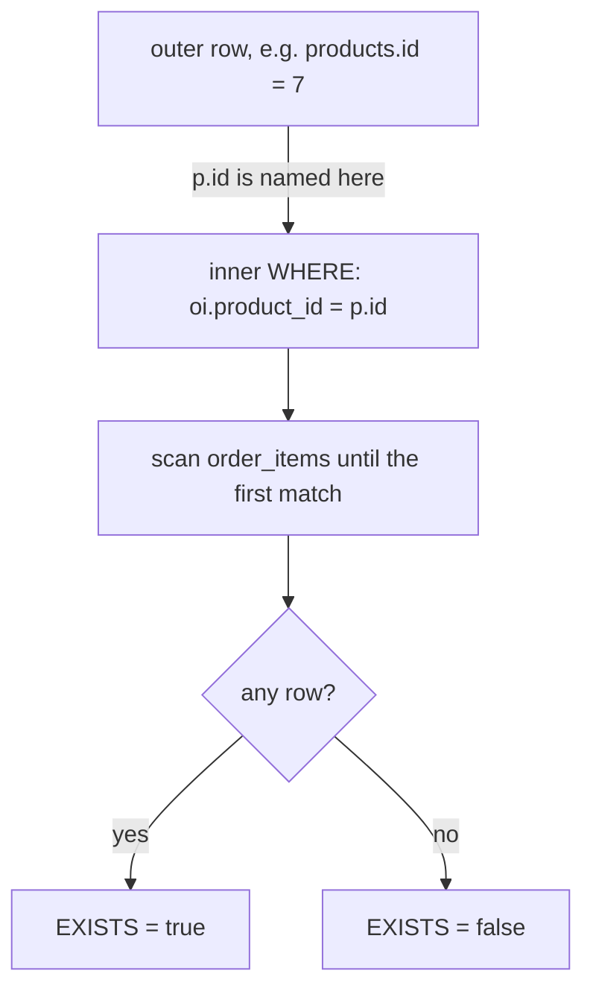

# Correlated subqueries and EXISTS

The line count for the discontinued camp stove is `0`, and the obvious join drops the row from the report. That join returned 160 rows, one per order line, and covered 19 of the 20 products. The team asked for every product, so the missing row is the whole problem.

A correlated subquery keeps the grain without a `LEFT JOIN` and without a `COALESCE`. Last chapter the subqueries stood alone: average a column once, list some ids once, and the answer was the same for every outer row. A correlated subquery names a column from the outer query, so it answers a question about one outer row at a time. That per-row reading is what makes `EXISTS` and `NOT EXISTS` natural, and it is how you keep one row per product while the inner query looks at many.

## A subquery that reads the outer row

Here is the smallest useful correlated query.

```sql
SELECT p.name
FROM products p
WHERE EXISTS (
    SELECT 1
    FROM order_items oi
    WHERE oi.product_id = p.id
);
```

The tell is inside the inner `WHERE`. `oi.product_id` is a column of `order_items`, which the inner `FROM` names. `p.id` is not: `p` is the alias of the outer `products`, and nothing inside the parentheses declares it. The inner query reads a value from the query around it, and that is what correlated means.

Missing that reference costs you the answer, not an error message. The statement still runs, and every row gets a plausible number that is wrong.

One fixed outer row makes the mechanism concrete. Read the inner query as though the outer row were a constant.

| Outer row under test | Inner `WHERE` becomes | Inner rows | `EXISTS` |
| --- | --- | --- | --- |
| id 1, Aurora Wireless Earbuds | `WHERE oi.product_id = 1` | 10 | true |
| id 5, Trail Runner Jacket | `WHERE oi.product_id = 5` | 10 | true |
| id 20, Discontinued Camp Stove | `WHERE oi.product_id = 20` | 0 | false |

The inner query cannot answer without knowing which outer row is under test. So it is not a value that you can compute once and reuse. Compare it with `(SELECT AVG(price) FROM products)`: that query mentions nothing outside itself, so one evaluation serves every row.

That per-row account describes the meaning, not a promise about execution. The planner may deliver the same answer another way, and often does. What matters for you is the reasoning habit: fix one outer row, work out what the inner query sees, then move to the next.

## EXISTS is a test, not a fetch

`EXISTS (subquery)` returns a boolean. It is true as soon as the inner query produces one row, and false only when the inner query produces none.

Because one row settles the answer, the executor can stop at the first match instead of collecting the whole inner result. That early exit is the short circuit, and it is why `EXISTS` stays cheap on a table with thousands of lines per product.

The inner `SELECT` list carries no meaning here. `SELECT *`, `SELECT 1` and `SELECT name` all return the same answer, because nothing uses the value. The convention is `SELECT 1`, which signals to the reader that the column list is a placeholder and the `WHERE` clause is the whole point.

Ask how many products have ever been ordered and you get a number that is not twenty.

```sql
SELECT count(*) AS products_ever_ordered
FROM products p
WHERE EXISTS (
    SELECT 1 FROM order_items oi WHERE oi.product_id = p.id
);
```

| products_ever_ordered |
| --- |
| 19 |

Try this: change `SELECT 1` to `SELECT name` inside the `EXISTS` above and run it again. The count stays at 19, which shows the inner column list carries no meaning.



Chapter 1 asked the customer version of this question with `IN`. The same question written with `EXISTS` returns the same 19 customers. PostgreSQL can plan either form as a semi-join, matching outer rows against inner rows and stopping at the first hit. So the two are rarely different in cost. Pick by meaning: `IN` says "does this value appear in that list", and `EXISTS` says "is there a matching row". When the answer you need is yes or no, `EXISTS` says it in the clause that asks it.

## NOT EXISTS is the anti-join

`NOT EXISTS` keeps the outer rows for which the inner query produces no rows at all.

Where `EXISTS` is a semi-join, keeping a row because a partner exists, `NOT EXISTS` is an anti-join, keeping a row because no partner exists. The shape is identical; only the `NOT` changes.

```sql
SELECT p.name
FROM products p
WHERE NOT EXISTS (
    SELECT 1 FROM order_items oi WHERE oi.product_id = p.id
)
ORDER BY p.id;
```

| name |
| --- |
| Discontinued Camp Stove |

One row from twenty products. It is the product priced at 0.00, marked inactive, with no stock. Nothing in the order data refers to it, and the anti-join finds it by finding nothing.

The pattern generalises to every "which parents have no children" question: customers who never ordered, categories with no products, orders with no lines. The correlation always lives in the inner `WHERE`, and the outer table supplies one row at a time for the inner query to reject.

`NOT EXISTS` also survives `NULL` where `NOT IN` does not. It asks whether a row exists, so it never builds a list of values to compare against. A `NULL` key on the inner side fails to equal `p.id` like any other non-match, and no row is produced for the anti-join to keep.

`NOT IN` works differently: it builds a chain of `<>` tests, and one `NULL` in that chain makes the whole chain unknown. Chapter 3 shows the failure with a query that returns zero rows and no explanation.

## A correlated count in the SELECT list

The `SELECT` list has a job for the same trick. Each row in a result is one row, so anything in the list must produce one value for that row. A correlated scalar subquery does exactly that.

```sql
SELECT p.name,
       (SELECT COUNT(*)
        FROM order_items oi
        WHERE oi.product_id = p.id) AS lines
FROM products p
ORDER BY p.id;
```

`COUNT` makes this safe for two reasons. First, an aggregate returns one row, so the subquery can never break the one-value rule. Second, `COUNT` over an empty set returns `0`, not `NULL`, so a product with no lines still gets a true count. No `LEFT JOIN` fills a gap here, and no `COALESCE` repairs one.

Drop the aggregate and the same query stops working, which shows where the safety came from.

```sql
-- Fails with: more than one row returned by a subquery used as an expression
SELECT p.name,
       (SELECT oi.order_id FROM order_items oi WHERE oi.product_id = p.id) AS any_line
FROM products p;
```

Each product that has been ordered has eight to ten lines, so the inner query returns a whole column of order ids where the `SELECT` list holds room for one value. The error is the same one chapter 1 produced in `WHERE`. The rule did not change; only the clause did.

## Worked example: one row per product, lowest id first

Put the pieces together. The query below is the one from the previous section, written out once more beside its result.

```sql
SELECT p.name,
       (SELECT COUNT(*)
        FROM order_items oi
        WHERE oi.product_id = p.id) AS lines
FROM products p
ORDER BY p.id
LIMIT 5;
```

Read it in four steps.

```text
FROM products p                  -> 20 rows, ids 1 to 20
inner COUNT per outer row        -> one number for that product
SELECT p.name and the count      -> two columns, still 20 rows
ORDER BY p.id, then LIMIT 5      -> the first five products
```

| name | lines |
| --- | --- |
| Aurora Wireless Earbuds | 10 |
| Nimbus Headphones | 9 |
| Linen Duvet Cover | 9 |
| Cedar Desk Lamp | 8 |
| Trail Runner Jacket | 10 |

The first five rows keep one row per product. The grain survived because the inner query collapsed to a single number before it met each outer row, so it had no way to multiply anything.

One product has never appeared in an order line: the discontinued camp stove. Ask for it by itself and the correlated count returns `0`.

```sql
SELECT (SELECT COUNT(*)
        FROM order_items oi
        WHERE oi.product_id = 20) AS camp_stove_lines;
```

| camp_stove_lines |
| --- |
| 0 |

A `LEFT JOIN` version needs care in the same row. `count(*)` returns `1` there, because the join still produces one row with nothing on the right side, and `count(oi.id)` returns `0` only because it skips nulls. A `SUM` of a right-side column such as `quantity` comes back `NULL` and needs `COALESCE`.

There is a check worth running on any list of counts: add them up. The twenty counts in the full list sum to 160, which is the row count of `order_items`. When the total comes out low, a row or a join condition is missing.

The exercise asks for the full list, not the first five. You now have the correlation clause, the aggregate, and the reason the `0` appears.

## The correlation you forget

Here is the mistake that produces a table of identical numbers.

```sql
SELECT p.name,
       (SELECT COUNT(*) FROM order_items) AS lines
FROM products p
ORDER BY p.id
LIMIT 3;
```

| name | lines |
| --- | --- |
| Aurora Wireless Earbuds | 160 |
| Nimbus Headphones | 160 |
| Linen Duvet Cover | 160 |

No error, and nothing is obviously wrong on one row. But 160 is the size of the whole `order_items` table, and every product claims it.

The cause is a missing correlation. The inner query names no column from `products`, so it is uncorrelated: it runs once, returns one number, and that number is handed to all twenty outer rows. Adding `WHERE oi.product_id = p.id` turns the constant into a per-row fact.

Two habits catch this. The first is the sum check from the previous section: twenty rows at 160 each add to 3200, not 160. The second is to ask, for every correlated subquery you write, which outer column the inner query reads. If you cannot name one, the subquery is either uncorrelated by design or missing its link.

## Choosing between a correlated query and a join

Most correlated queries have a join equivalent, and the usual decision is grain. If the inner side can return many rows and you want to keep the outer grain, the scalar subquery says that directly. A plain join fans each outer row out to one per match, and you then need `GROUP BY` or `DISTINCT` to get the shape back.

`EXISTS` and `NOT EXISTS` are the clearest case, because they ask for no columns from the inner side at all. The join equivalent means joining, then de-duplicating with `DISTINCT`: more machinery for a smaller idea.

The exception runs the other way. If the inner query genuinely does not depend on the outer row, leave it uncorrelated. `(SELECT AVG(price) FROM products)` needs one evaluation, and wrapping it in a per-row form would ask the server to repeat work that cannot change.

Cost is the last question, and it is a measurement rather than a rule. A correlated subquery runs its inner query once per outer row in the worst case, so an index on the correlation column, here `order_items.product_id`, is what keeps that cheap. PostgreSQL often rewrites `EXISTS` and `NOT EXISTS` into semi-joins and anti-joins anyway. Write the version that states your question, then read `EXPLAIN` before you rewrite a clear query for speed.

## What to remember

What I would do: write the correlation clause first, then the rest of the subquery around it. Ask which outer column the inner `WHERE` reads on every correlated query, and treat an identical value down a column as a missing link. Use `NOT EXISTS` rather than `NOT IN` whenever the inner key can be `NULL`.

- A correlated subquery names a column from the outer query, so it answers per outer row. Fix one row at a time to reason about it.
- `EXISTS` is a boolean test that stops at the first matching row. The inner `SELECT` list is irrelevant, so write `SELECT 1`.
- `NOT EXISTS` is an anti-join: it keeps outer rows with no match, and a `NULL` inner key cannot become a match.
- A correlated `COUNT` in the `SELECT` list returns `0` for an empty set, so the outer grain survives without `LEFT JOIN` or `COALESCE`.
- A subquery that names no outer column is uncorrelated. The tell is an identical value on every row.
- Choose grain first: a subquery keeps the outer grain, a join combines columns and multiplies rows.

## Check yourself

**1. How do you tell a correlated subquery from an uncorrelated one by reading it?**

<details>
<summary>Answer</summary>

Look for a column the inner `FROM` cannot supply. Here `p.id` appears beside a `FROM order_items`, so it must come from the enclosing query. The inner query then depends on which outer row is tested.

</details>

**2. Why is `SELECT 1` the usual inner list for `EXISTS`, and what changes if you write `SELECT name`?**

<details>
<summary>Answer</summary>

Nothing changes. `EXISTS` tests whether any row exists, so the selected values are never used. `SELECT 1` is a signal to the reader that the column list is a placeholder and the `WHERE` clause carries the meaning.

</details>

**3. The join version of the line-count question covers 19 of the 20 products. Where does the twentieth go, and how does the subquery version keep it?**

<details>
<summary>Answer</summary>

The inner join drops it, because the discontinued camp stove has no matching `order_items` row. The correlated `COUNT` returns `0` for that empty set, so the outer row survives with a truthful count.

</details>

**4. A query returns `160` on every product row. What did the author most likely forget, and what check exposes it?**

<details>
<summary>Answer</summary>

The correlation clause. The inner query names nothing from `products`, so it counts all of `order_items` once and reuses the total. Adding the twenty counts gives 3200 instead of 160, so the sum check exposes it.

</details>

**5. When is leaving a subquery uncorrelated the better choice?**

<details>
<summary>Answer</summary>

When the answer does not depend on the outer row, as with `(SELECT AVG(price) FROM products)`. The server can compute it once and reuse the value, instead of repeating identical work for every row it tests.

</details>
