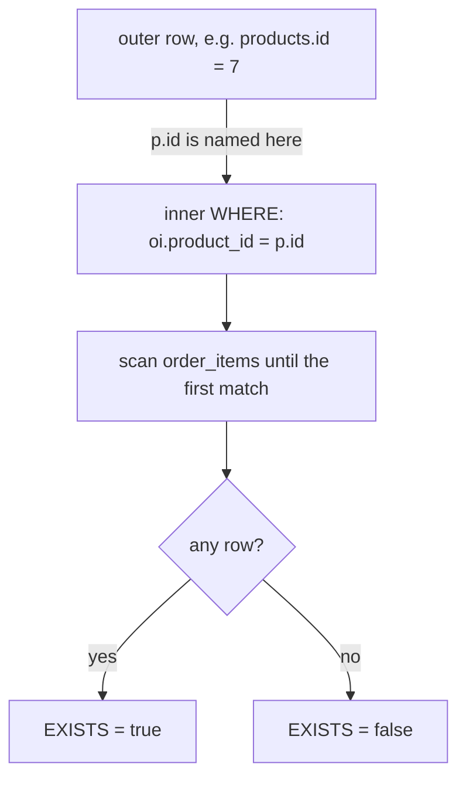

# Correlated subqueries and EXISTS

An uncorrelated subquery can be computed once and reused; a correlated one names a column from the outer query, so it is easiest to read as running once per outer row. That per-row reading is what makes `EXISTS` and `NOT EXISTS` natural: they ask whether a match exists rather than fetching the match. This module builds a per-product line count and a customer anti-join.

## A subquery that reads the outer row

In the previous module every subquery stood on its own. `(SELECT AVG(price) FROM products)` mentions nothing outside itself, so the database can evaluate it once and reuse the value for every row being tested. A correlated subquery is different: it names a column that belongs to the query around it.

The tell is the comparison inside the inner `WHERE`. In `oi.product_id = p.id`, `p.id` is not a column of `order_items` at all; it comes from the outer `FROM products p`. The inner query cannot be answered without knowing which outer row is under test, so it is not a value you can compute once — conceptually it runs per outer row.

That is a description of meaning, not a promise about execution: the planner may deliver the same answer another way. What matters is reasoning about the subquery with one outer row fixed at a time.

## EXISTS is a test, not a fetch

`EXISTS (subquery)` returns a boolean. It is true as soon as the inner query produces a single row, and false only when it produces none. Because one row is enough, the executor can stop at the first match instead of materialising the whole inner result — `EXISTS` short-circuits.

The inner `SELECT` list is irrelevant. `SELECT *`, `SELECT 1` and `SELECT name` all mean the same thing here, which is why the convention is `SELECT 1`: it signals that no value is being used. What carries the meaning is the `WHERE` clause that ties the inner table back to the outer one.

```sql
SELECT o.col
FROM outer_table o
WHERE EXISTS (
    SELECT 1 FROM inner_table i
    WHERE i.key = o.key
);
```

PostgreSQL may rewrite `EXISTS` into a semi-join, matching outer rows against inner rows and stopping at the first hit. That is one way the answer is delivered, not a change in meaning; an index on the inner key makes it cheap.



## NOT EXISTS is the anti-join

`NOT EXISTS` keeps the outer rows for which the inner query produces *no* rows. Where `EXISTS` is a semi-join — keep a row because a partner exists — `NOT EXISTS` is an anti-join: keep a row because no partner exists.

The classic use is "which parents have no children": customers who have never placed an order, categories with no products, orders with no lines. The shape is always the same, and the correlation always lives in the inner `WHERE`.

`NOT EXISTS` is also the NULL-safe spelling of the anti-join: a comparison against NULL is never true, so a NULL on the inner side cannot become a spurious match. Treat it as the form to reach for by default.

## A correlated scalar subquery in the SELECT list

The same per-row idea works in the `SELECT` list, where the subquery must produce exactly one value — a scalar — for each outer row. `(SELECT COUNT(*) FROM order_items oi WHERE oi.product_id = p.id)` is one such scalar; if it ever returned two rows, PostgreSQL would stop with `more than one row returned by a subquery used as an expression`.

The aggregate makes it safe. `COUNT` over a set of rows always returns a number, and over an empty set it returns `0`. A product with no order lines therefore gets `0` rather than `NULL`, so no `LEFT JOIN` and no `COALESCE` are needed to fill the gap.

The outer query still reads one row per product. That is the point of putting the count here rather than joining: the inner result collapses to a single value before it ever meets the outer row, so it cannot multiply it.

## Choosing between a correlated query and a join

Most correlated queries have a join equivalent, and the deciding factor is grain. If the inner side can return many rows and you want to keep the outer grain — one product, one customer, one order — the scalar subquery says that directly; a plain join would fan each outer row out to one per matching inner row.

`EXISTS` and `NOT EXISTS` are the clearest case, because they want no columns from the inner side at all. Asking the same question with a join means joining, then de-duplicating the multiplication with `DISTINCT` — more machinery to express a smaller idea.

The exception is the other direction: when the inner query is genuinely independent of the outer row, leave it uncorrelated so the planner can compute it once rather than once per row.

## Worked example: one row per product, lowest id first

```sql
SELECT p.name,
       (SELECT COUNT(*)
        FROM order_items oi
        WHERE oi.product_id = p.id) AS lines
FROM products p
ORDER BY p.id;
```

The correlated count runs once per product row, and the outer `ORDER BY p.id` asks for the lowest product id first.

| name | lines |
| --- | --- |
| Aurora Wireless Earbuds | 10 |
| Nimbus Headphones | 9 |
| Linen Duvet Cover | 9 |
| Cedar Desk Lamp | 8 |
| Trail Runner Jacket | 10 |
| Pulse Fitness Tracker | 8 |
| Vertex Mechanical Keyboard | 8 |
| Harbor Rain Shell | 8 |
| Maple Cutting Board | 8 |
| Copper Kettle | 8 |
| Wool Throw Blanket | 8 |
| Granite Cookware Set | 9 |
| Summit Hiking Poles | 8 |
| Ceramic Vase | 8 |
| Espresso Tamper | 8 |
| Solar Camp Lantern | 8 |
| Bamboo Shelf | 8 |
| Noise-Cancel Earmuffs | 8 |
| Rope Dog Leash | 9 |
| Discontinued Camp Stove | 0 |

There are twenty rows, one per product: the grain survived because the inner query collapsed to a count before meeting the outer row. The last line is the one to notice — the discontinued camp stove has never appeared in an order line, so its count is `0`, not `NULL`.

## Check yourself

**1. What makes a subquery correlated?**

<details>
<summary>Answer</summary>

It references a column from the enclosing query, such as `p.id` inside the inner `WHERE`. That means it cannot be evaluated once and reused; conceptually it is evaluated per outer row.

</details>

**2. Why is the list after `EXISTS` usually written as `SELECT 1`?**

<details>
<summary>Answer</summary>

Because `EXISTS` only tests whether any row is produced, so the selected values are never used. `SELECT 1` signals that the inner column list is not the point; the `WHERE` clause tying inner to outer is.

</details>

**3. In the worked example, why is no `LEFT JOIN` needed to show `0`?**

<details>
<summary>Answer</summary>

The inner query is a `COUNT`, and `COUNT` over an empty set returns `0` rather than `NULL`. The outer row is always returned, so products with no lines still get a truthful count.

</details>
