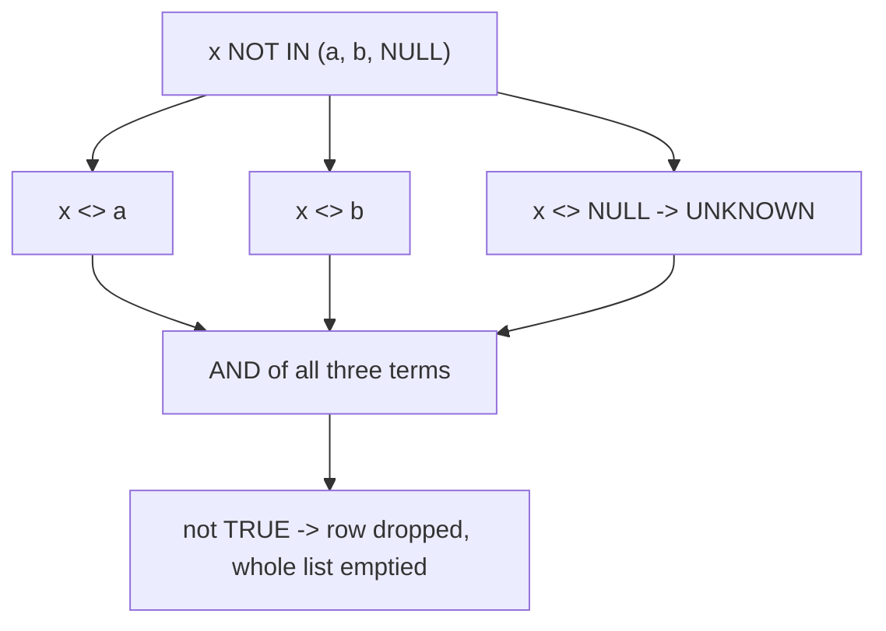

# IN, EXISTS and the NULL trap

`IN` and `EXISTS` answer the same question for most queries, so choosing between them can look like a matter of taste. It stops being taste the moment a `NULL` enters the comparison: `NOT IN` can return no rows at all and say nothing about it. This module explains the three-valued logic behind that silence and the NULL-safe forms to use instead.

## Same question, two spellings

On a well-behaved column the two spellings agree. `WHERE c.id IN (SELECT o.customer_id FROM orders o)` and `WHERE EXISTS (SELECT 1 FROM orders o WHERE o.customer_id = c.id)` return the same customers here, and PostgreSQL can often compile both into the same semi-join against `orders`.

The equivalence is real but conditional. `IN` is shorthand for a disjunction of equalities against the values the subquery returns; `EXISTS` tests for the presence of at least one matching row. The two coincide while every value involved is either a genuine value or a genuine non-match — and they diverge exactly when `NULL` appears.

## SQL truth has three values

A `WHERE` clause keeps a row only when its condition is true. SQL has three truth values — true, false and unknown — and any comparison with `NULL` using `=`, `<>` or `<` produces unknown, because "equal to a value I do not have" cannot be answered either way.

The trap lives in how `NOT IN` expands. `x NOT IN (a, b, NULL)` is defined as `x <> a AND x <> b AND x <> NULL`. The first two comparisons can be true, but the third is unknown. A conjunction is true only when every term is true, so one unknown term makes the whole expression not true, and the row is dropped.

The damage is total rather than partial. If even one `NULL` sits anywhere in the list, no outer row can satisfy the whole conjunction, so `NOT IN` returns the empty set. The same reasoning applies on the left: `NULL NOT IN (1, 2)` is unknown and the row is dropped too, so a nullable left-hand column is its own hazard.

## Why the failure is silent

Nothing errors. The query parses, plans and runs; it simply returns zero rows, which is also a plausible answer to the question. A report that goes blank after a data reload looks like a data problem, not a query problem.

It is hard to reproduce because it depends on the data, not the syntax. The same `NOT IN` works while the key column happens to be `NOT NULL`, and starts returning nothing the day a nullable column, an outer join or a fresh import introduces a single `NULL`. That is why the rule that follows is about the schema, not the sample.

## The NULL-safe forms

```sql
-- Not safe: one NULL in the list kills every row
SELECT name FROM customers
WHERE id NOT IN (SELECT customer_id FROM orders);

-- Safe: EXISTS never compares against a list that can hold NULL
SELECT name FROM customers c
WHERE NOT EXISTS (
    SELECT 1 FROM orders o WHERE o.customer_id = c.id
);
```

`NOT EXISTS` is the anti-join from the last module: it keeps an outer row when no inner row matches. A `LEFT JOIN ... WHERE right.key IS NULL` reaches the same conclusion, provided you join on a column that is itself `NOT NULL` so the test is unambiguous.

A third option changes the list rather than the operator: add `WHERE col IS NOT NULL` inside the subquery so no `NULL` can reach the comparison. That is correct only when ignoring NULL keys is the semantics you want, so it is not a general-purpose fix.

For scalar inequality there is a NULL-safe operator. `city IS DISTINCT FROM 'Leeds'` treats a missing city as a real, distinct value, whereas `city <> 'Leeds'` leaves those rows unknown: in this dataset 23 customers match the `<>` form and 27 match `IS DISTINCT FROM`, the difference being the four customers whose `city` is `NULL`.



## Worked example: customers with no orders

```sql
SELECT c.name
FROM customers c
WHERE NOT EXISTS (
    SELECT 1 FROM orders o WHERE o.customer_id = c.id
)
ORDER BY c.name;
```

Read as "customers with no matching order", the anti-join is easy to follow, and it is immune to `NULL`s on either side.

| name |
| --- |
| Aya Rahman |
| Bo Ivanov |
| Cleo Haidar |
| Dara Novak |
| Dev Larsen |
| Yara Park |
| Zane Lindqvist |

Because `orders.customer_id` is declared `NOT NULL`, the unsafe `NOT IN` returns the same seven rows here, so the trap is invisible — exactly the false confidence this module warns about. The query is correct only while the schema guarantee holds: put a literal `NULL` in the list and `WHERE id NOT IN (1, 2, NULL)` drops the count from 28 to 0 on the same table.

## Check yourself

**1. Why can `x NOT IN (a, b, NULL)` return no rows?**

<details>
<summary>Answer</summary>

It expands to `x <> a AND x <> b AND x <> NULL`, and the last comparison is unknown. An `AND` is true only if every term is true, so the unknown term makes the row not-true and it is filtered out; one `NULL` anywhere in the list empties the result.

</details>

**2. Besides `NOT EXISTS`, which forms are NULL-safe for this anti-join?**

<details>
<summary>Answer</summary>

A `LEFT JOIN` followed by `WHERE right.key IS NULL`, joining on a column that cannot itself be NULL, or forcing the list to be NULL-free with `WHERE col IS NOT NULL` inside the subquery when ignoring NULL keys is the semantics you want.

</details>

**3. Why is a `NOT IN` failure so hard to debug in production?**

<details>
<summary>Answer</summary>

It raises no error and returns zero rows, which is also a plausible answer, and it depends on the data rather than the syntax. The same query keeps working until a single `NULL` reaches the column, so it can appear overnight after an import or a schema change.

</details>
