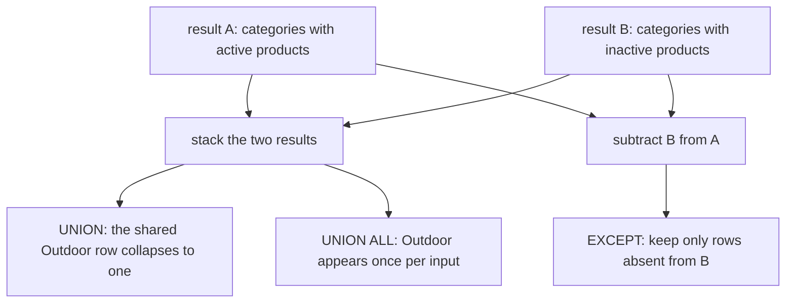

# Set operations: UNION, INTERSECT, EXCEPT

A join combines columns from two tables side by side; a set operation stacks whole result sets on top of one another. When the question is "which of these rows appear in both lists?" or "which are in one list but not the other?", a set operation says it directly and a join does not. This module covers `UNION`, `UNION ALL`, `INTERSECT` and `EXCEPT`, the rules they share, and the duplicate handling that distinguishes them.

## Side by side versus on top of one another

A join is about matching rows. It takes a row from each side, pairs them by a condition, and emits both rows' columns together, so the result is wider than either input. A set operation is about stacking rows. It takes two result sets that already have the same shape and returns one result set holding rows from one of them, the other, or both — no wider, but possibly shorter or longer.

That difference decides which tool fits. If you want each order decorated with its customer's name, you need columns from two tables and a join. If you want the categories that appear in one product list but not another, both inputs are the same single column and nothing is being paired.

## The rules all four operators share

The inputs must line up: the same number of columns, in the same order, with compatible types. Values are matched by position, not by name, so the first column of the first `SELECT` is compared with the first column of the second, and PostgreSQL resolves each position to a common type.

Column names come from the first `SELECT`, which is why aliasing the second one is pointless. A trailing `ORDER BY` applies to the whole compound result, not to either input, and may only name the output columns of that first `SELECT` — or their positions.

Precedence is the other shared rule. In PostgreSQL, `INTERSECT` binds more tightly than `UNION` and `EXCEPT`, and `UNION` and `EXCEPT` associate left to right. When a statement mixes them, add parentheses rather than rely on that order.

## UNION removes duplicates, UNION ALL does not

`UNION` returns the rows of the first input together with the rows of the second, with duplicate rows removed from the combined result. `UNION ALL` returns every row from both inputs, duplicates included, so it can never return fewer rows than the two inputs together contain.

Removing duplicates is not free: PostgreSQL has to sort or hash the combined rows to find them, while `UNION ALL` skips that work because it never asks the question. That is why `UNION ALL` is the right default when the inputs cannot overlap, such as rows filtered by mutually exclusive conditions — it says what you mean and costs less.

One NULL detail is worth knowing: set operations treat `NULL`s as equal for comparison, so two rows that match in every column, including columns that are `NULL` on both sides, count as duplicates under `UNION`. That is a deliberate exception to three-valued logic.

## INTERSECT and EXCEPT, and the ALL variants

`INTERSECT` keeps the rows that appear in both inputs; `EXCEPT` keeps the rows from the first input that are absent from the second. Both de-duplicate their result in the same way `UNION` does.

The `ALL` forms switch to bag semantics, where multiplicity matters. `INTERSECT ALL` emits a row `min(m, n)` times, where `m` and `n` are its counts in the two inputs; `EXCEPT ALL` emits it `max(m - n, 0)` times. The plain forms answer "does this row appear on both sides?"; the `ALL` forms answer "how many more copies sit on the left?".

Consider the categories filtered by `active`: the plain `EXCEPT` below returns three rows, but `EXCEPT ALL` returns eighteen, because Outdoor occurs five times among active products and once among inactive ones, leaving four copies. Same inputs, different question about counts.

## When a set operation says the question and a join does not

Some questions are naturally about membership in a list. "Which categories contain only active products?" is a difference between the set of categories with active products and the set with inactive ones — a subtraction, not a pairing. `EXCEPT` states that in one line; a join equivalent needs grouping, `HAVING` and a `NOT`, and reads like a double negative.

Because set operations compare whole rows, both sides must project the same shape. That constraint is also a discipline: it forces you to say exactly which columns identify a row before comparing lists, and it makes the operator's meaning unambiguous. A join, by contrast, never compares whole rows; it compares only the columns named in its `ON` clause.



## Worked examples

A pocket reference for the four operators:

```sql
SELECT col FROM a UNION     SELECT col FROM b;  -- distinct rows
SELECT col FROM a UNION ALL SELECT col FROM b;  -- every row
SELECT col FROM a INTERSECT SELECT col FROM b;  -- rows in both
SELECT col FROM a EXCEPT    SELECT col FROM b;  -- rows only in a
```

The categories that only ever hold active products:

```sql
SELECT category FROM products WHERE active
EXCEPT
SELECT category FROM products WHERE NOT active
ORDER BY category;
```

| category |
| --- |
| Electronics |
| Home |
| Kitchen |

Outdoor is absent because the discontinued camp stove sits in it: that category appears on both sides of the subtraction, so `EXCEPT` removes it and leaves the three that never hold an inactive product.

The other direction is the exercise's question: the Home products that have never appeared in an order.

```sql
SELECT name FROM products WHERE category = 'Home'
EXCEPT
SELECT p.name
FROM products p
JOIN order_items oi ON oi.product_id = p.id
ORDER BY name;
```

On this dataset the answer is empty, which is a correct answer. All five Home products have sold at least once — Linen Duvet Cover 9 lines, Cedar Desk Lamp 8, and Wool Throw Blanket, Ceramic Vase and Bamboo Shelf 8 each — so nothing is left after the subtraction. Drop the category filter and `EXCEPT` does return a row: the camp stove is the only product never ordered.

| name |
| --- |
| Discontinued Camp Stove |

## Check yourself

**1. What does `UNION` do that `UNION ALL` does not?**

<details>
<summary>Answer</summary>

`UNION` removes duplicate rows from the combined result, which requires PostgreSQL to sort or hash the rows to find them. `UNION ALL` concatenates every row from both inputs and keeps duplicates, so it is cheaper and the better default when the inputs cannot overlap.

</details>

**2. Which `SELECT` supplies the output names, and what may `ORDER BY` reference?**

<details>
<summary>Answer</summary>

The first `SELECT`. A trailing `ORDER BY` applies to the whole compound statement and may only name those output columns, or refer to them by position; it cannot reach any other column of either input.

</details>

**3. When do `EXCEPT ALL` and `EXCEPT` differ?**

<details>
<summary>Answer</summary>

When a row appears more times in the first input than in the second. `EXCEPT` de-duplicates and keeps the row once; `EXCEPT ALL` uses bag semantics and emits it `max(m - n, 0)` times, so multiplicity rather than mere presence decides the result.

</details>
