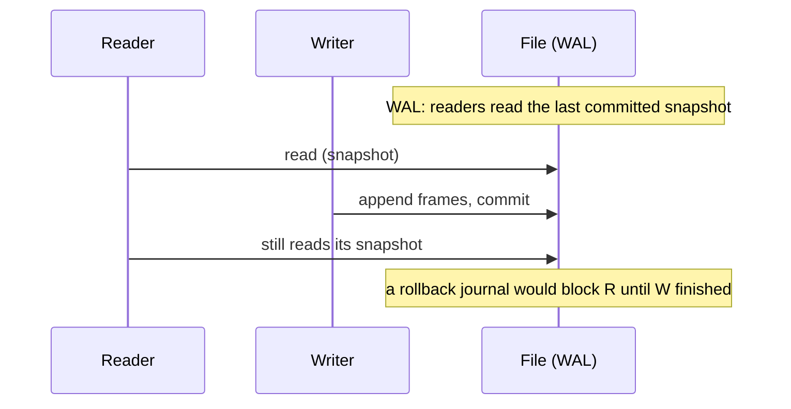

# One writer at a time: concurrency and WAL

## Two writers, one file

SQLite has no MVCC. It does not keep multiple versions of a page so that two transactions can write the same table at once. It has locks, and the locks are on the file: a rollback journal makes readers and writers take turns, and under WAL a reader and the single writer proceed together against a consistent snapshot. Either way, **one writer at a time**.

That is not a limitation to apologise for, because it is what makes the rest of the design possible. The engine is a library inside your process, so a lock is a lock on a file both processes can see — no lock manager process, no coordinator, no distributed state. The cost is that write concurrency is a serial resource, and the production question is not "how do I get more writers?" but "how long does each writer hold the lock, and what happens to the one waiting behind it?"



## `PRAGMA journal_mode` decides the shape

The journal mode is persistent: it is a property of the file, written in its header, not a per-connection wish. `delete` — the default — means a writer writes a rollback journal, and readers block while a commit is in flight. `wal` means commits append to a `-wal` sidecar file and readers keep the snapshot they started with, so reads never block on the writer and the writer never blocks on readers. For a read-heavy application with occasional writes, WAL is usually the single highest-value pragma there is.

```sql
PRAGMA journal_mode;
```

| journal_mode |
| --- |
| delete |

This lesson's fixture is a read-only copy, so it reports `delete`: changing the journal mode writes to the file header, and a read-only file cannot be changed. That is also the first production fact to internalise — `PRAGMA journal_mode = WAL` fails (or silently stays put) when the file or the directory is not writable, because WAL needs to create the `-wal` file next to the database. `memory` and `temp` exist, and both mean "no journal on disk at all", with the corresponding loss of durability.

## `SQLITE_BUSY` is the second writer's problem

When a writer cannot get the lock, SQLite does not queue it. By default it returns immediately with `SQLITE_BUSY`, and it is the application's job to retry. `PRAGMA busy_timeout` converts that instant failure into a wait: the connection sleeps and retries for up to the given number of milliseconds before giving up.

```sql
PRAGMA busy_timeout;
```

| timeout |
| --- |
| 2000 |

The column is called `timeout`, and the value is milliseconds — two seconds here, set by the gateway when it opens the connection. In PostgreSQL none of this exists: a second writer simply proceeds, because MVCC lets it. In SQLite a busy timeout is not optional for anything that writes from more than one connection, and the second correctness rule is that a retry must re-run the whole transaction, not resume it — a statement that was interrupted mid-transaction cannot be half-applied.

## What to do about it

Keep write transactions short: do the read and the compute *before* `BEGIN IMMEDIATE`, and hold the write lock only for the write. Turn on WAL. Set a busy timeout measured in seconds, not in retries. And know that `SQLITE_LOCKED` is a different error with a different cause — it is a conflict *within* one connection (typically two statements fighting over the same table through a shared cache), not between processes, and a busy timeout will not fix it.

## Check yourself

**1. What does WAL change about concurrency, precisely?**

<details>
<summary>Answer</summary>

It lets readers read a consistent snapshot while the single writer commits, so they do not block each other. It does not allow two writers: writes still serialise.

</details>

**2. What happens to a write that cannot get the lock with the default `busy_timeout`?**

<details>
<summary>Answer</summary>

It fails immediately with `SQLITE_BUSY`. The default timeout is 0, so there is no waiting; a timeout is what turns the immediate failure into a bounded retry.

</details>

**3. Why does `PRAGMA journal_mode = WAL` fail on the lesson fixture?**

<details>
<summary>Answer</summary>

The fixture is opened read-only, and switching journal mode writes to the file header and creates a `-wal` sidecar. A read-only file cannot be changed, so the mode stays `delete`.

</details>
