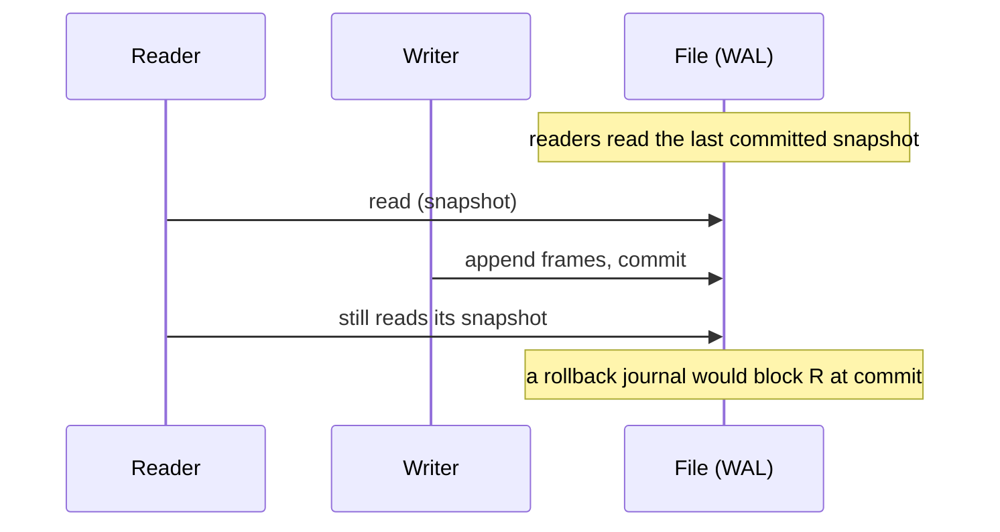

# One writer at a time: concurrency and WAL

The second copy of your script stopped with `database is locked`, and its order was never written. Its SQL was correct: one insert, one transaction, a file on local disk. The first copy still held the write lock. SQLite lets one writer change the file at a time, and the lock that enforces that rule lives on the database file.

That rule shapes every write path in this course. The engine is a library inside your program (chapter 1), so the lock is one the operating system enforces on a file both processes can see. There is no lock manager to tune and no coordinator to add. What you can change is how long a writer holds the lock, and what the second writer does while it waits.

## Two writers, one file

A write transaction is a group of statements that commit as one unit or roll back as one unit.

Two of them cannot overlap in SQLite. The second writer waits for the first, and a writer that cannot wait fails with `database is locked`, so its insert never lands.

The reason for the limit is the storage design. PostgreSQL keeps several versions of a row, so a reader and a writer can work on the same page without meeting. SQLite keeps one copy of each page. If two transactions changed one page at once, neither could commit an image that agrees with the other, so the engine serialises writers through a lock.

That lock is an operating system file lock on the database file. A second process sees it because it locks the same file. This is why a SQLite file belongs on a local disk: the lock has to work for every process that opens it.

WAL does not add a second stream. It removes a different conflict, the one between a reader and the writer.

## A rollback journal makes them take turns

The default journal mode is a rollback journal, and it works in four steps. Read them in order, because each one explains the next constraint.

1. The writer's first change takes a RESERVED lock on the file. Other readers may keep reading while it holds that lock.
2. The engine copies the original content of every page it is about to change into a sidecar file, `orders.db-journal`.
3. At commit the writer takes an EXCLUSIVE lock. That lock waits for the readers already running and keeps new ones out, so the file is quiet while the changed pages are written.
4. The journal is deleted. The mode is named `delete` after this step.

The journal is the undo log. If the process dies before step 4, the next connection finds a hot journal, rolls the file back with it, and the half-written change never becomes visible. That is atomicity in a single file, and it is why the write cost is roughly double: each changed page is written to the journal first, then to the database.

The visible cost is step 3. Readers block while a commit writes, and a writer that arrives while another writer holds RESERVED gets no queue and no place to wait.

On a small transaction that window is short enough to ignore. On a transaction that holds a table for a second, every reader and every other writer feels it.

## WAL keeps the reader's snapshot

A write-ahead log moves the writes to a separate file. The writer appends new page images to `orders.db-wal` as frames, finishes with a commit frame, and leaves the database file itself alone. Those changes reach the database file later, during a checkpoint.

That ordering is what changes the concurrency. A reader notes how far into the log it may look. That position is its snapshot: the data as of the last commit when the read began. New commits land after that position, so they cannot disturb the read. The reader never waits for the writer, and the writer never waits for it.



Read the diagram for what it does not say. There is still one writer. Two writers both want the same append point in the log, so the second one gets the same busy answer it would get with a rollback journal. WAL removes the reader-writer conflict, not the writer-writer one.

Two sidecars come with the mode: `-wal` holds the frames, and `-shm` holds the shared index readers use to find them. A copy of the database file alone can miss data that is committed and still only in `-wal`. Chapter 7 covers the copy that handles this.

## Read the mode, and read the reply

`journal_mode` is stored in the file header, so it survives the connection that set it. Ask this workspace:

```sql
PRAGMA journal_mode;
```

| journal_mode |
| --- |
| memory |

The answer is `memory` because this workspace's database is `:memory:`, opened that way by the app. There is no file, so there is no header to hold a mode, no journal to write, and no `-wal` beside it. The engine reports the storage you asked for, and `memory` is the honest name for it.

A file-backed database answers differently. A fresh file reports `delete`, the default. After a successful switch it reports `wal`. A read-only copy of a file reports whatever that file's header holds, and the read cannot change it.

That is the first half of the production habit: read the mode instead of assuming one. Here is the second half, and the mistake it prevents. You want WAL for the read-heavy app, so you run the switch:

```sql
PRAGMA journal_mode = WAL;
```

| journal_mode |
| --- |
| memory |

The statement ran without an error and the reply is `memory`, not `wal`. Nothing switched, because this database has no file to put a log beside.

Had you skipped the reply, you would have written "WAL is on" in the notes and moved on.

The reply is the state after the attempt, not an echo of your request. On a file-backed database in a directory you can write, the same statement returns `wal` and creates the sidecar. On a read-only file, or a directory where the new file cannot be created, it returns the mode the file already had. Read the returned row and compare it with what you wanted.

The gateway that serves the shared dataset makes a related choice. It keeps its fixture in the default rollback-journal mode, because a WAL file cannot be opened read-only on every platform and the shared dataset is opened read-only. The comment beside the DSN in `backend/internal/envdb/sqlite.go` records the reason. A mode is a deployment decision.

## The second writer meets `SQLITE_BUSY`

When a writer cannot take the lock, SQLite does not put it in a queue. It returns result code 5, `SQLITE_BUSY`, and the learner-visible sentence is `database is locked`. The app classifies that sentence as a timeout rather than an environment fault, which is the right reading: something else held the lock, and your statement ran out of patience.

Patience is a per-connection setting called the busy timeout. With no timeout, the connection fails at once.

```sql
PRAGMA busy_timeout;
```

| timeout |
| --- |
| 0 |

Zero milliseconds in this workspace, because the app never sets one here. The gateway sets 2000 on every connection it opens, in `backend/internal/engine/sqlite.go`, so a lock is waited out for two seconds before the learner sees an error.

The difference matters when you read your own results. A timeout of `0` does not mean SQLite has no busy timeout. It means this connection has none.

Try this: run `PRAGMA busy_timeout = 2000;`, then `PRAGMA busy_timeout;`. The connection answers `2000`, because the timeout belongs to the connection that set it. Run `PRAGMA journal_mode;` and it still answers `memory`, because a mode that lives in the file header has no file here to change.

The engine implements the timeout as a sleep-and-retry loop. It waits, tries the lock again, and repeats until the milliseconds run out, then reports `SQLITE_BUSY`. That loop hides a short commit from your code and cannot hide a long one. If a writer holds the lock for ten seconds, a two-second timeout still fails.

One error looks like this one and is not. `SQLITE_LOCKED` reports `database table is locked`, and it names a conflict inside a single connection, typically two statements sharing one table through a shared cache. A busy timeout does not fix it, because there is no other process to wait for.

## Both settings in one row

The exercise asks for the two concurrency settings in one row, using the table-valued spelling of each pragma. The shape is a scalar subquery per setting, because each table-valued pragma returns a one-row table:

```sql
SELECT journal_mode FROM pragma_journal_mode();
```

| journal_mode |
| --- |
| memory |

`pragma_journal_mode()` is a table with one row and one column, `journal_mode`. `pragma_busy_timeout()` is the same shape, and its column is called `timeout`. A scalar subquery takes the single value out of a one-row table. The exercise can then put the two subqueries side by side in one `SELECT` list and alias the second one.

The column names come from the pragmas, not from you. The busy timeout names its column `timeout`, which is why an alias is needed when it sits beside `journal_mode`. Chapter 2 explains why these tables exist and why the spelling looks the way it does.

The values are the workspace's, so the row reads `memory` and `0`. Run the same query against the gateway and it reads `delete` and `2000`, because that connection opens a file and sets a timeout. Same query, same columns, different deployment.

## Keep the write transaction short

Three habits follow from the mechanism, and each one buys a measurable amount of concurrency.

Do the reading and the deciding before the transaction starts. Fetch the rows, compute the new values, then open the write transaction, write, and commit. A transaction that reads and then writes holds the lock across the whole span.

Open the write with `BEGIN IMMEDIATE` when you know you will write. A deferred transaction starts as a reader and asks for the write lock at its first write. That moment falls in the middle of your work, after you have computed everything. A `SQLITE_BUSY` there loses all of it. `BEGIN IMMEDIATE` moves the wait to the first line, where a retry costs nothing.

Retry the whole transaction, never the single statement. A statement that failed inside a transaction leaves the transaction in a state your code has not planned for, so the correct retry re-runs the group from `BEGIN`. Cap the retries and report the failure when the cap is reached.

## What to remember

**What I would do:** read the reply to every pragma you set, and compare it with the value you asked for. Set a busy timeout on the connection and cap the retries, so a lock you cannot win ends in a reported error rather than a hang. Treat the journal mode as a deployment choice, since `memory` here and `delete` through the gateway are both correct for their storage.

- SQLite serialises writers because it keeps one copy of each page. The lock is a file lock, so a second writer waits or fails.
- A rollback journal makes readers wait during a commit. WAL removes that wait by letting a reader keep its snapshot.
- WAL does not add a second writer. Two writers still take turns at the append point.
- `journal_mode` belongs to the file and persists. This workspace reports `memory` because its database is in memory, and a file reports `delete` or `wal`.
- The reply to `PRAGMA journal_mode = WAL` is the mode you actually have. Compare it with the one you asked for.
- `SQLITE_BUSY` means the lock belonged to someone else. `busy_timeout` is per connection, and it is `0` here and `2000` in the gateway.
- Keep write transactions short, open them with `BEGIN IMMEDIATE`, and retry the whole group.

## Check yourself

**1. Two writers, one WAL file. What does the second writer experience, and why?**

<details>
<summary>Answer</summary>

The same wait or `SQLITE_BUSY` it would meet under a rollback journal. WAL separates readers from the writer. Both writers still append to one log, so their commits serialise.

</details>

**2. Why does `PRAGMA journal_mode` return `memory` in this workspace and `delete` on a file-backed database?**

<details>
<summary>Answer</summary>

The mode is a property of the database storage. This workspace runs on `:memory:`, which has no file header and no journal file, so the engine names that storage. A file-backed database keeps the mode in its header, and a fresh file carries the default `delete`.

</details>

**3. You set `PRAGMA busy_timeout = 2000` and a write still fails with `database is locked` after two seconds. What happened?**

<details>
<summary>Answer</summary>

Another connection held the write lock for longer than the timeout. The timeout bounds the wait, not the other writer's transaction. Shorten the transaction that holds the lock, or lengthen the wait.

</details>

**4. A colleague retries only the statement that returned `SQLITE_BUSY`, inside the same open transaction. What goes wrong?**

<details>
<summary>Answer</summary>

The transaction may already be able to see a partial result. The retry has to start at `BEGIN`, not mid-transaction. The failed statement left the group in a state your code did not plan for, so re-run the whole group and cap the retries.

</details>
