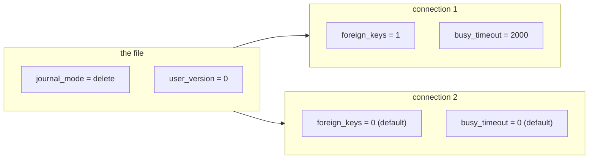

# `PRAGMA` vs `SET`

`foreign_keys` is off by default, so the `REFERENCES` clause in a schema enforces nothing until a connection turns it on. That default is the reason to read a setting before you trust a test. In PostgreSQL you would run `SHOW` or read `pg_settings`; in SQLite you type `PRAGMA foreign_keys;` and a row comes back. That row is the whole subject of this chapter.

The name `PRAGMA` suggests a switch on the engine, but a pragma is a statement. It returns a result set when it has something to report, and half of them configure one connection rather than the database. Treat it as a small API with SQL syntax. `PRAGMA table_info` reads the schema, `PRAGMA busy_timeout = 2000` changes a setting, and both are statements you can send from any program. SQLite has no `SET` statement at all.

## A setting arrives as a result set

A pragma is a command that either reports something the engine knows or changes a setting. Some pragmas return rows with named columns. Some return nothing, because they only change something. A few return rows even when they change something, and that reply is the value you now have.

The dot-commands in the `sqlite3` shell are not pragmas, and they are not SQL. `.tables`, `.schema` and `.mode` are conveniences the shell implements. A program cannot send them, because they never reach the engine. It can send `PRAGMA table_info(products)`, because that is a statement.

PostgreSQL keeps two names for the two jobs: `SHOW` reads a setting, `SET` changes one, and the view `pg_settings` lists them all. SQLite folds the jobs into one statement, which is convenient and occasionally confusing, since nothing in the syntax says whether a given pragma reads or writes. Guess wrong and a foreign key you believe is enforced is off, so a write lands that the schema meant to reject.

## What a pragma returns

Ask for the columns of `products`:

```sql
PRAGMA table_info(products);
```

| cid | name | type | notnull | dflt_value | pk |
| --- | --- | --- | --- | --- | --- |
| 0 | id | INTEGER | 0 | NULL | 1 |
| 1 | name | TEXT | 1 | NULL | 0 |
| 2 | category | TEXT | 1 | NULL | 0 |
| 3 | price | NUMERIC | 1 | NULL | 0 |
| 4 | stock | INTEGER | 1 | 0 | 0 |
| 5 | active | BOOLEAN | 1 | 1 | 0 |

Six rows, one per column, in declaration order. Read the columns in turn.

`cid` is the column's position, counted from zero. `name` is its name. `type` is the declared type, copied from the `CREATE TABLE` statement word for word, which is why it shows `NUMERIC` and `BOOLEAN` even though SQLite stores neither as such. Chapter 3 takes that up.

`notnull` and `pk` are numbers, so `1` means yes. The `id` row reports `0` in `notnull` even though it is the key, because the column has no declared `NOT NULL`. `pk` is what marks the key. `dflt_value` holds the default as text, so `typeof(dflt_value)` reports `text` for `stock` and `active`, and the column is null where there is no default.

The width of the result is the point. You asked one question and the engine answered with six columns of facts, one row per column of the table.

## The same read as a table

Since 3.16, most read-only pragmas also exist as a table-valued function, spelled with a `pragma_` prefix. This query is the curriculum demo, and it returns the same six rows:

```sql
SELECT cid, name, type, "notnull", dflt_value, pk
FROM pragma_table_info('products')
ORDER BY cid;
```

| cid | name | type | notnull | dflt_value | pk |
| --- | --- | --- | --- | --- | --- |
| 0 | id | INTEGER | 0 | NULL | 1 |
| 1 | name | TEXT | 1 | NULL | 0 |
| 2 | category | TEXT | 1 | NULL | 0 |
| 3 | price | NUMERIC | 1 | NULL | 0 |
| 4 | stock | INTEGER | 1 | 0 | 0 |
| 5 | active | BOOLEAN | 1 | 1 | 0 |

The double quotes around `"notnull"` are load bearing. `NOTNULL` is part of SQLite's grammar as a spelling of the `NOT NULL` constraint, so an unquoted `notnull` in the select list fails with `near "notnull": syntax error`. Double quotes tell SQLite to read it as a column name.

Try this: remove the quotes from `"notnull"` in the query above and run it. The engine returns `near "notnull": syntax error`, because the bare word parses as part of the constraint grammar. Put them back and the six rows return.

The gain is everything `SELECT` can do. You can filter the columns, sort them, put them beside another table, or count them per table. A bare pragma gives you a printout. The table-valued spelling gives you a relation, and a relation composes.

That difference shows up first as a mistake. You want one column's type, so you add a filter to the pragma:

```sql
PRAGMA table_info(products) WHERE name = 'price';
```

```
near "WHERE": syntax error
```

A pragma is a single statement with its own argument list. Once the engine has parsed `table_info(products)`, the statement is complete, and the next keyword is a syntax error. The filter has to go outside, which means the read has to be a table:

```sql
SELECT name, type
FROM pragma_table_info('products')
WHERE name = 'price';
```

| name | type |
| --- | --- |
| price | NUMERIC |

Same function, same argument, now inside a `SELECT` where a `WHERE` clause is legal. Chapter 4's foreign-key audit reads `pragma_foreign_key_list` the same way.

## Writing uses the same statement

The write form is the read form with a value attached:

```sql
PRAGMA user_version = 3;
```

That statement returns no rows, because it has nothing to report: it wrote the number into the database header. Read it back and the value is `3`.

Nothing in the text tells you which pragmas read, which write, and which answer after a write. `PRAGMA journal_mode = WAL` writes and returns a row, and chapter 1 showed why you must read that row: the reply is the mode you actually have. It may not be the one you asked for.

`PRAGMA busy_timeout = 2000` writes and returns one row holding the value you just set, so read it back the same way. `PRAGMA user_version = 3` writes and returns nothing, because the number lives in the header and there is no reply to give. Learn the handful you use and read their replies.

The parenthesis spelling works for some pragmas too. `PRAGMA busy_timeout(2000)` sets the same value as `PRAGMA busy_timeout = 2000`, and the engine accepts either. The app's Go code uses the parenthesis form in its connection string, which is why `_pragma=busy_timeout(2000)` appears there.

## Scope: the file or the connection

The distinction that causes real bugs is scope, and each pragma belongs to one of two groups.

| lives in the file | lives in the connection |
| --- | --- |
| `journal_mode` | `foreign_keys` |
| `user_version` | `busy_timeout` |
| `application_id` | `cache_size` |
| `auto_vacuum` | `synchronous` |
| `page_size` | `query_only` |

A file pragma is stored in the database, so every connection that opens it reads the same value, and the value survives closing the program. A connection pragma is a setting on one open handle, so it starts at the default on every new connection and disappears when that connection closes.



`foreign_keys` is the famous member of the second group, because it is off by default. The schema declares `orders.customer_id REFERENCES customers(id)`, and that clause does nothing at all until a connection turns enforcement on. A connection that never sets it accepts an order for a customer that does not exist. Chapter 4 makes that concrete and shows the audit query.

`query_only` is the other one worth knowing here, because this app uses it. The shared dataset is opened with SQLite's own `mode=ro` plus `PRAGMA query_only = 1`, so a write fails at the engine. The in-browser workspace does not set it, so the same pragma reports `0` there and the workspace stays writable. Same statement, different answer, and the difference belongs to the connection.

## Where this app sets its pragmas

Because a connection pragma has no memory, it has to be applied where the connection is made. That is a line of code, not a configuration file, and it is worth knowing which line.

The gateway applies `foreign_keys(1)` and `busy_timeout(2000)` to every connection it opens, in `backend/internal/engine/sqlite.go`. The comment beside them gives the reason: SQLite has no global setting to inherit from, so a connection that is not configured is a connection with the defaults. Both entries are connection settings, so both have to be applied at every open.

The in-browser workspace runs `PRAGMA foreign_keys = ON` once, immediately after it opens its database, in `web/src/api/sqliteEngine.ts`. It leaves `busy_timeout` and `query_only` alone, so the workspace keeps a zero timeout and accepts writes.

That one detail explains a reading from chapter 1. `PRAGMA busy_timeout` returns `0` in this workspace and `2000` through the gateway, because the workspace never sets it and the gateway always does. Neither number belongs to a database file. Both are what one connection carries, changed or left alone.

## One row per table

The exercise asks for every table's name and column count, alphabetically. The catalog supplies the names, and the table-valued pragma supplies the columns of one table:

```sql
SELECT (SELECT COUNT(*) FROM pragma_table_info('products')) AS product_columns;
```

| product_columns |
| --- |
| 6 |

The part the exercise needs is the argument. `pragma_table_info` accepts a constant here, but it also accepts a column of the row being processed. `FROM sqlite_master m` gives one row per catalog object, and `pragma_table_info(m.name)` then reads the columns of whichever table that row names. Filter the catalog to `m.type = 'table'` to drop the indexes, count the rows the pragma returns, and sort the result by name.

The correlated call is the part to notice. The argument is a column of the current row, not a constant, so one statement answers the question for every table in the file.

Here is the mistake to expect. Drop the `WHERE` clause, because the catalog filter looks like clutter:

```sql
SELECT m.name AS table_name,
       (SELECT COUNT(*) FROM pragma_table_info(m.name)) AS columns
FROM sqlite_master m
ORDER BY m.name;
```

You get ten rows instead of five. Each index reports `0` columns, because `pragma_table_info('orders_customer_id_idx')` describes a table and an index is not one. It returns nothing, so `COUNT(*)` counts that nothing. The five zeros look plausible, and the counts you wanted are now mixed in with five you did not.

## What to remember

**What I would do:** set `foreign_keys` and `busy_timeout` in the code that opens the connection, because every new handle starts from the defaults. Read each setting back, and treat the reply as the state rather than the echo. Before you trust a pragma, check its scope: the file remembers `journal_mode`, and the connection forgets `foreign_keys`.

- A pragma is a statement. Some return rows, some change a setting, and a few do both.
- `PRAGMA table_info(products)` returns one row per column, with the declared type as written.
- `pragma_table_info('products')` is the same read as a relation, so it can be filtered, joined, and given a column as its argument.
- A `WHERE` clause belongs outside a pragma. Inside the statement it is a syntax error.
- File pragmas persist and connection pragmas do not. `journal_mode` and `user_version` live in the file; `foreign_keys` and `busy_timeout` live in a connection.
- A connection has no memory of the last one, so the app sets its pragmas where it opens the connection.

## Check yourself

**1. You write `PRAGMA table_info(products) WHERE name = 'price';` and the engine rejects it. What does that tell you about the statement?**

<details>
<summary>Answer</summary>

A pragma is one complete statement, with an argument list and no clause of its own. To filter it, read the table-valued form inside a `SELECT`, where `WHERE` is part of the grammar.

</details>

**2. `PRAGMA busy_timeout` returns `0` in this workspace and `2000` through the gateway. Which of those is the default, and why do they differ?**

<details>
<summary>Answer</summary>

`0` is SQLite's default for a new connection. The gateway runs `busy_timeout(2000)` on every connection it opens, and the browser workspace never sets it, so each reports the value its own connection carries.

</details>

**3. Why does `foreign_keys` need setting on every new connection, while `journal_mode` does not?**

<details>
<summary>Answer</summary>

`foreign_keys` is a connection setting, so each new handle starts from the default, which is off. `journal_mode` is stored in the file header, so every connection that opens that file reads the same mode without being told.

</details>

**4. In the exercise query, what changes if you drop `WHERE m.type = 'table'`?**

<details>
<summary>Answer</summary>

You get ten rows instead of five. The five index entries survive, and each reports `0` columns, because `pragma_table_info` describes a table and an index has none. The counts for the real tables are still right, which is what makes the mistake easy to miss.

</details>
