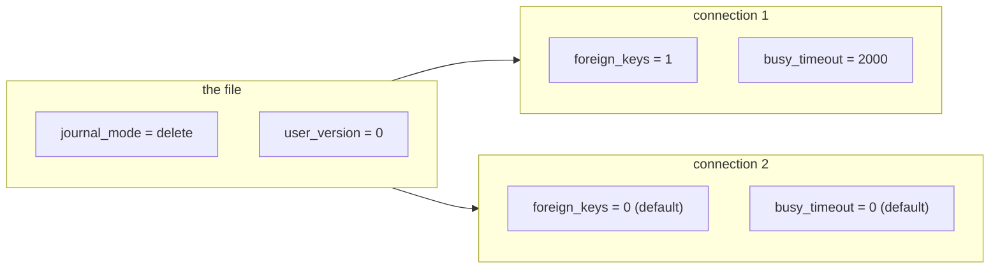

# `PRAGMA` vs `SET`

## A `PRAGMA` is a statement that returns rows

In PostgreSQL, configuration is commands: `SET work_mem = '64MB'` changes a setting, `SHOW work_mem` reads it, and `pg_settings` lists everything. SQLite folds all of that into `PRAGMA`, and the surprising part is the shape: a `PRAGMA` is not a special meta-command bolted onto the shell, it is SQL that returns a result set. `PRAGMA table_info('products')` has columns, `cid`, `name`, `type`, `notnull`, `dflt_value`, `pk`, and rows, one per column of the table. You can `SELECT` from it, join it, and filter it.

```sql
PRAGMA table_info(products);
```

| cid | name | type | notnull | dflt_value | pk |
| --- | --- | --- | --- | --- | --- |
| 0 | id | INTEGER | 0 | NULL | 1 |
| 1 | name | TEXT | 1 | NULL | 0 |
| 2 | category | TEXT | 1 | NULL | 0 |
| 3 | price | NUMERIC | 1 | NULL | 0 |
| 4 | stock | INTEGER | 1 | 0 | 0 |
| 5 | active | BOOLEAN | 1 | 1 | 0 |

Write is the same statement with `=`: `PRAGMA user_version = 3`, `PRAGMA journal_mode = WAL`. Nothing about the syntax distinguishes a read from a write; you have to know which pragma is which.

## Table-valued pragmas

Since 3.16, most read-only pragmas also exist as **table-valued functions**, spelled `pragma_<name>`, which can appear anywhere a table can: in `FROM`, in a subquery, in a join. That is the difference between "the shell printed something" and "the planner can use it":

```sql
SELECT name, type
FROM pragma_table_info('products')
ORDER BY cid;
```

| name | type |
| --- | --- |
| id | INTEGER |
| name | TEXT |
| category | TEXT |
| price | NUMERIC |
| stock | INTEGER |
| active | BOOLEAN |

Because it is a table expression, the query above is ordinary SQL: add a `WHERE type NOT IN (...)`, put it beside another table, or use it in a CTE. `pragma_table_list`, `pragma_foreign_key_list`, `pragma_index_list` and friends follow the same pattern; the production chapters use them to read the schema the way PostgreSQL reads `information_schema`.

## Per-connection or per-file

The distinction that causes real bugs is scope. Some pragmas are properties of the **file** and persist for everyone who opens it: `journal_mode`, `user_version`, `application_id`, `auto_vacuum`, `page_size`. Others are properties of the **connection** and vanish when it closes: `foreign_keys`, `busy_timeout`, `cache_size`, `synchronous`, `query_only`, `case_sensitive_like`.

That second group is why the executor for this app sets its pragmas when it opens the connection, and why anything you set in one connection is invisible in the next:



`PRAGMA foreign_keys` is the famous one: it defaults to off, so a connection that never set it will happily write rows that violate the foreign keys the schema declares. PostgreSQL has no equivalent trap because constraint enforcement is the server's, not the session's.

## `SET` is not the comparison you want

The PostgreSQL analogue of `PRAGMA busy_timeout = 2000` is a session `SET`, and the analogue of `PRAGMA table_info` is `information_schema.columns`. But the mental models differ in one useful way: `SET` changes how the *server* will treat your session; `PRAGMA` is either a query against the database or a change to this connection's local configuration. When you port a tool that assumed settings were global to the server, you find that SQLite's per-connection settings have to be re-established on every new connection: the DSN, in this app's case, is where they live.

## Check yourself

**1. What does `PRAGMA table_info('products')` return, and how is that different from PostgreSQL's `\d products`?**

<details>
<summary>Answer</summary>

It returns a result set with one row per column and columns `cid`, `name`, `type`, `notnull`, `dflt_value`, `pk`. `\d` is a shell meta-command that prints text; `PRAGMA` is SQL you can select from, filter and join.

</details>

**2. Which of `journal_mode`, `foreign_keys` and `user_version` are properties of the file?**

<details>
<summary>Answer</summary>

`journal_mode` and `user_version` live in the file and persist for every opener. `foreign_keys` is per-connection and defaults to off on each new connection.

</details>

**3. Why does the gateway set pragmas when it opens a connection rather than once at startup?**

<details>
<summary>Answer</summary>

Because `foreign_keys`, `busy_timeout` and the other configuration pragmas are per-connection. Settings made on one connection do not exist on the next, so they must be applied where the connection is created.

</details>
