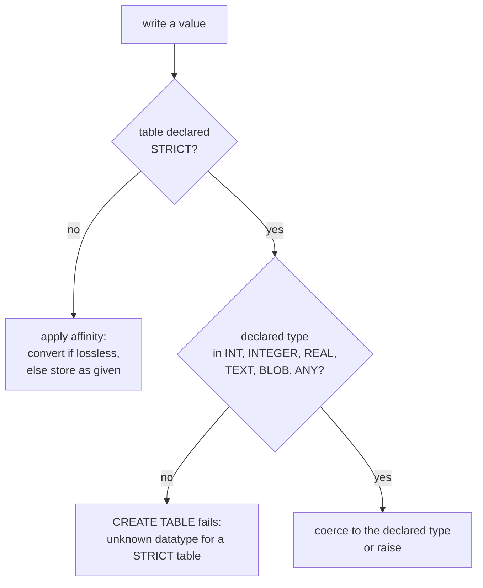

# Types that do not lie: `STRICT` tables

The money column declares `NUMERIC NOT NULL`, and `typeof(price)` reports two storage classes in it: `integer,real`. Ten rows hold an integer and ten hold a real, and no write was refused. The declaration was a suggestion, and SQLite followed it when it could.

That is the behaviour chapter 2 of the essentials course described as affinity. It is also the reason a schema written for SQLite can look stricter than it behaves. `STRICT` is the switch that turns the suggestion into a rule, one table at a time.

## A declared type is a hint

Every SQLite column has an affinity, and the affinity comes from the text of the declared type. The rules are substring matches, so `DATE`, `BOOLEAN`, `NUMERIC` and `TIMESTAMP` all select the same one.

| affinity | selected when the declared type contains |
| --- | --- |
| `INTEGER` | `INT` |
| `TEXT` | `CHAR`, `CLOB` or `TEXT` |
| `BLOB` | `BLOB`, or no type at all |
| `REAL` | `REAL`, `FLOA` or `DOUB` |
| `NUMERIC` | anything else |

Affinity is applied when a value is written. The engine looks at the value, converts it to the column's affinity if the conversion is lossless, and stores the result. If the conversion would lose information, the value goes in unchanged.

Nothing is refused. A column declared `INTEGER` accepts the text `'abc'`, because no conversion exists and the engine does not need one. That acceptance costs you at read time: `sum` adds the text as zero and `avg` divides by every row anyway, so the total survives and the mean does not.

PostgreSQL works from the other end. A column has a type, the type is checked at write time, and a value that does not fit is an error. SQLite gives you the check only if you ask for it.

## What affinity does to the money column

Ask the engine what it stored, rather than what the schema promised:

```sql
SELECT group_concat(DISTINCT typeof(price)) AS classes
FROM products;
```

| classes |
| --- |
| integer,real |

Two storage classes in one `NUMERIC` column. `typeof` returns the storage class of a value: `integer`, `real`, `text`, `blob` or `null`. The declared type is not one of them, which is the whole point.

Ten products hold an integer and ten hold a real. The pattern is the decimal part. Here are two rows side by side:

```sql
SELECT id, price, typeof(price) AS stored, printf('%.2f', price) AS shown
FROM products
WHERE id IN (1, 4)
ORDER BY id;
```

| id | price | stored | shown |
| --- | --- | --- | --- |
| 1 | 59 | integer | 59.00 |
| 4 | 42.5 | real | 42.50 |

Row 1 is Aurora Wireless Earbuds, seeded as `59.00`. A whole number fits an integer, so `NUMERIC` affinity stores it in the smallest lossless class. Row 4 is Cedar Desk Lamp at `42.50`, and the half needs a real.

The seed text had two decimal places in both cases. The stored value has none in the first and one in the second.

That is why money in this database is a formatting decision. The scale is not in the value, so you put it back when you print, which is what `printf('%.2f', price)` does. Comparisons and sums stay numeric, and a query that needs a fixed scale has to add it.

## A value the column never refused

Here is the mistake the flexibility invites. You copy prices into a column declared `INTEGER`, because a price is a number:

```sql
CREATE TABLE price_loose (id INTEGER PRIMARY KEY, price INTEGER);
INSERT INTO price_loose (id, price)
SELECT id, price FROM products ORDER BY id LIMIT 3;
INSERT INTO price_loose (id, price) VALUES (99, 'not a price');
SELECT count(*) AS rows, sum(price) AS total, avg(price) AS mean
FROM price_loose;
```

| rows | total | mean |
| --- | --- | --- |
| 4 | 272 | 68 |

Nothing failed. The three copied prices are 59, 129 and 84, which sum to 272. The fourth row holds the text `'not a price'`, and `sum` and `avg` treat it as zero rather than complaining.

So the total is right by luck and the mean is wrong: 272 over four rows is 68, and the mean of the three real prices is 90.67.

The row is visible if you look for it:

```sql
SELECT id, price, typeof(price) AS stored FROM price_loose ORDER BY id;
```

| id | price | stored |
| --- | --- | --- |
| 1 | 59 | integer |
| 2 | 129 | integer |
| 3 | 84 | integer |
| 99 | not a price | text |

`typeof` is the dialect's answer to "what is this, really". Reach for it whenever a number looks wrong, and the storage class will tell you whether the value is what the column claims.

## `STRICT` turns the hint into a rule

Append `STRICT` to `CREATE TABLE` and the table gets a real type system. Every column must declare one of six types: `INT`, `INTEGER`, `REAL`, `TEXT`, `BLOB` or `ANY`. Every write is then checked against the declared type, and a value that does not fit raises an error instead of being stored.

Here is the port of `products`, with each type chosen from the list:

```sql
CREATE TABLE products_strict (
    id       INTEGER PRIMARY KEY,
    name     TEXT    NOT NULL,
    category TEXT    NOT NULL,
    price    REAL    NOT NULL,
    stock    INTEGER NOT NULL DEFAULT 0,
    active   INTEGER NOT NULL DEFAULT 1
) STRICT;
```

Two declarations changed. `price` was `NUMERIC` and is now `REAL`, because `NUMERIC` is not on the list. `active` was `BOOLEAN` and is now `INTEGER`, because `BOOLEAN` is not on the list either, and the seed already stores `1` and `0` there.



The left branch is every table in this course so far. The right branch is opt in, per table.

## The write a `STRICT` table refuses

A `STRICT` table converts what it can and raises on what it cannot. Run the four cases and the pattern is clear.

Text that looks like a number is converted. Insert `'42'` into an `INTEGER` column and the column holds the integer `42`.

An integer into a `REAL` column is converted, because an integer is a real with nothing after the point. Insert `59` into `products_strict.price` and `typeof` reports `real`.

A number into a `TEXT` column is converted the other way. Insert `42` into a `TEXT` column and the column holds the text `'42'`.

Text that is not a number into a numeric column is refused, and this is the error to recognise:

```sql
INSERT INTO products_strict (id, name, category, price, active)
VALUES (1, 'Aurora Wireless Earbuds', 'Electronics', 59, 'yes');
```

```
cannot store TEXT value in INTEGER column products_strict.active
```

That is a constraint failure, not a syntax error. The statement is valid and the value is not, and the engine names both the value class and the column. The same insert into a table without `STRICT` succeeds and stores `text`, which is the `price_loose` result above.

`ANY` is the exception inside the list. A column declared `ANY` accepts every storage class, so it behaves like an ordinary untyped column while still being legal in a `STRICT` table. It suits the column that genuinely holds more than one kind of value.

`STRICT` does not do two jobs people expect. It does not add `NOT NULL`, which stays a separate constraint. It does not enforce foreign keys either, because enforcement is a connection setting and it is off by default. Chapter 4 takes that up.

## Which types this schema would have to change

A `STRICT` table rejects a declared type outside the six, and it rejects it at `CREATE TABLE` time. Try to port `products` while keeping the original types:

```sql
CREATE TABLE products_numeric_strict (
    id    INTEGER PRIMARY KEY,
    price NUMERIC NOT NULL
) STRICT;
```

```
unknown datatype for products_numeric_strict.price: "NUMERIC"
```

The statement never creates a table. That error is useful, because it is the whole port in one line: `NUMERIC` cannot appear in a `STRICT` table, and neither can `DATE`, `TIMESTAMP`, `BOOLEAN` or `VARCHAR(20)`.

Reading the declared types is the first step of the rewrite, and `pragma_table_info` is a table, so the question is a query:

```sql
SELECT name, type
FROM pragma_table_info('products')
WHERE type NOT IN ('INT', 'INTEGER', 'REAL', 'TEXT', 'BLOB', 'ANY')
ORDER BY cid;
```

| name | type |
| --- | --- |
| price | NUMERIC |
| active | BOOLEAN |

Two columns in one table. The list in the `WHERE` clause is the six allowed types spelled out, so any row that survives the filter is a column a `STRICT` declaration would refuse.

Try this: add `'NUMERIC'` to that `NOT IN` list and run the query again. The result keeps `active BOOLEAN` and loses `price`. The filter answers the question you gave it, so check the list before you trust the rows.

For `price`, the port has to decide what money really is. `REAL` is the direct choice: it keeps a fraction, and the engine already stores half the prices that way. An integer count of cents is the choice when you need exact scale. Both are honest. Leaving the column `NUMERIC` is not, because the declaration is rejected before the table exists.

## Finding the whole port

One table is the small version of the job. The exercise asks for every column in the file whose declared type is not on the list, with the table name beside it. The one-table query above becomes a join: `sqlite_master` supplies the table names, `pragma_table_info(m.name)` supplies the columns of each one, and the same `NOT IN` list filters the declared types. Sort by table name, then by column position.

The list that comes back is the work plan for the port: one date column, one timestamp column, one boolean, and two money columns, spread across four tables.

The mistake to expect is a filter that looks complete and is not. The schema declares `quantity INTEGER` and `stock INTEGER`, so a reader who checks the money columns finds two and stops. The date and timestamp columns hide, because their names do not sound like types. Run the query, and the list comes from the file.

## What to remember

**What I would do:** declare every new table `STRICT`, and start a port by running `pragma_table_info` against the old one. Choose `REAL` or an integer count of cents for money, and put the scale back when you print. When a total looks right and the mean beside it does not, run `typeof` before you touch the query.

- A declared type selects an affinity by substring. Affinity converts a value at write time and stores it unchanged when conversion would lose information.
- `NUMERIC` stores a whole number as an integer and a fraction as a real, so one column reports `integer,real`.
- `typeof(x)` names the storage class of a value, which is the honest answer to "what is in this column".
- `STRICT` accepts six declared types: `INT`, `INTEGER`, `REAL`, `TEXT`, `BLOB` and `ANY`.
- A `STRICT` table converts a value it can convert and raises `cannot store TEXT value in INTEGER column` for one it cannot.
- `STRICT` does not add `NOT NULL` and does not turn on foreign keys.
- `pragma_table_info` plus a `NOT IN` list finds every column a `STRICT` port would have to change.

## Check yourself

**1. `products.price` is declared `NUMERIC`, yet ten rows hold an integer and ten hold a real. Why?**

<details>
<summary>Answer</summary>

`NUMERIC` affinity stores a value in the smallest class that keeps it exactly. A price with no fraction fits an integer, so it is stored as one. A price with a fraction needs a real, so it keeps one. The declared type is one word and the stored class depends on the value.

</details>

**2. An `INTEGER` column in an ordinary table holds `'not a price'`. Why did that write succeed?**

<details>
<summary>Answer</summary>

Because affinity never refuses a value. It converts when the conversion is lossless and stores the value as given otherwise, so `sum` and `avg` treat that row as zero and the mean drops without an error. `typeof` is how you find the row.

</details>

**3. Which of these declared types may a `STRICT` table use: `INTEGER`, `NUMERIC`, `TEXT`, `REAL`, `BOOLEAN`, `BLOB`, `ANY`?**

<details>
<summary>Answer</summary>

`INTEGER`, `TEXT`, `REAL`, `BLOB` and `ANY`, plus `INT` as the sixth name. `NUMERIC` and `BOOLEAN` are not on the list, and a `STRICT` table that declares one fails to create with `unknown datatype`.

</details>

**4. You declare `price REAL NOT NULL` in a `STRICT` table and insert `59`. What does the column hold, and what changed compared with the `NUMERIC` column?**

<details>
<summary>Answer</summary>

It holds the real `59.0`, because an integer converts to a real exactly. The `NUMERIC` column would have stored the integer `59`. Both compare and sum correctly, and the scale still belongs to your formatting, not to the value.

</details>

**5. Why does `STRICT` not make the schema safe on its own?**

<details>
<summary>Answer</summary>

It checks storage classes only. `NOT NULL` is a separate constraint, and foreign keys stay unenforced until a connection sets `foreign_keys`. A `STRICT` table can still hold a null in a column you forgot to constrain, and a reference to a row that does not exist.

</details>
