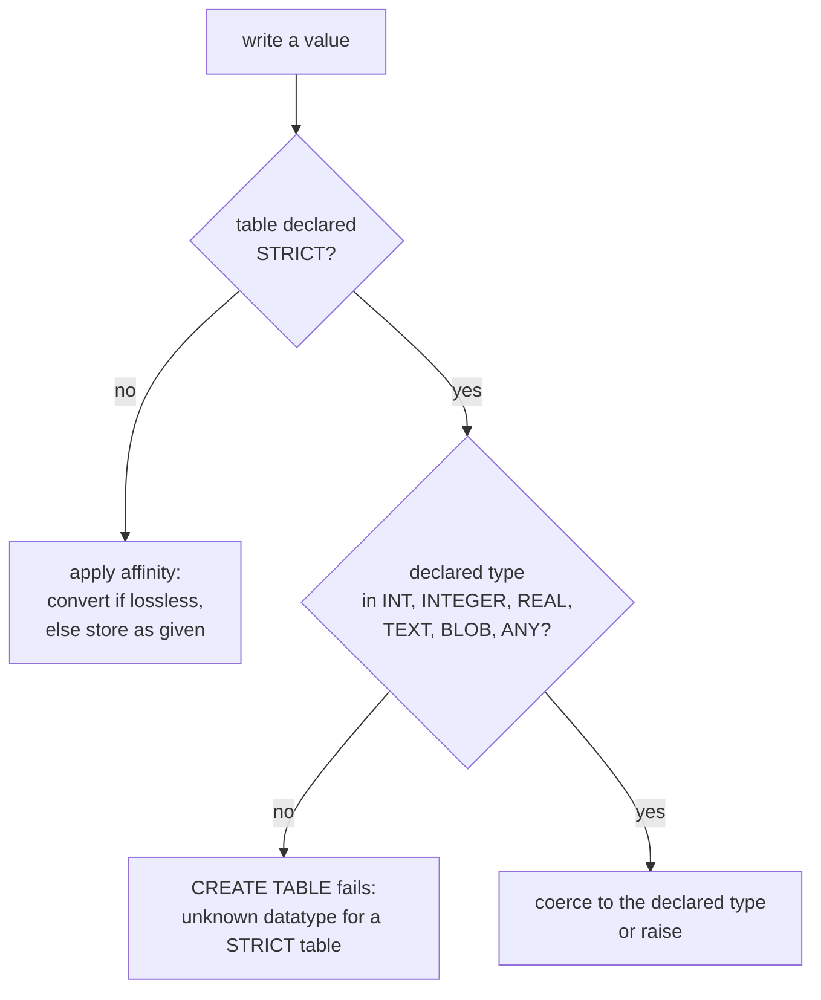

# Types that do not lie: `STRICT` tables

## Affinity is a habit; `STRICT` is a rule

Chapter 2 of the essentials course showed the flaw in the type system: a declared type picks an affinity that *converts when it can*, and stores whatever it cannot convert. A column declared `INT` accepts `'abc'`. That is flexibility when you want it and a data-integrity bug when you do not.

`STRICT` (SQLite 3.37+) is the per-table switch that turns the habit into a rule. Append `STRICT` to `CREATE TABLE` and every column must use one of six declared types — `INT`, `INTEGER`, `REAL`, `TEXT`, `BLOB` or `ANY` — and every write is checked against the declared type. A `TEXT` column rejects a number; an `INTEGER` column rejects `'abc'`; `REAL` accepts an integer and stores it as a float. It is the closest thing SQLite has to PostgreSQL's column type checking, and it is opt-in per table.



## The list is shorter than the schema

That six-type list is the trap: **`NUMERIC` is not on it.** Neither is `DATE`, `TIMESTAMP`, `BOOLEAN`, `VARCHAR(20)` or anything else the commerce schema declares. A STRICT table has to choose a real storage type, and the schema has to be rewritten to do it. Reading the declared types is the first step of that rewrite:

```sql
SELECT name, type
FROM pragma_table_info('order_items')
ORDER BY cid;
```

| name | type |
| --- | --- |
| id | INTEGER |
| order_id | INTEGER |
| product_id | INTEGER |
| quantity | INTEGER |
| unit_price | NUMERIC |

`unit_price NUMERIC` cannot appear in a STRICT table. Porting that table means deciding what the money column really is: `REAL`, which turns the integer `59` into `59.0` and keeps a fraction, or a text/`INTEGER` representation that fixes the scale yourself. Both are honest; leaving it `NUMERIC` and hoping is not, because the declaration would be rejected.

`DATE` and `BOOLEAN` go the same way — they become `TEXT` and `INTEGER`. Which is the point of `STRICT`: it makes you say out loud what the affinity chapter let you leave implied.

## `ANY` and the PostgreSQL contrast

`ANY` is the odd one out: it is a STRICT-table type that permits any storage class, so it behaves like an ordinary untyped column while still being usable inside a STRICT table's type list. There is no PostgreSQL equivalent, and there is no PostgreSQL per-table switch at all — one server, one type system, every table checked. SQLite's version is a compromise with its own history: default permissive, opt in per table.

Two things `STRICT` does **not** do. It does not add `NOT NULL` — that is still a separate constraint. And it does not enforce foreign keys — that is `PRAGMA foreign_keys`, and it is off by default, which is the next chapter.

## The query that finds the work

Because `pragma_table_info` is a table, "which columns would a STRICT table reject?" is a query rather than a code review. The STRICT type list is a literal `IN` list:

```sql
SELECT name, type
FROM pragma_table_info('products')
WHERE type NOT IN ('INT', 'INTEGER', 'REAL', 'TEXT', 'BLOB', 'ANY')
ORDER BY cid;
```

| name | type |
| --- | --- |
| price | NUMERIC |
| active | BOOLEAN |

Two columns in one table. Run it against a real schema and the answer is usually longer than anyone expected — which is the argument for `STRICT` in new work, where the rewrite is still cheap.

## Check yourself

**1. Which declared types may a `STRICT` table use?**

<details>
<summary>Answer</summary>

Exactly six: `INT`, `INTEGER`, `REAL`, `TEXT`, `BLOB` and `ANY`. `NUMERIC`, `DATE`, `BOOLEAN` and `VARCHAR(n)` are not allowed.

</details>

**2. Why can the commerce schema's money column not be `STRICT` as written?**

<details>
<summary>Answer</summary>

It is declared `NUMERIC`, which is not on the STRICT list. The port has to choose a real storage type — `REAL`, or an integer/text representation with the scale fixed by the application.

</details>

**3. Does `STRICT` remove the need for `PRAGMA foreign_keys`?**

<details>
<summary>Answer</summary>

No. `STRICT` is about column storage types. Foreign-key enforcement is separate and off by default; a STRICT table with a foreign key still needs `PRAGMA foreign_keys = ON`.

</details>
