```mermaid
flowchart LR
    A["PRAGMA foreign_keys = OFF"] --> B["BEGIN"]
    B --> C["CREATE TABLE new (...)<br/>with the schema you want"]
    C --> D["INSERT INTO new<br/>SELECT ... FROM old"]
    D --> E["DROP TABLE old"]
    E --> F["ALTER TABLE new RENAME TO old"]
    F --> G["recreate indexes, triggers, views"]
    G --> H["PRAGMA foreign_key_check"]
    H --> I["COMMIT"]
    I --> J["PRAGMA foreign_keys = ON"]
```

# Changing a schema with `user_version`

The store has been live for a month, and `orders.status` accepts any text. Nothing in the file stops a client from storing `Completed`, `done` or an empty string, and a report that groups by status shows one state three times. You want the database to accept only the five words the code understands.

In PostgreSQL this is one `ALTER TABLE` and the server enforces the rule for every client. In SQLite you copy the table: create a new one with the constraint, move the 80 orders across, drop the old table, rename the new one into its place. The process that opens the file next also needs to know the copy happened. `PRAGMA user_version` is where that note lives, a number in the file header that SQLite stores and never reads.

## Four verbs and a wall

`ALTER TABLE` changes a table that already exists, where `CREATE TABLE` makes one. SQLite supports four forms:

- `RENAME TO` renames a table.
- `RENAME COLUMN` renames one column (3.25+).
- `ADD COLUMN` appends a column.
- `DROP COLUMN` removes one (3.35+).

The list is short, and the restrictions on the last two matter in practice. `ADD COLUMN` cannot make the column `PRIMARY KEY` or `UNIQUE`.

```sql
ALTER TABLE products ADD COLUMN sku TEXT UNIQUE;
```

```
Cannot add a UNIQUE column
```

The new column's default must be a constant, so a date function is refused.

```sql
ALTER TABLE products ADD COLUMN created_at TEXT DEFAULT CURRENT_TIMESTAMP;
```

```
Cannot add a column with non-constant default
```

A `NOT NULL` column needs a default as well. The 20 products already stored need a value for a column their rows do not have.

```sql
ALTER TABLE products ADD COLUMN note TEXT NOT NULL;
```

```
Cannot add a NOT NULL column with default value NULL
```

Add `DEFAULT 'none'` and the same statement succeeds.

`DROP COLUMN` has its own wall. It cannot remove a column an index uses, because the index would then describe a column that no longer exists. A key column and a column a generated column reads are refused for the same reason.

```sql
ALTER TABLE orders DROP COLUMN customer_id;
```

```
error in index orders_customer_id_idx after drop column: no such column: customer_id
```

One reason explains the `ADD COLUMN` walls. The change lands on a table that already holds rows, and every row has to make sense under the new declaration when the statement commits. A constant default makes sense for all 20 products. `CURRENT_TIMESTAMP` would need a different value in each row, and the verb has no second pass in which to write them. A `UNIQUE` column would need an index built over the 20 names already stored, which is work for a rebuild. `DROP COLUMN` is the same idea from the other side: an index is a stored definition too, and it would be left naming a column that no longer exists.

## Why a type or a unique rule needs a copy

A table's definition is text. `sqlite_master.sql` holds the `CREATE TABLE` statement that made `products`, and the word `NUMERIC` in `price NUMERIC NOT NULL` sits inside that text. There is no separate per-column record for a verb to edit. Changing a declared type, adding a `UNIQUE` constraint or reordering columns means writing a new `CREATE TABLE` and moving the rows into it.

The declared type is also a promise about future writes, not a container. SQLite stores each value with its own storage class. The 20 prices are already whatever the seed wrote, and a type change would not rewrite them even if a verb existed. What changes is the rule the table states, and that rule is part of the `CREATE TABLE` text.

One recent build bends this. The engine in this workspace, SQLite 3.53.4, accepts `ALTER TABLE ... ADD CONSTRAINT ... CHECK (...)`, and it checks the rows already stored. SQLite 3.46.1 rejects the same statement with `near "constraint": syntax error`, because the form is newer than the documented four verbs. A `UNIQUE` constraint is still refused in both builds, and neither changes a declared type in place. The rebuild below is what you need for those, and for any file that must open on an older library.

## The twelve-step rebuild

SQLite documents the procedure as twelve steps. The numbering earns its place because the steps people drop sit at the edges: foreign keys off before the transaction starts, and a check before it commits.



Here is the procedure written out for the constraint this chapter opened with. The comments name the step each statement belongs to.

```sql
PRAGMA foreign_keys = OFF;                 -- step 1, outside the transaction
-- step 3: list the indexes, triggers and views that reference orders (see below)

BEGIN;                                     -- step 2
CREATE TABLE orders_new (                  -- step 4: the shape you want
    id          INTEGER PRIMARY KEY,
    customer_id INTEGER NOT NULL REFERENCES customers(id),
    ordered_at  TIMESTAMP NOT NULL,
    status      TEXT NOT NULL
                CHECK (status IN ('pending', 'completed', 'shipped', 'cancelled', 'refunded'))
);
INSERT INTO orders_new (id, customer_id, ordered_at, status)   -- step 5
SELECT id, customer_id, ordered_at, status FROM orders;
DROP TABLE orders;                         -- step 6
ALTER TABLE orders_new RENAME TO orders;   -- step 7
CREATE INDEX orders_customer_id_idx ON orders (customer_id);   -- step 8
CREATE INDEX orders_status_idx      ON orders (status);        -- step 8
-- step 9: recreate any views or triggers that reference orders (none on this table)
PRAGMA foreign_key_check;                  -- step 10: no rows means no orphans
PRAGMA user_version = 3;                   -- the counter commits with the table
COMMIT;                                    -- step 11
PRAGMA foreign_keys = ON;                  -- step 12
```

Step 3 is a query, and the one to run before you start. The objects that live on `orders` are the rows in `sqlite_master` with `tbl_name = 'orders'` and a `type` of `index`, `trigger` or `view`. In this file that query returns two rows, `orders_customer_id_idx` and `orders_status_idx`, and step 8 recreates both by name. A trigger or view on the table would be dropped the same way, so read them all and recreate them.

The copy is step 5: `INSERT ... SELECT` reads the 80 orders and writes them into the new table. `DROP TABLE orders` then removes the old table and takes both indexes with it. The 160 rows in `order_items` keep their `order_id` values. The rename in step 7 puts the name `orders` back onto a table that holds the same ids, so those rows point at a parent again.

After the commit, `orders` holds 80 rows, both indexes exist, and `sqlite_master` shows a `CHECK` in the definition where there was none. `PRAGMA integrity_check` still reports `ok`. This workspace is writable, so you can run the script here and look; the reset button puts the seeded database back.

The cost decides when you run the migration. The table is read once and written once, and the write lock is held from `BEGIN` to `COMMIT`. On 80 rows nobody notices. On 8 million rows other writers wait for the length of the copy, and in rollback mode readers wait during the commit, which makes it a maintenance window. PostgreSQL's `ALTER TABLE` does the equivalent work inside the server, which is why migrations there are usually one statement and here are a script.

## Foreign keys go off before the transaction

This is the step people drop, and it fails in a quiet way. Run the first three statements of the rebuild in the wrong order and ask what the pragma is set to:

```sql
BEGIN;
PRAGMA foreign_keys = OFF;
PRAGMA foreign_keys;
```

| foreign_keys |
| --- |
| 1 |

The second statement changed nothing. Continue the rebuild and the drop fails:

```sql
DROP TABLE orders;
```

```
FOREIGN KEY constraint failed
```

`PRAGMA foreign_keys` is a per-connection setting, and it cannot change while a transaction is open. Enforcement would otherwise differ between statements of the same transaction, so SQLite leaves the setting where it was. The pragma reports no error, which is the worse kind of failure.

Set the pragma off before `BEGIN` and the drop runs, because the 160 child rows are no longer checked while their parent is missing. That leaves you one job: prove the copy preserved every relationship before you commit. `PRAGMA foreign_key_check` walks every foreign key in the file and reports each child row whose parent is absent. No rows means no orphans. If it returns a row, roll back and fix the copy, because a committed file can hold a child with no parent and nothing later will complain.

## `user_version` is the file's migration counter

There is no server to ask. Every SQLite file starts with a header, and the header holds two four-byte fields for the application: `user_version` at byte 60 and `application_id` at byte 68. `PRAGMA user_version` reads and writes the first of them.

```sql
PRAGMA user_version;
```

| user_version |
| --- |
| 0 |

Nothing in the engine interprets that number. It is not compared with the schema and does not select a migration. The engine stores it and stops, so what the number means is your decision.

The number does have one property worth relying on. It is written atomically with the rest of the transaction. A migrated file carries its version with it wherever it is copied, and a migration that rolls back takes the counter with it.

```sql
BEGIN;
PRAGMA user_version = 3;
ROLLBACK;
PRAGMA user_version;
```

| user_version |
| --- |
| 0 |

The pattern is the one a migrations table would support, minus the table. Read the version, apply every migration above it in order, write the new value. A connection that cannot write the file cannot bump the version, so the schema and the number move together or not at all.

Try this: run the same block without `BEGIN`, as `PRAGMA user_version = 3;` on its own, and read it back. The number stays 3. The transaction is what makes the schema and the counter move together.

That number is not the only version this file carries. `dataset_meta` holds one row per dataset, and the `commerce` row records 1 for the data build the seed produced. The two counters answer different questions: `user_version` says which shape the schema has, and `dataset_meta.version` says which data build the rows came from. Neither can stand in for the other. The exercise has you read both in one row, with the table-valued pragma from chapter 2 and the `dataset_meta` table.

The trade against PostgreSQL is worth naming. There the migration record lives in the server, one connection changes the schema for every client, and the catalog lock is the server's problem. Here the record lives in the file, so there is no migration service, and two processes that open the same file must agree about who migrates and when. That is a feature when one process owns the file, and it is why people put a server in front when a fleet of writers does.

## A version that lied

A counter nothing checks is easy to advance too early. Suppose you set it before running the rebuild, then the copy fails on a typo and you fix the typo later:

```sql
PRAGMA user_version = 3;
```

| user_version |
| --- |
| 3 |

The file now claims schema 3. Ask it the only question that matters, whether the constraint is really there:

```sql
SELECT count(*) AS guarded
FROM sqlite_master
WHERE name = 'orders' AND sql LIKE '%CHECK%';
```

| guarded |
| --- |
| 0 |

Zero. The counter moved and the schema did not. A file in that state opens without complaint, and the next migration sees 3 and skips the work it believes is done. The failure surfaces later, in a query that expected the rule to hold.

The fix is ordering, not a new pragma. Bump the version last, inside the same transaction, after the copy and after `foreign_key_check`, which is where the script above puts it. Then a failed rebuild leaves the counter where it was, and a successful one moves both in a single commit. The workspace keeps the new number until you reset it, so the experiment is safe to run.

## `application_id` is the format marker

The second header field answers a different question: whose file is this. `PRAGMA application_id` reads it, and the value is a magic number for your file format, the kind of constant a specification pins. This workspace reports 0, because nothing here owns a format.

```sql
SELECT (SELECT user_version FROM pragma_user_version())      AS user_version,
       (SELECT application_id FROM pragma_application_id())   AS application_id;
```

| user_version | application_id |
| --- | --- |
| 0 | 0 |

The two fields are easy to confuse, and they do different jobs. `user_version` counts how far your schema has evolved. `application_id` names which application should open the file at all. A tool handed a stranger's `.db` can read that field and refuse a file it was not built for, instead of running SQL against a schema it does not understand. The magic string at the start of the file tells you SQLite can read it; the `application_id` tells you whether your program should.

For a shipped format, set both when the file is created, so the reading side can check the format and the schema before it touches a table.

## What to remember

What I would do: keep the schema version in `user_version`. Write each migration so it can run twice without changing the result. Do the rebuild in one transaction with `foreign_keys` off and `foreign_key_check` before the commit. Version the file, not just the code.

- `ALTER TABLE` has four forms: `RENAME TO`, `RENAME COLUMN`, `ADD COLUMN` and `DROP COLUMN`. Every other schema change writes a new table.
- A new column must be one every existing row already satisfies: no `PRIMARY KEY` or `UNIQUE`, a constant default, and a default for `NOT NULL`.
- A declared type is text inside the table definition, so changing it means creating a table with the shape you want and copying the rows.
- The twelve-step rebuild turns foreign keys off before `BEGIN`, checks them with `foreign_key_check` before `COMMIT`, and turns them back on after.
- `PRAGMA user_version` is a four-byte header field that commits and rolls back with the transaction. The engine stores it and never interprets it.
- `PRAGMA application_id` names the file's format. It has nothing to do with the schema version.

## Check yourself

**1. Which of these needs a new table: rename `orders.status`, add `products.note TEXT`, change `products.price` to `INTEGER`, make `products.name` unique?**

<details>
<summary>Answer</summary>

The first two are single verbs. `RENAME COLUMN` and `ADD COLUMN` handle them in place. The type change needs the rebuild, because the declared type is part of the `CREATE TABLE` text. The unique rule needs either a rebuild or a `CREATE UNIQUE INDEX`, which stores the same rule as an object of its own.

</details>

**2. Why does `PRAGMA foreign_keys = OFF` have to run before `BEGIN`?**

<details>
<summary>Answer</summary>

The setting cannot change inside a transaction, and the pragma does not report an error when it is ignored. A rebuild that sets it after `BEGIN` runs with enforcement still on, and `DROP TABLE orders` fails with `FOREIGN KEY constraint failed`.

</details>

**3. A file reports `user_version` 3. What does that prove about its schema?**

<details>
<summary>Answer</summary>

Only that something wrote 3. The engine never compares the number with the tables, so a file can claim 3 and hold the schema from version 2. Read the schema or run a query that depends on the change before you trust the number.

</details>

**4. Why does `foreign_key_check` belong inside the transaction, before `COMMIT`?**

<details>
<summary>Answer</summary>

So a copy that lost a parent can be rolled back. After the commit the file keeps the orphan row, and no later statement checks it again, because enforcement only applies to writes.

</details>

**5. What does a tool learn from a file whose `application_id` is 0?**

<details>
<summary>Answer</summary>

Nothing. Zero is the default, so the tool cannot tell whether the file belongs to its format. A format that ships to other people sets the field to a constant of its own. A stranger can then refuse the file instead of querying a schema it does not know.

</details>
