# Changing a schema with `user_version`

## Four verbs, then the rebuild

SQLite's `ALTER TABLE` supports exactly four operations: `RENAME TO`, `RENAME COLUMN`, `ADD COLUMN` and — since 3.35 — `DROP COLUMN`. `ADD COLUMN` has restrictions that matter in practice: the new column may not be `PRIMARY KEY` or `UNIQUE`, and its default must be a constant, which is why `ADD COLUMN created_at DEFAULT CURRENT_TIMESTAMP` is rejected and `DEFAULT '1970-01-01'` is accepted. `DROP COLUMN` cannot touch a column that is indexed, part of the primary key, or referenced by a generated column.

Everything else — changing a column's type, adding a constraint, reordering, replacing a declaration — is the documented twelve-step rebuild. In outline:

```mermaid
flowchart LR
    A["PRAGMA foreign_keys = OFF"] --> B["BEGIN"]
    B --> C["CREATE TABLE new (...)<br/>with the schema you want"]
    C --> D["INSERT INTO new<br/>SELECT ... FROM old"]
    D --> E["DROP TABLE old"]
    E --> F["ALTER TABLE new RENAME TO old"]
    F --> G["recreate indexes, triggers, views"]
    G --> H["PRAGMA foreign_key_check"]
    H --> I["COMMIT"]
    I --> J["PRAGMA foreign_keys = ON"]
```



Two details are easy to get wrong. First, foreign keys must be off *outside* the transaction — `PRAGMA foreign_keys` is a no-op inside one — or the `DROP TABLE` will cascade in ways you did not intend. Second, `foreign_key_check` before the commit is what tells you the copy preserved the relationships; a rebuild that skips it can commit dangling children. PostgreSQL's `ALTER TABLE` does all of this in the server, which is why migrations there are usually one statement and here are a script.

## `user_version` is the file's own migration counter

There is no migrations table and no server to ask. SQLite reserves a four-byte integer in the database header for the application to use as it likes, and `PRAGMA user_version` reads and writes it. Nothing in the engine interprets it — the engine only stores it, atomically, with the rest of the transaction:

```sql
PRAGMA user_version;
```

| user_version |
| --- |
| 0 |

The pattern is the same one a migrations table would support, minus the table: read the version, apply every migration above it in order, write the new version. Because it lives in the header, a migrated file carries its schema version with it wherever it is copied, and a tool that opens an old file can tell immediately whether the schema it expects is there.

```sql
PRAGMA user_version = 3;
```

A connection that cannot write the file cannot bump the version, and vice versa — which is exactly the invariant you want: the version and the schema move together or not at all.

## `application_id` is the magic number

The header has a second four-byte field for a value that identifies *which application* owns the file. `PRAGMA application_id` states it, and the convention is a magic number registered for your format — the kind of thing a file-format specification pins. A tool that opens a stranger's `.db` can read it and refuse files that belong to something else, instead of trying SQL against a schema it does not understand. It is the closest thing a file has to a file-type tag.

## The honest trade

PostgreSQL's migrations live in the server: one connection applies a `ALTER TABLE` and every client sees the new schema. SQLite's live per file, in a header field, applied by whichever process opens it next. That is simpler in the small — no migration service, no lock on a shared catalog — and harder in the large, because two processes opening the same file have to agree about who migrates and when. For an embedded application where one process owns the file, it is the right trade. For a fleet of writers, it is the reason people put a server in front.

## Check yourself

**1. Which `ALTER TABLE` operations does SQLite support directly?**

<details>
<summary>Answer</summary>

`RENAME TO`, `RENAME COLUMN`, `ADD COLUMN` and `DROP COLUMN` (3.35+, with restrictions). Everything else is the rebuild: create, copy, drop, rename.

</details>

**2. Why must `PRAGMA foreign_keys` be changed outside the transaction?**

<details>
<summary>Answer</summary>

It is a no-op inside a transaction. The rebuild has to turn enforcement off before `BEGIN` so the drop-and-rename cannot cascade, and back on after `COMMIT`.

</details>

**3. What does `PRAGMA user_version` actually store, and who interprets it?**

<details>
<summary>Answer</summary>

A four-byte integer in the database header, written atomically with the rest of the transaction. The engine only stores it; the application decides what the numbers mean and applies the migrations.

</details>
