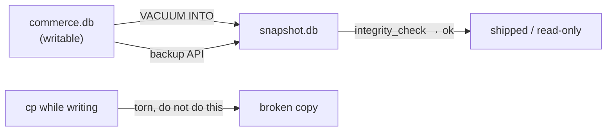

# Backup, `ATTACH` and shipping the file

## A file is a backup unit

The database is one file, so a backup is one file: with one rule attached. `cp commerce.db backup.db` while a writer is running copies a torn file: the pages are consistent only at a commit boundary, and `cp` does not know where that is. There are two correct ways to copy it. `VACUUM INTO 'backup.db'` builds a fresh, defragmented database from the current one while it runs; the online backup API copies page by page under the right locks. Use one of those, or stop the writer first.

```sql
PRAGMA integrity_check;
```

| integrity_check |
| --- |
| ok |

That single `ok` is the verification step for a shipped file: the page checksums, the B-tree invariants and the freelist all agree. A backup you cannot integrity-check is a backup you have not tested. The same pragma is the first thing to run after an unclean shutdown or a copy you are not sure about.

## What the file costs, in pages

`PRAGMA page_size` and `PRAGMA page_count` describe the file in its own units, and both are read as ordinary statements:

```sql
SELECT (SELECT page_size  FROM pragma_page_size())  AS page_size,
       (SELECT page_count FROM pragma_page_count()) AS pages;
```

| page_size | pages |
| --- | --- |
| 4096 | 11 |

Eleven 4 KiB pages, under 64 KiB, hold the whole commerce dataset. That is the scale argument for SQLite in one measurement: shipping it is a file copy, not a dump and restore. `VACUUM` rewrites the file to reclaim free pages after large deletes; `auto_vacuum` moves that work continuously, at the cost of a pointer map in every file. Both trade file size against write cost, and both are decisions about the *file*, not the session.



## `ATTACH` is a second database, not a schema

`ATTACH 'other.db' AS other` adds a file to the connection so a single statement can read from both, and `DETACH` removes it. On versions before 3.45 the attached name was the only way to reach it in SQL even from inside the same file. What it is *not* is a schema in PostgreSQL's sense: there is no `search_path`, no ownership, no `CREATE SCHEMA`, and the attached database has its own schema, its own pragmas and its own journal. The right way to think about it is "two databases in one query", and the reason it is useful here is exactly that the two files can be copied independently.

```sql
ATTACH DATABASE '/tmp/scratch.db' AS scratch;
```

Detach is required before the file can be safely removed on Windows, and forgetting it is a classic source of "the file is in use" errors. The lesson fixture is read-only, so attach is another read-about-it operation here.

## Shipping a read-only copy

The pattern this app uses is the one to end on. Build the file once, verified with `integrity_check`; ship it read-only; hand each session its own copy if it needs to write. There is no server to provision, no credentials to distribute, and no way for a learner to damage the canonical dataset: a write fails at the storage layer, as chapter 1 showed. The operational question shrinks from "is the database healthy?" to "is the file the build produced?".

## Check yourself

**1. Why is `cp` not a safe backup while the database is being written?**

<details>
<summary>Answer</summary>

It can copy a torn file: pages are consistent only at a commit boundary, and `cp` has no way to honour the journal. Use `VACUUM INTO` or the backup API, or stop the writer.

</details>

**2. What does `ATTACH` give you that a schema does not?**

<details>
<summary>Answer</summary>

It lets one connection query two independent database files, each with its own schema and pragmas. It is not a namespace inside the current database; there is no `search_path` and no ownership.

</details>

**3. What is `PRAGMA integrity_check` for?**

<details>
<summary>Answer</summary>

Verifying a file's B-tree, pages and freelist agree: the check to run on a shipped backup or after an unclean shutdown. It returns `ok` when the file is intact.

</details>
