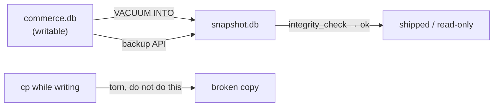

# Backup, `ATTACH` and shipping the file

Someone asks for a copy of the store to test a report against. You copy `commerce.db` to `report.db` while the app is running, hand it over, and the report fails on a table the original has, or on a row it should not have. Your SQL was not the problem. The file is the bytes of the database at an arbitrary instant, and SQLite never agreed to that instant being a commit.

A backup is a copy taken at a moment the engine can defend. This chapter covers the two ways to ask for one, the check that proves the copy is whole, and the file's own unit of size, the page.

## `cp` copies bytes, not a database

A commit is the instant the database records that a transaction is durable. Before it, the old pages are the truth. `cp` knows nothing about that boundary. It reads the file from beginning to end, takes no SQLite lock, and never looks at the journal beside it. The copy command reports success either way, so the damage ships as a missing table or a total that disagrees with the store.

The damage depends on the journal mode from chapter 1. Under the default rollback journal, the writer first copies the pages it is about to change into `commerce.db-journal`, then overwrites them in place. A copy taken between two of those writes can hold one page from the new transaction next to one from the old.

The original could be repaired from its journal. Your copy cannot, because the journal is not in it.

WAL is worse for this, in a way that surprises people. Commits append their pages to `commerce.db-wal`, and the main file catches up only at a checkpoint.

A copy of `commerce.db` alone can therefore be missing data that the original committed minutes ago. Copy the database file while a WAL writer is still connected, open the copy, and `no such table` is a possible answer for a table the original shows in its catalog.

There are two safe answers. Stop every writer, checkpoint, and copy the file. Or ask SQLite for the copy, which is what the next section covers. The first is fine for a laptop and poor for a service that is always writing.

## Two copies that hold the right locks

`VACUUM INTO 'backup.db'` builds a new database from the current one through a read transaction. The result is a single file: pages packed, free space dropped, no journal and no sidecar, consistent as of the moment the read began. The original keeps serving writes while the copy runs. It arrived in SQLite 3.27, and it refuses a path that already exists with `output file already exists`, so a second run cannot quietly overwrite last night's backup.

The backup API does the same job from inside a program. `sqlite3_backup_init`, `sqlite3_backup_step` and `sqlite3_backup_finish` copy the database page by page under a read lock the engine takes. You can step a slice at a time, report progress, and copy into a database that already exists, which `VACUUM INTO` will not do. The `.backup` command in the shell is this API with a friendly name.



The browser workspace is the one place this does not apply directly. Its database lives in memory, and the filesystem the engine sees is virtual, so a copy written to a path does not appear on your disk or survive a reload. The statements still run. The lesson is about the file you keep.

## `integrity_check` is the test a backup has to pass

A file that copies without an error is not yet a backup. `PRAGMA integrity_check` reads the whole file and checks that it describes itself. It walks the page headers, the B-tree page order and cell counts, every index entry against its row, the freelist links, and the page size in the header.

```sql
PRAGMA integrity_check;
```

| integrity_check |
| --- |
| ok |

One row, `ok`, means the file is intact. Otherwise you get one row per problem.

The check reads every page, so on this 88 KiB store it costs nothing, and on a file measured in gigabytes it is a scan. Run it on the copy, not only on the original: the original being healthy says nothing about the bytes that landed on the other disk. Run it after an unclean shutdown as well, when the journal may have been left mid-play.

## The file's own unit of size is the page

SQLite reads and writes the file in pages, and a page is a fixed block of bytes. `PRAGMA page_size` reports the block size, and `PRAGMA page_count` reports how many blocks the file holds. The demo query reads both, next to the integrity result:

```sql
SELECT (SELECT integrity_check FROM pragma_integrity_check()) AS integrity,
       (SELECT page_size  FROM pragma_page_size())             AS page_size,
       (SELECT page_count FROM pragma_page_count())            AS pages;
```

| integrity | page_size | pages |
| --- | --- | --- |
| ok | 8192 | 11 |

Eleven pages of 8192 bytes make 90,112 bytes, which is 88 KiB. The whole commerce store fits in that: 30 customers, 20 products, 80 orders, 160 order lines, the indexes and the catalog. Copying that to another machine is a file copy, and that is the scale argument for SQLite in one measurement.

The page size is a property of the file, chosen when the file is created. SQLite's long-standing default is 4096. The WebAssembly build behind this workspace creates 8192-byte pages instead, which is why the demo reports 8192 and why any prose that says 4 KiB is describing a different file.

You can set the size on an empty database, and this build honours it. On a file that already holds tables the same statement changes nothing, so the only reliable way to learn the size is to read it.

Try this: run `PRAGMA page_size = 4096;` and then read `PRAGMA page_size` again. It still answers 8192, and the statement raised no error. A file that already holds tables keeps the size it was created with.

`VACUUM` rewrites the file and can drop free pages while it goes. `auto_vacuum` moves that work into each commit, at the cost of a pointer map in every file. Both are decisions about the file, not about the session, and both change page_count rather than the rows.

## A wrong turn: eleven times 4096

Most SQLite guides multiply by 4096, because that is the default page size. Here is that formula:

```sql
SELECT (SELECT page_count FROM pragma_page_count()) * 4096 AS bytes;
```

| bytes |
| --- |
| 45056 |

44 KiB, and the query raised no error. The real file is twice that, and 44 KiB is believable enough that nobody checks. Give that number to a capacity check and you provision half the disk you need. The exercise that follows asks you to size the file the way a copy operation would, and this formula makes `kib` come out 44.

The fix is to let the file say how big its pages are:

```sql
SELECT (SELECT page_size FROM pragma_page_size()) *
       (SELECT page_count FROM pragma_page_count()) AS bytes;
```

| bytes |
| --- |
| 90112 |

90,112 bytes, or 88 KiB. The arithmetic is the same in both queries. The first one assumed a constant where the file carries a value, and the file you are handed was created by someone else, on another build, possibly with 65536-byte pages.

## `ATTACH` adds a second database, not a schema

`ATTACH 'other.db' AS other` adds a file to the open connection, and `DETACH` removes it. The connection then has two databases with separate catalogs and separate journals, and one statement can read from both. The per-database pragmas (`page_size`, `journal_mode`, `user_version`) belong to each file, while a connection pragma such as `foreign_keys` or `busy_timeout` covers the whole connection.

```sql
ATTACH DATABASE ':memory:' AS archive;
SELECT name, file FROM pragma_database_list;
```

| name | file |
| --- | --- |
| main | |
| archive | |

The `file` column is empty for both rows here, because this workspace holds its databases in memory rather than in files. On a file database it shows the path. `main` is the first database, and an unqualified name resolves there. `SELECT count(*) FROM main.customers` still returns 30 after the attach, and `archive.sqlite_master` holds nothing until you create something there.

What `ATTACH` does not add is a schema in the PostgreSQL sense. There is no `search_path` to search, no `CREATE SCHEMA`, no owner and no grant. Two databases in one query is the whole idea, and it is useful for exactly the reason this chapter cares about: the two files can be copied and replaced independently. You can read the live store and write a report into a scratch file with one statement, or copy rows between two files without a dump.

`DETACH` matters more on Windows than anywhere else. The attached file stays open, so deleting it before the detach fails with a message about the file being in use. That error is the same shape as every "in use" error you have met.

## Shipping a read-only copy

The pattern this app uses is the one to end on. Build the file once, check it with `integrity_check`, and ship it read-only.

Hand each session its own copy if it needs to write. There is no server to provision, no credentials to distribute, and no way for a learner to damage the canonical dataset. A write fails at the storage layer with `attempt to write a readonly database`.

Two header fields finish the job, and chapter 6 covers both. `application_id` says the file belongs to this application, so a tool that opens a stranger's file can refuse it. `user_version` says which schema shape the file has, so the reader knows what it is about to query. The operational question is no longer whether the database is healthy. It is whether the file is the one the build produced.

## What to remember

**What I would do:** never copy a live database file. Ask for the copy with `VACUUM INTO`, run `PRAGMA integrity_check` on the file that lands on the other disk, and ship it read-only. Divide with the `page_size` the file reports, not with 4096.

- `cp` copies bytes, not a database. It ignores the commit boundary and the journal, and in WAL mode the newest pages are in the sidecar.
- `VACUUM INTO` builds one compact file through a read transaction. The backup API does the same from code, page by page.
- `PRAGMA integrity_check` returns `ok` or one row per problem. Run it on the copy, and after an unclean shutdown.
- The file is measured in pages: `page_size * page_count` bytes. The page size is a per-file setting, so read it.
- A formula that multiplies by 4096 is right only for files that use 4096-byte pages.
- `ATTACH` puts a second database in the connection. It is not a schema, and `DETACH` is what releases the file.

## Check yourself

**1. Why can a copy of `commerce.db` miss committed rows, even with no writer running?**

<details>
<summary>Answer</summary>

Because the commits may still be in the sidecar. In WAL mode, `commerce.db-wal` holds them until a checkpoint writes them back into the main file. A copy of the main file alone can open without the table you created, because the pages that describe it are still in the sidecar. Copy the sidecar too, checkpoint first, or use `VACUUM INTO` or the backup API.

</details>

**2. What does `VACUUM INTO` give you that `cp` does not?**

<details>
<summary>Answer</summary>

A consistent file. It is read through a transaction while the original keeps running, and written as one compact file with no journal or sidecar. `cp` gives you bytes at an arbitrary instant, with no guarantee that the pages belong to the same transaction.

</details>

**3. A file reports page_size 8192 and page_count 11. How big is it, and which of the two numbers is likely to differ on another file?**

<details>
<summary>Answer</summary>

90,112 bytes, or 88 KiB. The page size is the per-file setting, and SQLite's default is 4096, so another file can report 4096 or 65536 and a different page count. The page count depends on the data in that file in any case.

</details>

**4. Why run `integrity_check` on the copy rather than only on the original?**

<details>
<summary>Answer</summary>

The original is healthy by assumption. The copy is the file you will ship, and a byte-level copy can be short or damaged by the medium without any error from the copy command. The check is the only evidence that the copy is a database.

</details>

**5. What does `ATTACH` add, and what does it not?**

<details>
<summary>Answer</summary>

A second database file in the connection, with its own catalog and journal. One statement can query both. It does not add a schema inside the current database: there is no `search_path`, no `CREATE SCHEMA` and no ownership.

</details>
