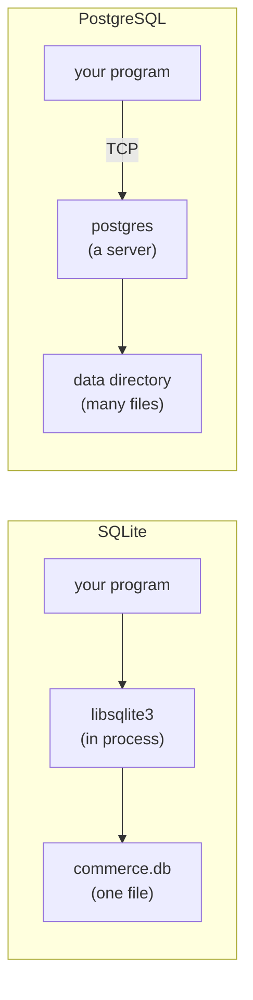

# A database in a file

## One file is the whole database

PostgreSQL is a server. You start a process, it listens on a port, and clients connect to it over a socket with a username and a password. The data lives in a data directory the server owns, and the server decides who may read it. SQLite deletes every one of those moving parts. The database *is* a file on disk, and the engine is a library your program links against and calls as a function. Opening a connection means opening a path.

That single decision reshapes everything downstream. There is no port to firewall, no daemon to keep alive, no role table to consult, and no `search_path` to resolve: an unqualified table name is looked up in one namespace, because there is exactly one database per file. When this course says "the database", it means the bytes in `commerce.db`.

```sql
SELECT COUNT(*) AS customers FROM customers;
```

There is no connection string in that statement, no host, no database name. The host application opened the file; the SQL only names the table.



Both pictures run the same SQL. The difference is where the work happens: in process against a file, or over a socket against a server. That is the whole contrast the rest of this course builds on.

## The catalog is a table

A server needs an administrative interface to answer "what tables exist?": `psql`'s `\dt`, or `information_schema.tables`, or `pg_catalog.pg_class`. SQLite answers it with an ordinary table you already know how to query: `sqlite_master` (also spelled `sqlite_schema`). Every table, index, view and trigger in the file is a row in it, with the `CREATE` statement that made it stored verbatim in the `sql` column.

```sql
SELECT type, name
FROM sqlite_master
WHERE type = 'table'
ORDER BY name;
```

| type | name |
| --- | --- |
| table | customers |
| table | dataset_meta |
| table | order_items |
| table | orders |
| table | products |

Because it is a normal table, you filter it with the same `WHERE`, `LIKE` and `ORDER BY` you use on `products`. There is no separate catalog language and no `\d` meta-command: `PRAGMA table_info('products')` is just another statement that returns rows.

## Air-gapped by construction

A gateway that embeds SQLite for a lesson does not need a database to be reachable, because there is nothing to reach. The engine ships inside the process and the dataset ships with the code, so a machine with no network, no Docker and no running services can still run every query in this course. That is why this app's default execution path is a copy of this file rather than a connection to a server.

It also means the security boundary is not a grant. A classroom copy is made read-only at the file level, so a write does not fail on a privilege check: SQLite itself refuses it:

```sql
INSERT INTO dataset_meta (dataset, version) VALUES ('oops', 1);
```

```
attempt to write a readonly database
```

Read that error as the file talking, not a DBA. The lesson environment is a copy you cannot damage.

## What the file does not have

There is no `GRANT`, no `CREATE ROLE`, no second schema inside the file. There is one namespace, one writer at a time, and a file whose permissions the operating system enforces. `ATTACH` can bring a second file into the same connection, but that is another database, not a schema inside this one. Chapter 7 is the honest inventory of what that costs you.

## Check yourself

**1. Why is there no `search_path` in SQLite?**

<details>
<summary>Answer</summary>

Because a file holds one database in one namespace. `search_path` exists to resolve which schema in which database an unqualified name means; with nothing to disambiguate, there is nothing to configure.

</details>

**2. Where does the list of tables live, and how do you read it?**

<details>
<summary>Answer</summary>

In `sqlite_master`, a table with one row per schema object. You read it with an ordinary `SELECT`, filtering on `type` and `name` like any other table.

</details>

**3. A write to the lesson dataset fails. Is that a permissions check?**

<details>
<summary>Answer</summary>

Not the PostgreSQL kind. There are no roles to check. The database file was opened read-only, so the engine refuses the write at the storage layer: the error is `attempt to write a readonly database`.

</details>
