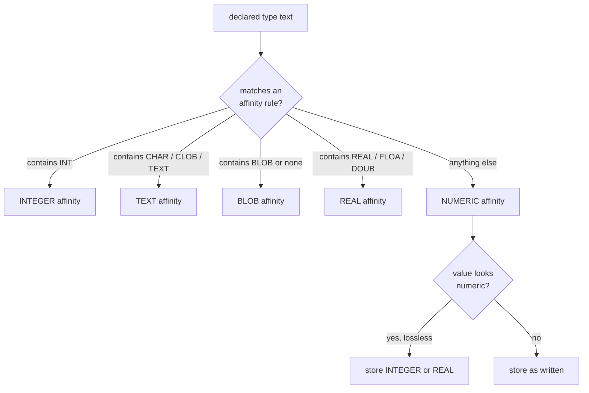

# Storage classes and type affinity

## Five storage classes, five affinities

Ask PostgreSQL what type a column holds and the answer is a fact: `integer`, `numeric(10,2)`, `timestamptz`. Ask SQLite and you get two different facts. The **declared type** is text in the `CREATE TABLE` statement and nothing more; it selects one of five **affinities** for the column. The **storage class** is what a particular value actually is when it is written: `NULL`, `INTEGER`, `REAL`, `TEXT` or `BLOB`. A value is never converted because the column said so; it is converted because the affinity rule says it should, and only when the conversion is lossless.

This is the one SQLite idea that a PostgreSQL reflex gets wrong most often. In PostgreSQL, `price numeric(10,2)` *rejects* `'abc'` with `22P02 invalid input syntax`. In SQLite, `price NUMERIC` accepts it and stores the text, because TEXT is a legal storage class for any column.



The rules are ordered, and the order is the rule. `VARCHAR(20)` contains `CHAR`, so it is TEXT affinity, not NUMERIC. `BIGINT` contains `INT`. A column with no declared type at all gets BLOB affinity, which means no conversion ever, and that is not the same as NUMERIC affinity and is easy to lose.

## Affinity converts on write, not on read

NUMERIC affinity is the one that surprises people, because it rewrites numeric-looking text at insert time. The commerce dataset declares money as `NUMERIC` and seeds it with two-decimal strings like `'59.00'` and `'42.50'`. SQLite stores the first as the *integer* `59`, because the fraction was zero, and an integer is the lossless representation, and the second as the *real* `42.5`. The scale is gone from the value; the column name still says NUMERIC.

```sql
SELECT typeof(price) AS stored, COUNT(*) AS products
FROM products
GROUP BY stored
ORDER BY stored;
```

| stored | products |
| --- | --- |
| integer | 10 |
| real | 10 |

Twenty products, two storage classes, one declared type. PostgreSQL would have returned `numeric` for all twenty and a `'59.00'` string on the wire; SQLite returns a number whose class depends on the value. When a later chapter has to compare two dialects cell for cell, this is the fact that makes a literal shared contract impossible, and it is why the value report has to be read as "what SQLite stored", not "what the column promised".

## `CAST` is the only cast

PostgreSQL spells a cast `x::integer` and also accepts `CAST(x AS integer)`. SQLite has no `::`: the token is a syntax error, so `CAST` is the whole language. There is no `date` target either, because there is no date type; `CAST(x AS date)` parses, selects NUMERIC affinity, and does nothing a plain `CAST(x AS TEXT)` would not do better.

Casting also *applies* the same conversion the affinity would have applied on write, with the same lossless-only rule bent into a coercion:

```sql
SELECT CAST('abc' AS INTEGER) AS abc_to_int,
       typeof(CAST('abc' AS INTEGER)) AS abc_type,
       CAST(59.00 AS TEXT) AS price_as_text;
```

| abc_to_int | abc_type | price_as_text |
| --- | --- | --- |
| 0 | integer | 59 |

`'abc'` is not numeric, so `CAST` cannot convert it losslessly and returns `0`. That is not an error and not NULL: it is the engine's documented answer, and it is the reason you validate input in the application rather than trusting a cast to reject it.

## Check yourself

**1. A column is declared `INT`. Can `'abc'` be stored in it?**

<details>
<summary>Answer</summary>

Yes. The declaration selects INTEGER affinity, not an integer constraint. TEXT is a legal storage class for any column, and a non-numeric string is not converted, so `'abc'` is stored as TEXT.

</details>

**2. `price NUMERIC` seeded with `'59.00'`: what does `typeof(price)` return, and why?**

<details>
<summary>Answer</summary>

`integer`. NUMERIC affinity converts numeric-looking text on write, and `'59.00'` is losslessly an integer, so the stored class is INTEGER even though the declared type says NUMERIC.

</details>

**3. How do you cast in SQLite, and what does `CAST('abc' AS INTEGER)` return?**

<details>
<summary>Answer</summary>

`CAST(x AS type)`. There is no `::` operator. `CAST('abc' AS INTEGER)` returns `0`, because the text cannot be converted and SQLite gives the coercion's zero value rather than raising an error.

</details>
