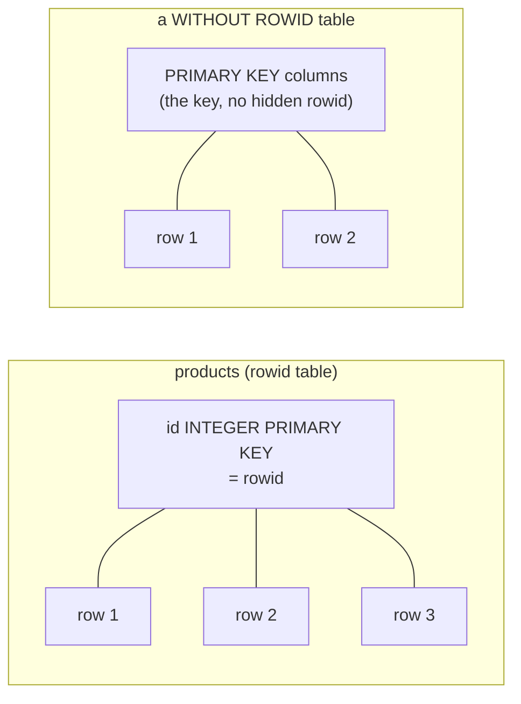

# `rowid`, `INTEGER PRIMARY KEY` and `AUTOINCREMENT`

## Every ordinary row has an address

A SQLite table that is not declared `WITHOUT ROWID` is a B-tree keyed by a 64-bit signed integer the engine assigns to every row: the `rowid`. You did not create it, you cannot drop it, and you can select it by three interchangeable names — `rowid`, `_rowid_` and `oid`. The address is the row's identity *in the file*, in the same way a heap tuple id is a row's address in PostgreSQL, except that here it is part of the query language instead of an internal column.

```sql
SELECT rowid AS rid, id, name
FROM products
ORDER BY id
LIMIT 3;
```

| rid | id | name |
| --- | --- | --- |
| 1 | 1 | Aurora Wireless Earbuds |
| 2 | 2 | Nimbus Headphones |
| 3 | 3 | Linen Duvet Cover |

The two columns agree here because this dataset declares `id INTEGER PRIMARY KEY`. That is not a coincidence, and it is the most useful fact in the chapter: **`INTEGER PRIMARY KEY` is the rowid**, not a column that stores a copy of it.

## The alias that is the rowid

When a column's declared type is exactly `INTEGER` and it is the table's single `PRIMARY KEY`, SQLite makes that column an alias for the rowid. Reading it reads the B-tree key; inserting into it inserts the key; there is no second index and no extra storage. That is why every table in this dataset — `customers`, `products`, `orders`, `order_items` — has a small dense id space you can rely on:

```sql
SELECT MAX(id) AS max_id, MAX(rowid) AS max_rowid, COUNT(*) AS rows
FROM products;
```

| max_id | max_rowid | rows |
| --- | --- | --- |
| 20 | 20 | 20 |

Three numbers that agree. Twenty products, ids 1 through 20, no gaps and no duplicates, because id *is* the key.



`WITHOUT ROWID` inverts the default: the declared `PRIMARY KEY` becomes the storage key and there is no hidden integer address. It exists for small, narrow tables where the extra rowid lookup is the dominant cost, and it removes the rowid entirely — you cannot `SELECT rowid` from such a table.

## `AUTOINCREMENT` is a promise about reuse

It is tempting to read `INTEGER PRIMARY KEY` as "auto-incrementing" and stop there. The id is assigned for you when you omit it, yes — but plain `INTEGER PRIMARY KEY` reuses values. Delete the row with the largest id and the next insert can take that id back, because SQLite picks one more than the current maximum key.

`AUTOINCREMENT` adds a different promise: ids are **never reused**, even after deletes. It buys that with a `sqlite_sequence` table that records the highest value ever used, one extra write per insert, and a hard ceiling on how many ids the table can ever issue. PostgreSQL's `GENERATED … AS IDENTITY` and `serial` also never reuse a value in practice, so if you are porting a schema that depends on monotonic, never-reused keys, that is the SQLite spelling.

| Declaration | Assigns ids | Reuses after delete | Extra storage |
| --- | --- | --- | --- |
| `INTEGER PRIMARY KEY` | yes | yes | none |
| `INTEGER PRIMARY KEY AUTOINCREMENT` | yes | no | `sqlite_sequence` row |

The dataset here uses neither keyword — the seed supplies explicit ids — which is why `sqlite_master` shows a plain `INTEGER PRIMARY KEY`. For a lesson dataset that gets copied and reset, an id that *can* be reused is a feature, not a bug.

## What PostgreSQL does instead

PostgreSQL has no rowid and no alias. A surrogate key is a column with a default drawn from a sequence: `GENERATED ALWAYS AS IDENTITY` in modern schemas, `serial` in older ones. The sequence is an object separate from the table, with its own state, and `nextval` is what fills the column. Three mechanisms, three mental models — but only one of them lets you write `WHERE rowid = 5`.

## Check yourself

**1. What is `rowid` in a table with an `INTEGER PRIMARY KEY`?**

<details>
<summary>Answer</summary>

It is the same value. `INTEGER PRIMARY KEY` makes that column an alias for the rowid, so selecting either returns the B-tree key and inserting into either sets it.

</details>

**2. Delete the highest-id row of a plain `INTEGER PRIMARY KEY` table. What can happen to that id?**

<details>
<summary>Answer</summary>

It can be reused. The next insert takes one more than the current maximum key, and the deleted value is no longer the maximum. Only `AUTOINCREMENT` forbids reuse.

</details>

**3. Why does `AUTOINCREMENT` cost a table?**

<details>
<summary>Answer</summary>

It must remember the highest value ever issued, not just the current maximum, so SQLite keeps a `sqlite_sequence` table and updates it on insert. That is the price of promising ids are never reused.

</details>
