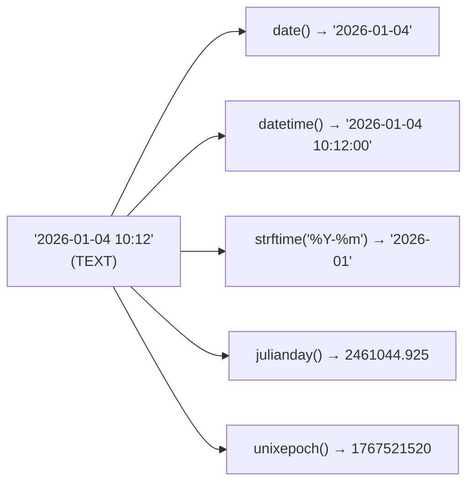

# Dates are not a type

## No `DATE`, no `TIMESTAMP`

PostgreSQL ships a calendar in the type system: `date`, `timestamp`, `timestamptz`, `interval`, a `DATE '2026-01-01'` literal syntax, `age()`, operators like `+ interval '1 month'`. SQLite ships none of it. `DATE` and `TIMESTAMP` are legal words in a `CREATE TABLE`, but they are not types — they are text that matches no affinity rule, so they land in the NUMERIC catch-all. And because an ISO-8601 string like `'2026-01-04 10:12'` does not look numeric, NUMERIC affinity leaves it alone and stores it as TEXT.

The dataset is the proof:

```sql
SELECT id, signup_date, typeof(signup_date) AS stored
FROM customers
ORDER BY id
LIMIT 3;
```

| id | signup_date | stored |
| --- | --- | --- |
| 1 | 2025-11-02 | text |
| 2 | 2025-11-15 | text |
| 3 | 2025-12-01 | text |

A column declared `DATE` holding TEXT is not a bug to fix. It is the design: store the calendar as a sortable string and do the arithmetic with functions. `'2026-01-04 10:12'` sorts lexicographically exactly the way it sorts chronologically, which is why `WHERE ordered_at >= '2026-02-01'` and `ORDER BY ordered_at` both just work.

## The date functions are your calendar

Everything PostgreSQL's operators do, SQLite does with five functions. `date()` returns a `YYYY-MM-DD` string, `time()` returns `HH:MM:SS`, `datetime()` returns `YYYY-MM-DD HH:MM:SS`, `strftime()` formats with `%Y`/`%m`/`%d`/`%H`/`%M`/`%S`, and `julianday()` returns a Julian day number you can subtract. `unixepoch()` (3.38+) returns seconds since 1970.



Grouping by month is the canonical example, and the shape to memorise. PostgreSQL writes `DATE_TRUNC('month', ordered_at)::date`; SQLite writes `strftime('%Y-%m-01', ordered_at)` — the same `YYYY-MM-01` first-of-month, from a format string instead of a truncation function.

```sql
SELECT strftime('%Y-%m-01', ordered_at) AS month, COUNT(*) AS orders
FROM orders
GROUP BY month
ORDER BY month;
```

| month | orders |
| --- | --- |
| 2026-01-01 | 16 |
| 2026-02-01 | 19 |
| 2026-03-01 | 18 |
| 2026-04-01 | 18 |
| 2026-05-01 | 9 |

`strftime` returns NULL for a string that is not a valid time value, which is a quiet failure mode worth knowing: a bad date does not raise, it disappears from the group-by. The mapping manifest for this dataset pins every date column to one ISO-8601 shape for exactly that reason.

## Arithmetic is a modifier string

There is no `INTERVAL`. Instead `date()`, `time()` and `datetime()` take trailing modifiers: `'+1 month'`, `'-7 days'`, `'+2 hours'`, `'start of month'`, `'weekday 1'`. They compose left to right.

```sql
SELECT date('2026-01-31', '+1 month') AS plus_month,
       julianday('2026-02-01') - julianday('2026-01-01') AS days;
```

| plus_month | days |
| --- | --- |
| 2026-03-03 | 31.0 |

Two lessons in one row. The first: `'+1 month'` on January 31 does not clamp to February 28 — it normalises to March 3, so "one month later" is arithmetic on a text calendar, not a calendar-aware interval type. The second: subtracting two Julian day numbers is how you measure a span, and it comes back as a floating-point day count. `31.0` days from January 1 to February 1 is 31 real days, not a calendar month.

Date mathematics also multiplies with `WITH RECURSIVE`: a seed date plus the `'+1 month'` modifier is the SQLite replacement for PostgreSQL's `generate_series`. Chapter 4 of the porting course builds that series; here it is enough to know the modifier is where the arithmetic lives.

## Check yourself

**1. A column is declared `DATE`. What storage class do its values have, and why?**

<details>
<summary>Answer</summary>

TEXT. `DATE` matches no affinity rule, so it selects NUMERIC affinity, and NUMERIC affinity only converts values that look numeric. An ISO-8601 date does not, so it is stored as written.

</details>

**2. How do you truncate a timestamp to the first of its month?**

<details>
<summary>Answer</summary>

`strftime('%Y-%m-01', ts)`. There is no `DATE_TRUNC`; the format string does the truncation.

</details>

**3. What does `date('2026-01-31', '+1 month')` return, and what does that tell you about `INTERVAL`?**

<details>
<summary>Answer</summary>

`2026-03-03`. There is no interval type that clamps to the end of a shorter month; `'+1 month'` is a text modifier applied by the calendar maths, so it overflows into March.

</details>
