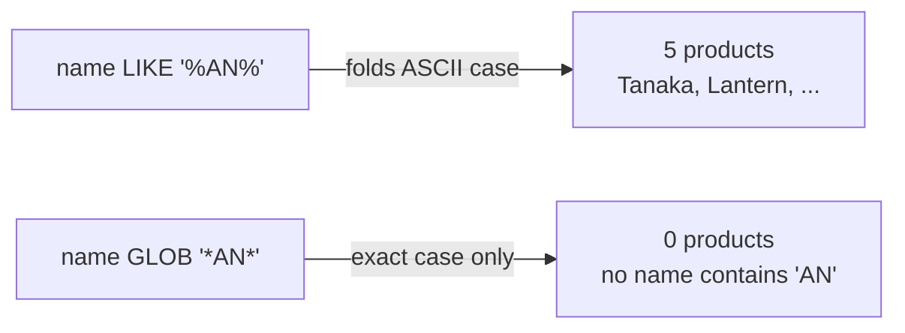

# `LIKE`, `GLOB` and collations

## `LIKE` is case-insensitive for ASCII

In PostgreSQL, `LIKE` is case-sensitive and `ILIKE` is the case-insensitive variant. SQLite has no `ILIKE`, and it does not need one, because its `LIKE` is already case-insensitive, for ASCII letters, by default. `'Ada' LIKE 'a%'` is true in SQLite and false in PostgreSQL. The PostgreSQL reflex, write `LIKE` when you mean an exact-case match, silently returns *more* rows here.

```sql
SELECT 'Ada' LIKE 'a%'  AS like_lowercase,   -- 1: matched
       'Ada' GLOB 'a*'  AS glob_lowercase,   -- 0: not matched
       'Ada' LIKE 'A%'  AS like_uppercase;   -- 1: matched
```

| like_lowercase | glob_lowercase | like_uppercase |
| --- | --- | --- |
| 1 | 0 | 1 |

The asymmetry is the whole point: `LIKE` folds case, `GLOB` does not. Both return `0`/`1` because SQLite has no boolean type (chapter 5 of the porting course), which is why the "true/false" columns above show integers.

The fold is ASCII-only in both directions. `'é' LIKE 'É'` is false. `'İ'` and `'i'` are different characters to SQLite no matter which operator you use, because folding outside ASCII would need a Unicode table the engine deliberately does not carry. If your data has non-ASCII text and case matters, `LIKE` is not the tool: normalise the column in the application, or store a folded copy.

## `GLOB` is the Unix one

`GLOB` is SQLite's second pattern operator, and it is case-sensitive. Its syntax comes from globbing, not from SQL: `*` matches any run of characters, `?` matches exactly one, and `[abc]` or `[a-z]` matches a character class. There is no escape character; a literal `*` cannot appear in the pattern at all.



That pair is worth running once, because it is the fingerprint of the difference:

```sql
SELECT (SELECT COUNT(*) FROM products WHERE name LIKE '%AN%') AS like_an,
       (SELECT COUNT(*) FROM products WHERE name GLOB '*AN*') AS glob_an;
```

| like_an | glob_an |
| --- | --- |
| 5 | 0 |

Five products contain the letters `an` in some case; zero spell them `AN`. `LIKE` found all five, `GLOB` found none. Neither is wrong: they answer different questions, and only one of them is the question you asked.

`PRAGMA case_sensitive_like` flips `LIKE` to PostgreSQL's behaviour for the connection, but it is a per-connection setting with a per-connection index consequence: an index built with one setting may not serve a query using the other. Treat it as a compatibility switch, not a design choice.

## Collations decide ordering and equality

Pattern matching is not the only place case matters. Every text column has a collation that decides `ORDER BY` and `=` and `BETWEEN`: BINARY by default, which compares UTF-8 bytes and puts uppercase before lowercase. Two others ship with the engine: `NOCASE`, which folds ASCII like `LIKE` does, and `RTRIM`, which ignores trailing spaces. A collation can be named per column, per comparison, or per `ORDER BY`:

```sql
SELECT name FROM customers ORDER BY name COLLATE NOCASE;
```

That sort interleaves uppercase and lowercase names the way a person expects. `COLLATE NOCASE` is also ASCII-only, and it is the collation you would bake into an index with `CREATE INDEX … ON customers (name COLLATE NOCASE)` if you needed the sort to be indexed. PostgreSQL's equivalent is a collation from the OS or ICU, chosen per database or per expression: a different mechanism, the same idea.

## Check yourself

**1. You port `WHERE email LIKE 'a%'` from PostgreSQL and get more rows than expected. Why?**

<details>
<summary>Answer</summary>

SQLite's `LIKE` is case-insensitive for ASCII by default, so `'A…'` matches `'a%'` too. PostgreSQL's `LIKE` is case-sensitive; the ported query is a different predicate.

</details>

**2. Which operator gives a case-sensitive pattern match, and what is its wildcard?**

<details>
<summary>Answer</summary>

`GLOB`, with `*` for any run of characters, `?` for one, and `[a-z]` classes. It is case-sensitive and has no escape character.

</details>

**3. What does `ORDER BY name COLLATE NOCASE` change, and for which characters?**

<details>
<summary>Answer</summary>

It folds ASCII letter case for the comparison, so `ada` and `Ada` sort together. Outside ASCII, such as `é`, `É` and `İ`, it does nothing, same as `LIKE`.

</details>
