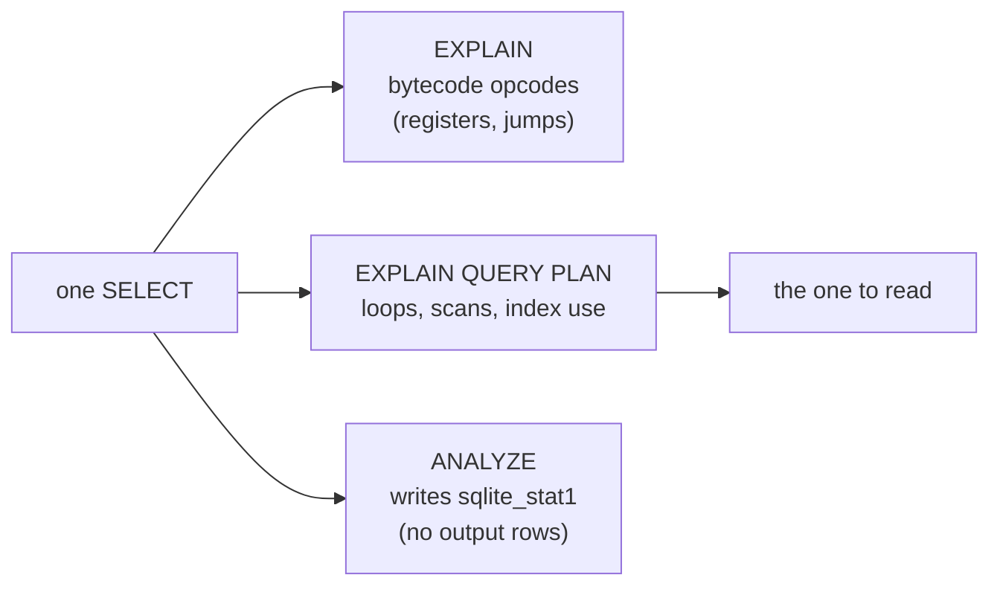

# Reading a query plan without `EXPLAIN ANALYZE`

## Three different things

PostgreSQL's plan story has two commands: `EXPLAIN` shows the chosen plan, `EXPLAIN ANALYZE` runs it and prints actual rows and timings next to the estimates. SQLite has only the first kind, and it splits it in two.

`EXPLAIN` prints the **virtual machine program**: the bytecode the statement compiles to, one opcode per row, with jump targets and register numbers. It is the honest lowest level of the engine, and it is almost never what a developer wants. `EXPLAIN QUERY PLAN` prints the **plan**: which table is scanned, which index is used, in what order the loops run. That is PostgreSQL's `EXPLAIN` without the costs, and it is the one to read.

There is no `EXPLAIN ANALYZE` at all. SQLite cannot report measured rows per node, so a plan here is always an *intention*, never a measurement. This app refuses to grade a plan for that reason: a plan contract would be a claim the engine cannot back. What you can do instead is read the plan and use `ANALYZE` to improve the statistics it is drawn from.



## What it prints

`EXPLAIN QUERY PLAN` returns rows, not text, with a `detail` column carrying one line per loop. The two words that matter are `SCAN` and `SEARCH`: a scan visits every row of a table, a search seeks into an index. A `USING COVERING INDEX` search reads the index alone; a `USING INDEX` search follows the index back to the table for columns it did not cover.

```sql
EXPLAIN QUERY PLAN
SELECT id FROM orders WHERE status = 'refunded';
```

| id | parent | notused | detail |
| --- | --- | --- | --- |
| 2 | 0 | 55 | SEARCH orders USING COVERING INDEX orders_status_idx (status=?) |

One line: an equality on `status` turns into an index search on `orders_status_idx`, and because the query asks only for `id`, which is the rowid, and the rowid is in every index entry, the index *alone* answers it. That is why the plan says COVERING rather than following the index back to the table. No row-by-row visit to the table happens at all.

The same read on a join shows the loop order, one line per loop:

```sql
EXPLAIN QUERY PLAN
SELECT o.id
FROM orders o
JOIN order_items oi ON oi.order_id = o.id
WHERE o.customer_id = 1;
```

| id | parent | notused | detail |
| --- | --- | --- | --- |
| 3 | 0 | 53 | SEARCH o USING COVERING INDEX orders_customer_id_idx (customer_id=?) |
| 7 | 0 | 54 | SEARCH oi USING COVERING INDEX order_items_order_id_idx (order_id=?) |

Two lines, two searches, no scans. Read top to bottom as the nesting order: find the customer's orders, then for each one seek its lines. A `SCAN orders` line where you expected a search is the signal that a predicate is not indexable, usually because it wraps the column in a function, so the index on the column cannot apply. `WHERE date(ordered_at) = '2026-01-04'` is the classic; `WHERE ordered_at >= '2026-01-04' AND ordered_at < '2026-01-05'` is the range the index can use.

## `ANALYZE` is statistics, not a plan

The third command is not a plan reader at all. `ANALYZE` surveys the tables and writes what it found into `sqlite_stat1`, a table the planner consults. It produces no output rows and answers no question about your query; it changes the *next* query's plan by giving the planner better numbers. Run it after a bulk load and stop thinking about it, in the same way you would run PostgreSQL's `ANALYZE`.

What you lose relative to PostgreSQL is the feedback loop. There is no node where an estimate sits next to a measured count, so there is no "the plan was wrong by two orders of magnitude" moment: only "the plan scans, and I expected a search". That narrower loop is enough for the decision that matters here: does the index I created get used, and if not, which predicate is hiding it.

## Check yourself

**1. What is the difference between `EXPLAIN` and `EXPLAIN QUERY PLAN`?**

<details>
<summary>Answer</summary>

`EXPLAIN` prints the bytecode program the statement compiles to: opcodes and jump targets. `EXPLAIN QUERY PLAN` prints the readable plan: scans, index searches and loop nesting.

</details>

**2. What does `SEARCH orders USING COVERING INDEX` mean, versus `USING INDEX`?**

<details>
<summary>Answer</summary>

Both are index seeks. COVERING means the index alone holds every column the query needs, so the table is never visited; plain `USING INDEX` means the engine follows the index back to the table for other columns.

</details>

**3. Why can a predicate like `WHERE date(ordered_at) = '2026-01-04'` cause a scan?**

<details>
<summary>Answer</summary>

The index is on `ordered_at`, but the predicate is on the result of `date(ordered_at)`, not on the column value. SQLite cannot use the index for a value it would have to compute per row, so it scans.

</details>
