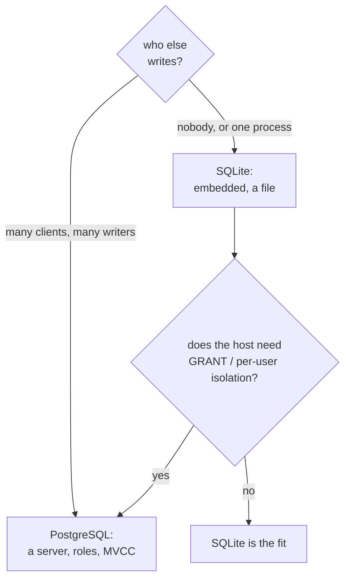

# When SQLite is the right choice — and what it cannot do

## Where a file beats a server

SQLite is the right store when the database and the process that uses it have the same lifetime and the same owner. That covers more ground than it sounds: the browser tab running this lesson, a phone app, a desktop tool, an embedded device, a build cache, a test fixture, an analytics file you email to a colleague. In each case "install a database server" is a cost with no buyer, and "open a file" is exactly the operation you wanted.

The property that makes it work is that there is no separate deployment. The schema, the data and the queries ship as one artifact. There is no production database to drift from the development one, no connection pool to size, no migration window where the server is half-upgraded. `make build` here produces one binary that carries the dataset inside it; that is the same argument at application scale.



## What is genuinely missing

Five absences matter, and they are absences of *features*, not bugs to work around.

**Roles and privileges.** There is no `CREATE ROLE`, no `GRANT`, no `REVOKE`. Access is the file's access: if a process can open it writable, it can write. `PRAGMA query_only` (the lesson copy uses a read-only file) is the closest thing to a read-only grant, and it is a connection-level switch the host sets, not something the database enforces against a determined client.

**Schemas.** One file is one namespace. `ATTACH` can add a second file to the connection and you can query across them, but that is a second *database*, not a schema inside this one. There is no `search_path` because there is nothing for it to search.

**A general `ALTER TABLE`.** SQLite supports `RENAME TO`, `RENAME COLUMN`, `ADD COLUMN` and, since 3.35, `DROP COLUMN` — with restrictions. Anything else (changing a column's type, adding a constraint, reordering) is a documented rebuild: create the new table, copy the rows, drop the old one, rename. The production course spends a chapter on the dance and how `PRAGMA user_version` tracks it.

**Many writers.** SQLite commits one writer at a time. Readers can run concurrently with the single writer under WAL, but two writers serialise; a long write makes the second one wait or fail with `SQLITE_BUSY` unless it has a busy timeout. PostgreSQL's MVCC runs many writers against the same pages. That difference is structural, not a tuning gap.

**Strong typing.** Without `STRICT`, a declared type is an affinity, as chapter 2 showed. A column declared `INT` can hold text. PostgreSQL rejects the same write. If you want the guarantee, `STRICT` tables (3.37+) provide it per table, with a short list of allowed types.

`EXPLAIN ANALYZE` is missing too, and chapter 6 covered why: plans can be read, measurements cannot.

## The whole store in one row

The positive case in one query — every relation of a commerce schema, sitting in a file you can copy:

```sql
SELECT (SELECT COUNT(*) FROM customers) AS customers,
       (SELECT COUNT(*) FROM products)  AS products,
       (SELECT COUNT(*) FROM orders)    AS orders,
       (SELECT COUNT(*) FROM order_items) AS order_items;
```

| customers | products | orders | order_items |
| --- | --- | --- | --- |
| 30 | 20 | 80 | 160 |

Move that file and you have moved the database. Back it up with `VACUUM INTO` or the backup API and you have a consistent snapshot without a server-side dump tool. Ship it read-only to a learner and you have a sandbox that cannot be broken.

## Check yourself

**1. Name the one SQLite feature that replaces `GRANT SELECT`.**

<details>
<summary>Answer</summary>

There is none. Privileges do not exist. The boundary is the file's permissions plus, at most, a host-set `PRAGMA query_only` on the connection.

</details>

**2. Two processes want to write at the same time. What happens?**

<details>
<summary>Answer</summary>

They serialise. SQLite allows one writer at a time; the second waits for the busy timeout and then fails with `SQLITE_BUSY`. WAL lets readers run alongside the writer, not a second writer.

</details>

**3. What does `ATTACH` give you, and what does it not give you?**

<details>
<summary>Answer</summary>

It adds another database file to the same connection so one statement can query across both. It does not create a schema or namespace inside the current database — that is still one file, one namespace.

</details>
