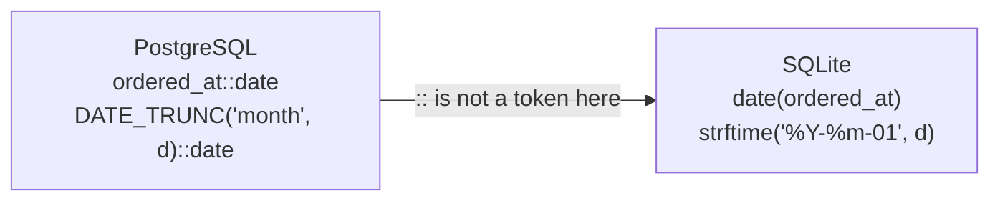

# Casts are gone: `::` → `CAST`

## `::` is PostgreSQL syntax

The PostgreSQL courses are full of `::`: `ordered_at::date`, `customer_id::text`, `unit_price::numeric`. In SQLite the double colon does not exist: it is a syntax error, and the replacement is the verbose standard form, `CAST(expr AS type)`.

That is the mechanical half of the port. The interesting half is that `CAST` does not mean the same thing. In PostgreSQL a cast is a type conversion with a validator attached: `'abc'::integer` raises `22P02` and the statement stops. In SQLite a cast applies an *affinity*, and an affinity never refuses a value.

## A cast converts; it does not validate

```sql
SELECT CAST('2026-05-01' AS TEXT)  AS text_cast,
       CAST('7' AS INTEGER)         AS int_cast,
       CAST(7 AS TEXT)              AS text_from_int,
       CAST('abc' AS INTEGER)       AS bad_text;
```

| text_cast | int_cast | text_from_int | bad_text |
| --- | --- | --- | --- |
| 2026-05-01 | 7 | 7 | 0 |

Four columns, one row, and the fourth is the port bug: `'abc'` is not a number, so PostgreSQL would have refused the query, and SQLite returns `0`. The rule is "take the longest numeric prefix you can find, or zero": `'12abc'` is `12`, `'abc'` is `0`, `''` is `0`. A cast is therefore the wrong place to discover that a column holds junk; the affinity chapter's `typeof()` is where that is visible.

`CAST(x AS DATE)` is not the fix for the missing `::date`, and it is worse than doing nothing. There is no date type, `DATE` is not one of the cast's recognised names, and an unrecognised name falls back to NUMERIC affinity, which reads numbers out of the text:

```sql
SELECT CAST('2026-05-01' AS DATE) AS d, typeof(CAST('2026-05-01' AS DATE)) AS t;
```

| d | t |
| --- | --- |
| 2026 | integer |

A date became the integer 2026. The conversion "succeeded", which is exactly why it is dangerous: nothing in the result says the day and month were thrown away. `date(x)` is the function that was wanted, and it returns text.

## `DATE_TRUNC` becomes a format string

The most common PostgreSQL date call in this curriculum is `DATE_TRUNC('month', o.ordered_at)::date`. In SQLite it is one call, not two, and the truncation is expressed as an output format:

```sql
strftime('%Y-%m-01', o.ordered_at)
```

`%Y-%m-01` is the year, a hyphen, the month, a hyphen, and the literal first day. Because the value is stored as ISO-8601 text, the result is text too, and it still sorts chronologically. `date(o.ordered_at, 'start of month')` is the other spelling and returns the same string; the format string is the one to prefer, because it says what it is doing.

The pattern generalises: `%Y-%m` is a month key, `%Y-%m-%d` is a date, `%Y-%m-%d %H:%M` is a minute stamp. Where the PostgreSQL curriculum reaches for `TO_CHAR`, the port reaches for `strftime`, and the two do not share a format vocabulary: `TO_CHAR(d, 'YYYY-MM')` is `strftime('%Y-%m', d)`.

## What a port looks like

Ports are mechanical once the pattern is named: replace every `::` with a `CAST`, or with a `date()`/`strftime()` call when the target was a date, and delete the casts that only existed to make PostgreSQL's type system happy. Then re-read each one and ask what it was protecting against: in SQLite it is no longer protecting anything.



## Check yourself

**1. Why is `CAST('abc' AS INTEGER)` a porting hazard rather than an error?**

<details>
<summary>Answer</summary>

Because it succeeds. SQLite takes the longest numeric prefix in the text and returns 0 when there is none, so a value PostgreSQL would have rejected with 22P02 quietly becomes a plausible number. Validate before you cast.

</details>

**2. What replaces `DATE_TRUNC('month', d)::date`?**

<details>
<summary>Answer</summary>

`strftime('%Y-%m-01', d)`, or `date(d, 'start of month')`. One call, over ISO-8601 text, returning text.

</details>

**3. What does `CAST('2026-05-01' AS DATE)` do in SQLite?**

<details>
<summary>Answer</summary>

It applies NUMERIC affinity, because `DATE` is not a recognised cast target, and returns the integer 2026: the numeric prefix of the string. It is not the port of `::date`; it silently discards the day and month.

</details>
