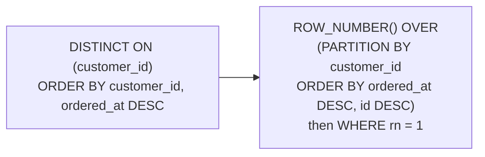

# Conditional aggregation without `FILTER` assumptions

## Two spellings, one engine version apart

PostgreSQL's `COUNT(*) FILTER (WHERE status = 'completed')` is the readable way to count a slice of a table in one pass. SQLite learned it in 3.30, released in 2019, so on any current build the statement works verbatim. The port question is therefore not "what is the replacement" but "what floor do I have to live above".

```sql
SELECT COUNT(*) FILTER (WHERE status = 'completed') AS completed
FROM orders;
```

| completed |
| --- |
| 37 |

The pattern to memorise is the conditional sum, because it runs on every SQLite ever shipped, including builds older than the one in front of you:

```sql
SELECT SUM(CASE WHEN status = 'completed' THEN 1 ELSE 0 END) AS completed,
       SUM(CASE WHEN status = 'cancelled' THEN 1 ELSE 0 END) AS cancelled,
       SUM(CASE WHEN status = 'refunded'  THEN 1 ELSE 0 END) AS refunded,
       SUM(CASE WHEN status = 'shipped'   THEN 1 ELSE 0 END) AS shipped,
       SUM(CASE WHEN status = 'pending'   THEN 1 ELSE 0 END) AS pending
FROM orders;
```

| completed | cancelled | refunded | shipped | pending |
| --- | --- | --- | --- | --- |
| 37 | 11 | 11 | 11 | 10 |

One row, one column per status, one pass over the table: a pivot. PostgreSQL would write the same five columns with five `FILTER` clauses, and both plans read `orders` once. The `ELSE 0` is not decoration: a `CASE` with no `ELSE` yields NULL, and `SUM` over an all-NULL slice is NULL rather than zero.

## `DISTINCT ON` does not exist

PostgreSQL's `DISTINCT ON (customer_id)` is a query with no SQLite spelling at all, the parser stops at `ON`. Two replacements exist, and both are familiar: a `GROUP BY` on the distinct key, or a row-number window filtered to 1.

For "the most recent order per customer", which is the shape `DISTINCT ON` was invented for, the window is the accurate translation, because it keeps the other columns of the surviving row:

```sql
WITH ranked AS (
  SELECT customer_id, id, date(ordered_at) AS ordered_on,
         ROW_NUMBER() OVER (
           PARTITION BY customer_id
           ORDER BY ordered_at DESC, id DESC
         ) AS rn
  FROM orders
  WHERE customer_id <= 5
)
SELECT customer_id, id AS order_id, ordered_on
FROM ranked
WHERE rn = 1
ORDER BY customer_id;
```

| customer_id | order_id | ordered_on |
| --- | --- | --- |
| 1 | 1005 | 2026-02-11 |
| 2 | 1003 | 2026-01-22 |
| 3 | 1004 | 2026-02-02 |
| 5 | 1072 | 2026-05-02 |

Four rows, not five: customer 4 exists and has never placed an order, and `DISTINCT ON` over `orders` would not invent one either. The tie-break matters for the same reason it does in PostgreSQL, `ordered_at` alone can repeat, but here the choice of function is also part of the contract: `RANK()` would let a tie through as two rows, `ROW_NUMBER()` picks exactly one survivor, and the `id DESC` on the second sort key decides which.



## The window is the general fallback

Both replacements fall out of one rule: a window function computes over a partition without collapsing the rows, and then a filter on its result selects. That is why the translation is so often a CTE whose last stage is `WHERE rn = 1`. The `GROUP BY` version is shorter when the only surviving columns are the key and an aggregate; the window version is the one that keeps the rest of the row.

## Check yourself

**1. When can `FILTER` be kept rather than rewritten?**

<details>
<summary>Answer</summary>

When every engine the query has to open on is SQLite 3.30 or newer. Below that it is a syntax error, so the `SUM(CASE …)` spelling is the portable one.

</details>

**2. What replaces `DISTINCT ON (key)`?**

<details>
<summary>Answer</summary>

`ROW_NUMBER() OVER (PARTITION BY key ORDER BY …)` filtered to `rn = 1`, or a `GROUP BY` when only the key and an aggregate are needed. `DISTINCT ON` itself does not parse.

</details>

**3. Why does `SUM(CASE WHEN … THEN 1 END)` come back NULL instead of 0?**

<details>
<summary>Answer</summary>

A `CASE` with no `ELSE` yields NULL, and `SUM` over all-NULL rows is NULL. Write `ELSE 0`, as the five-status pivot does.

</details>
