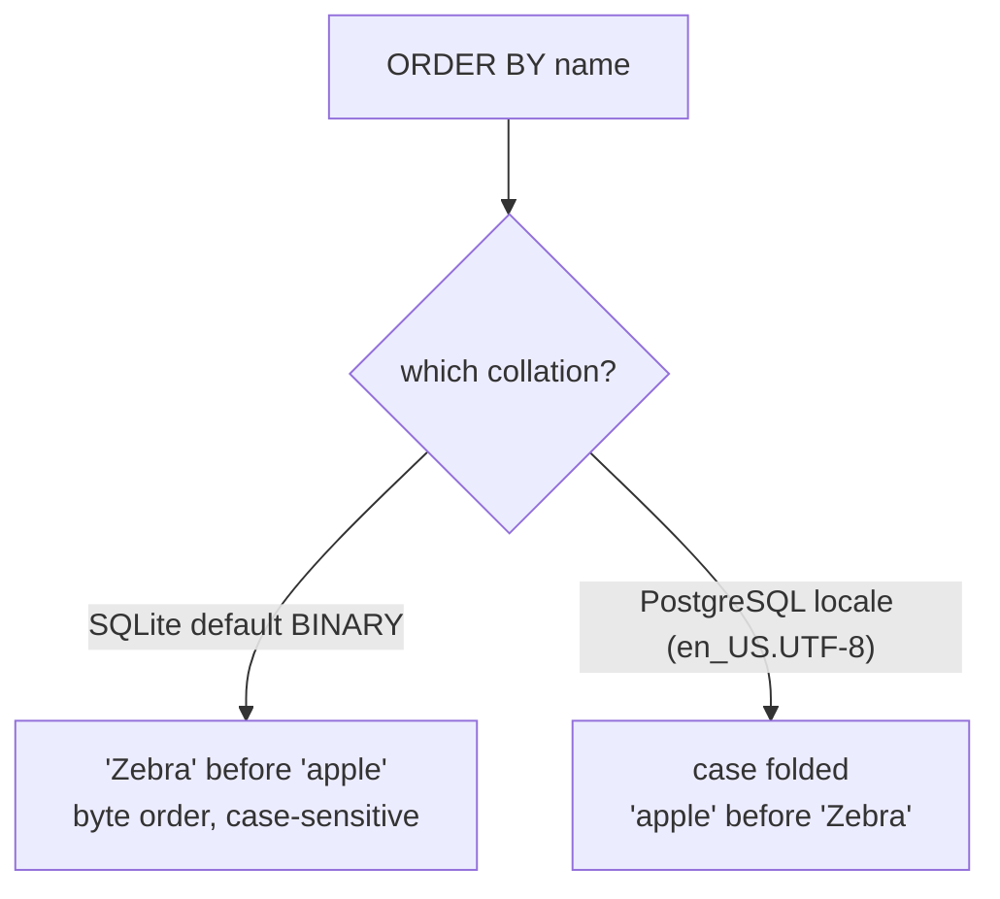

# Windows and ordering semantics

## The syntax ports; the ordering does not

Window functions arrived in SQLite 3.25, in 2018, with the same shape PostgreSQL uses: `PARTITION BY`, an `ORDER BY` inside `OVER`, `row_number()`, `rank()`, `dense_rank()`, `lag()`, `lead()`, `first_value()`, and explicit frames. A windowed query usually ports by copy and paste. What does not port is the *ordering semantics underneath it*, and that is where a port silently returns a different row.

## NULLs sort the other way round

The trap, in one query:

```sql
SELECT (SELECT city FROM customers ORDER BY city ASC LIMIT 1)               AS first_asc,
       (SELECT city FROM customers ORDER BY city ASC NULLS LAST LIMIT 1)    AS first_asc_nulls_last,
       (SELECT city FROM customers ORDER BY city DESC LIMIT 1)              AS first_desc;
```

| first_asc | first_asc_nulls_last | first_desc |
| --- | --- | --- |
| NULL | Austin | Toronto |

PostgreSQL sorts NULLs last ascending and first descending; SQLite does the opposite. The same three subqueries on the same data return `Austin`, `Austin`, `NULL` there. Four customers have no city, so both engines have a NULL to place and they place it oppositely: PostgreSQL treats a missing value as the largest, SQLite as the smallest.

The fix is not a workaround, it is an explicit sort: `ORDER BY city ASC NULLS LAST` is SQLite 3.30+ and makes the two dialects agree. A query whose result is read by a human should say where NULLs go rather than inherit a default that differs by engine.

## The default frame is a `RANGE`, not a `ROWS`

`SUM(x) OVER (ORDER BY month)` is a running total only if the frame means "the rows seen so far". The default is `RANGE BETWEEN UNBOUNDED PRECEDING AND CURRENT ROW`, which means exactly that when the sort key is unique, and something else when it is not: every row that ties with the current one is "current", so each peer gets the whole peer group's sum and the total is duplicated.

Both engines behave this way, so this is a correctness hazard rather than a port difference. A port is where it bites anyway, because the PostgreSQL query was written against keys that happened to be unique. The habit that survives is to write the frame you mean: `ROWS BETWEEN UNBOUNDED PRECEDING AND CURRENT ROW` when you mean rows.

## Collation is byte order by default

SQLite's default collation is `BINARY`: compare the UTF-8 bytes. `'Zebra' < 'apple'` is therefore true, because `Z` (0x5A) sorts before `a` (0x61). PostgreSQL uses the database's collation, which on a normal install is a locale such as `en_US.UTF-8` and folds case, so the same comparison is false and `ORDER BY name` interleaves the cases.

```sql
SELECT ('Zebra' < 'apple') AS byte_order;
```

| byte_order |
| --- |
| 1 |

For a port this matters wherever an `ORDER BY` produces something a human reads, and wherever a text `BETWEEN` or a range check was assumed to be case-insensitive. `COLLATE NOCASE` is the ASCII-only fix, applied to a column or an expression, and an expression index over `name COLLATE NOCASE` is how that sort stays fast.



## Check yourself

**1. Where do NULLs sort by default, here and there?**

<details>
<summary>Answer</summary>

SQLite: first ascending, last descending. PostgreSQL: last ascending, first descending. Write `NULLS FIRST` or `NULLS LAST` explicitly and the two agree.

</details>

**2. Why can `SUM(x) OVER (ORDER BY key)` be wrong when keys tie?**

<details>
<summary>Answer</summary>

The default frame is `RANGE … CURRENT ROW`, which includes every row that ties with the current one. Each peer receives the whole peer group's sum. Use an explicit `ROWS` frame when you mean rows.

</details>

**3. What does `'Zebra' < 'apple'` evaluate to, and why?**

<details>
<summary>Answer</summary>

1, true. SQLite's default `BINARY` collation compares bytes, and uppercase letters sort before lowercase ones. A case-folding locale collation answers false.

</details>
