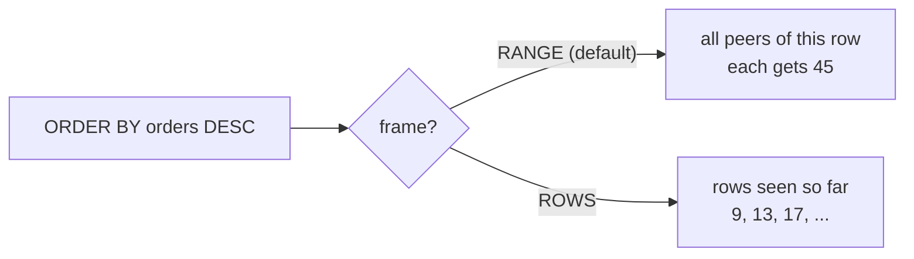

# Windows and ordering semantics

You port a report with a running total column to SQLite without reading it. The window runs, the totals look plausible, and the first four rows come back with an empty `city` cell. Nothing failed.

Window functions landed in SQLite 3.25, in 2018, with the shape PostgreSQL uses. The ordering underneath differs.

## The syntax ports; the ordering does not

`PARTITION BY`, the `ORDER BY` inside `OVER`, `row_number()`, `rank()`, `lag()`, and explicit frames all parse here. A windowed query ports by copy and paste, so nothing warns you that the numbers moved. The report ships with blank rows and totals that disagree with the old engine, and no error marks either one.

Three defaults decide the result: where NULLs sort, the frame a window falls back to, and how text compares.

## What a window function does

A window function computes a value from related rows and keeps one output row per input. `SUM(x) OVER (ORDER BY month)` adds a running total beside every month, where `GROUP BY month` would collapse the rows.

Inside `OVER`, the partition splits rows into groups, the order sequences each group, and the frame picks the rows feeding the current one.

```sql
SELECT category, name, price,
       RANK() OVER (PARTITION BY category ORDER BY price DESC) AS rk
FROM products
WHERE category = 'Kitchen'
ORDER BY price DESC;
```

The `WHERE` clause is the only edit from the posted query, so the ranks fit on screen.

| category | name | price | rk |
| --- | --- | --- | --- |
| Kitchen | Granite Cookware Set | 210.00 | 1 |
| Kitchen | Copper Kettle | 65.75 | 2 |
| Kitchen | Maple Cutting Board | 24.00 | 3 |
| Kitchen | Espresso Tamper | 19.99 | 4 |

`FROM` and `WHERE` hand four rows to the window. `PARTITION BY category` keeps categories apart, so each numbers from 1. The order inside `OVER` sets the rank; the final `ORDER BY` only sorts.

## NULLs sort the other way round

PostgreSQL treats NULL as larger than every value and SQLite treats it as smaller, so the engines place a missing value at opposite ends.

```sql
SELECT (SELECT city FROM customers ORDER BY city ASC LIMIT 1)               AS first_asc,
       (SELECT city FROM customers ORDER BY city ASC NULLS LAST LIMIT 1)    AS first_asc_nulls_last,
       (SELECT city FROM customers ORDER BY city DESC LIMIT 1)              AS first_desc;
```

| first_asc | first_asc_nulls_last | first_desc |
| --- | --- | --- |
| NULL | Austin | Toronto |

The middle column removes the default and answers `Austin` in both. The outer two answer `Austin` and NULL in PostgreSQL, which puts NULL last ascending and first descending.

## A wrong turn: the list opens with a blank

The city report ports badly. The obvious version returns four empty cells:

```sql
SELECT name, city
FROM customers
ORDER BY city
LIMIT 4;
```

| name | city |
| --- | --- |
| Dara Novak | NULL |
| Luca Novak | NULL |
| Tess Larsen | NULL |
| Bo Ivanov | NULL |

The same statement in PostgreSQL returns Yara Park in Austin, Farid Lindqvist in Berlin, Ines Haidar in Boston, and Quinn Rahman in Cairo. Both answered the question they were asked.

The correction names the placement, on SQLite 3.30 or later:

```sql
SELECT name, city
FROM customers
ORDER BY city NULLS LAST
LIMIT 4;
```

| name | city |
| --- | --- |
| Yara Park | Austin |
| Farid Lindqvist | Berlin |
| Ines Haidar | Boston |
| Quinn Rahman | Cairo |

`WHERE city IS NOT NULL` also removes the blanks, and it answers a different question: it drops those customers instead of sorting them last.

## The default frame is a `RANGE`, not a `ROWS`

When a window has an `ORDER BY` and no frame, both engines read `RANGE BETWEEN UNBOUNDED PRECEDING AND CURRENT ROW`. Under `RANGE`, every row that shares the current row's sort value is a peer, and each peer gets the same total.

Ten customers have four orders each, so ties are easy:

```sql
WITH per_customer AS (
  SELECT customer_id, COUNT(*) AS orders
  FROM orders
  GROUP BY customer_id
)
SELECT customer_id, orders,
       SUM(orders) OVER (ORDER BY orders DESC) AS running_range,
       SUM(orders) OVER (ORDER BY orders DESC
                        ROWS BETWEEN UNBOUNDED PRECEDING AND CURRENT ROW) AS running_rows
FROM per_customer
ORDER BY orders DESC, customer_id
LIMIT 4;
```

| customer_id | orders | running_range | running_rows |
| --- | --- | --- | --- |
| 1 | 5 | 5 | 5 |
| 3 | 4 | 45 | 9 |
| 5 | 4 | 45 | 13 |
| 6 | 4 | 45 | 17 |

Customer 1 has five orders and no peer, so both columns read 5. The range column adds all ten four-order customers at once: 5 + 4 × 10 = 45. The rows column adds one row at a time, so the engine decides each peer's slot.



Try this: change `ROWS BETWEEN UNBOUNDED PRECEDING AND CURRENT ROW` to `RANGE BETWEEN UNBOUNDED PRECEDING AND CURRENT ROW`, then rerun. `running_rows` reads 5, 45, 45, 45, the same values as `running_range`.

The exercise groups by month, so its frames agree today. Write the explicit `ROWS` frame anyway, and the query survives a repeated month.

## Collation is byte order by default

SQLite's default collation is `BINARY`, a byte comparison in which uppercase letters come first, so `Z` sorts before `a`. PostgreSQL uses the database locale, a name such as `en_US.UTF-8`, which folds case.

```sql
SELECT ('Zebra' < 'apple')                      AS byte_order,
       ('Zebra' < 'apple' COLLATE NOCASE)       AS case_folded;
```

| byte_order | case_folded |
| --- | --- |
| 1 | 0 |

The first column is 1, true, and PostgreSQL answers false. The second puts `COLLATE NOCASE` on the comparison, which lowercases ASCII letters, so both answer 0.

Every customer name starts with a capital letter, so `ORDER BY name` hides the difference. A text `BETWEEN` or mixed-case input does not. `COLLATE NOCASE` fixes the comparison. An index on `name COLLATE NOCASE` keeps it fast.

## What to remember

**What I would do:** write `NULLS LAST` into every sort that feeds a report, and write the frame out even when the default agrees. Check the collation on any text comparison before you trust the order. Do not call a ported window query done until the SQL names those three defaults.

- SQLite sorts NULLs first ascending and last descending. PostgreSQL does the reverse.
- Write `NULLS LAST` into the sort key so the result does not depend on the engine.
- The default frame is `RANGE`, which gives every peer the same total. `ROWS` counts one row at a time.
- The default collation is `BINARY`, so `Z` sorts before `a`. `COLLATE NOCASE` folds ASCII case.

## Check yourself

**1. Where do NULLs sort by default in each engine, and how do you make them agree?**

<details>
<summary>Answer</summary>

SQLite sorts them first ascending and last descending. PostgreSQL sorts them last ascending and first descending. An explicit `NULLS FIRST` or `NULLS LAST` makes both agree.

</details>

**2. Why do the three tied customers all read 45 in `running_range`?**

<details>
<summary>Answer</summary>

The frame is the default `RANGE`, which treats every row that ties with the current row as current. All ten four-order customers are peers, so each total includes the whole group.

</details>

**3. The same customers read 9, 13 and 17 in `running_rows`. What decides which?**

<details>
<summary>Answer</summary>

The `ROWS` frame counts one row at a time in window order. The window sorts by `orders DESC` alone, so the order among tied rows is not fixed.

</details>

**4. Why does `'Zebra' < 'apple'` return 1 here?**

<details>
<summary>Answer</summary>

The default collation compares bytes. `Z` is 0x5A and `a` is 0x61, so `Zebra` sorts first.

</details>
