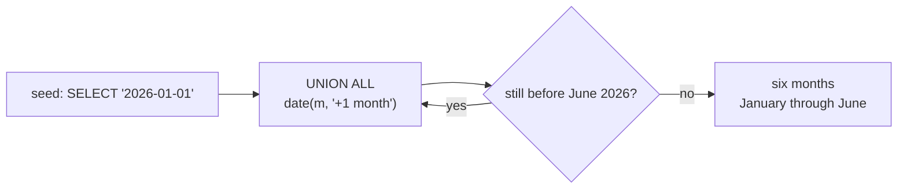

# Dates and intervals without types

## `DATE '…'` and `INTERVAL '…'` do not parse

PostgreSQL's date vocabulary is a small language: typed literals (`DATE '2026-01-01'`), interval arithmetic (`ordered_at + INTERVAL '1 month'`), `DATE_TRUNC`, `TO_CHAR`, `AGE`. SQLite has none of it. A date is ISO-8601 text, arithmetic is a function call with named modifier strings, and the format vocabulary is `strftime`'s.

The dataset stores `2026-01-04 10:12` verbatim: the same characters PostgreSQL prints, precisely so that a lesson can compare text to text. The port is therefore about functions, not about how the value is stored.

## Modifiers, not operators

`date(d, '+1 month')` is the arithmetic. The modifiers cover days, months, years, hours, minutes, seconds, weekdays, `start of month`, `start of year` and `'now'`, and they compose left to right.

The one that breaks a port quietly is month arithmetic, because a month is not a fixed number of days:

```sql
SELECT date('2026-01-31', '+1 month')                                   AS naive,
       date('2026-01-31', '+1 month', 'start of month')                 AS normalised,
       CAST(julianday('2026-02-01') - julianday('2026-01-01') AS INTEGER) AS jan_days;
```

| naive | normalised | jan_days |
| --- | --- | --- |
| 2026-03-03 | 2026-03-01 | 31 |

PostgreSQL returns `2026-02-28` for `DATE '2026-01-31' + INTERVAL '1 month'`: it clamps to the end of the target month. SQLite adds one to the month field and *normalises* the overflow, and February 31st does not exist, so the result rolls forward into March. `2026-03-03` is not a typo; it is what "add a month" means when the arithmetic is a day count. A report that steps a month at a time has to say what it wants: `'start of month'` first, or `'+1 month', 'start of month'` after.

`julianday()` is the other half of the vocabulary: a floating-point day number, so the difference of two of them is a duration in days. `strftime('%s', d)` and `unixepoch(d)` (3.38+) give the same duration in seconds.

## `generate_series` is not in the engine

PostgreSQL's `generate_series`, the standard way to build a date or number spine, is not compiled in. It exists as an optional extension in the SQLite command-line shell, which is exactly the kind of difference that makes a query work on a laptop and fail in the application.

The replacement is a recursive CTE, and it is the better one, because it is portable SQL rather than an engine extra:

```sql
WITH RECURSIVE months(m) AS (
  SELECT '2026-01-01'
  UNION ALL
  SELECT date(m, '+1 month') FROM months WHERE m < '2026-06-01'
)
SELECT months.m AS month, COUNT(orders.id) AS orders
FROM months
LEFT JOIN orders
  ON strftime('%Y-%m', orders.ordered_at) = strftime('%Y-%m', months.m)
GROUP BY months.m
ORDER BY months.m;
```

| month | orders |
| --- | --- |
| 2026-01-01 | 16 |
| 2026-02-01 | 19 |
| 2026-03-01 | 18 |
| 2026-04-01 | 18 |
| 2026-05-01 | 9 |
| 2026-06-01 | 0 |

June is the row the spine exists for: no orders that month, and `LEFT JOIN` plus `COUNT(orders.id)` is what turns the gap into a row of zeroes instead of a missing month. The `m < '2026-06-01'` guard on the recursive step is the termination condition; without it the CTE never stops.



## Check yourself

**1. Why is `date('2026-01-31', '+1 month')` the 3rd of March?**

<details>
<summary>Answer</summary>

The modifier increments the month field and the engine normalises the result: February 31st is out of range, so the overflow rolls into March. PostgreSQL clamps to 2026-02-28 instead. Add `'start of month'` if you meant a month boundary.

</details>

**2. What replaces `generate_series` for a month spine?**

<details>
<summary>Answer</summary>

A `WITH RECURSIVE` CTE that seeds one value and steps it with `date(...)` modifiers until a termination condition holds.

</details>

**3. How do you get a duration in days between two text dates?**

<details>
<summary>Answer</summary>

Subtract two `julianday()` values; the result is a floating-point day count. `CAST(... AS INTEGER)` truncates it, and `strftime('%s', ...)` or `unixepoch()` gives seconds.

</details>
