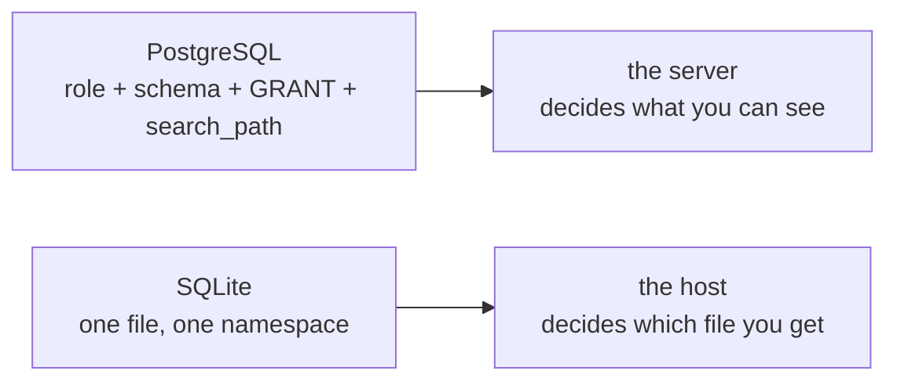

# Users, schemas and permissions do not exist

Your ported query stops on its first line. SQLite answers `FROM dataset.orders` with `no such table: dataset.orders`, and the message names a table you never asked for. The joins are fine and the aliases are fine. The name is the problem.

PostgreSQL builds access out of identity objects. A role owns a table, a schema qualifies its name, `search_path` decides what an unqualified name means, and `GRANT` hands out privilege. SQLite has none of that layer. What is left is one file, one namespace, and a host program that decides which file you get.

## The qualifier is part of the name

Read the failing statement and its error closely.

```sql
SELECT COUNT(*) FROM dataset.orders;
```

```
no such table: dataset.orders
```

Every `dataset.` name in the port fails the same way, so the cost is one edit per query and a repair that hides the problem.

That is not a syntax error. The parser reads `dataset.orders` as one identifier, so the lookup asks for a table whose name contains a dot. Create one and it works.

```sql
CREATE TABLE "dataset.orders" (x INTEGER);
```

It succeeds, and `dataset.orders` joins the catalog. The dot is a character in a name.

`SET search_path TO dataset` fails for a different reason, with `near "SET": syntax error`. There is no `SET` statement and no path to set. `customers` and `main.customers` name the same table, and `main` is the whole database.

Try this: run `SELECT COUNT(*) FROM orders;` and `SELECT COUNT(*) FROM main.orders;`. Both return 80, because `main` is the file and the unqualified name already resolves there.

SQLite does report two schema names, `main` and `temp`. `main` is the file, and `temp` holds temporary objects plus a catalog table of its own. Neither is a schema you define.

## The catalog is one pragma

PostgreSQL answers "what tables exist" from `information_schema.tables`, `pg_class`, `pg_namespace` and a shell command. SQLite answers from one table-valued pragma.

```sql
SELECT name, type, ncol, wr, strict
FROM pragma_table_list
WHERE schema = 'main'
ORDER BY name;
```

| name | type | ncol | wr | strict |
| --- | --- | --- | --- | --- |
| customers | table | 5 | 0 | 0 |
| dataset_meta | table | 2 | 0 | 0 |
| order_items | table | 5 | 0 | 0 |
| orders | table | 4 | 0 | 0 |
| products | table | 6 | 0 | 0 |
| sqlite_schema | table | 5 | 0 | 0 |

`FROM` produces one row per object in every attached schema, `WHERE schema = 'main'` keeps this file, and `ORDER BY name` sorts. Six rows come back: the five dataset tables plus `sqlite_schema`, which the catalog lists like any other.

`ncol` is the column count, and the 6 on `products` and 4 on `orders` match `PRAGMA table_info`. `wr` and `strict` are the `WITHOUT ROWID` and `STRICT` flags, both 0 here because this file uses neither.

`sqlite_schema` has an older spelling, `sqlite_master`, which answers the same. Counting its rows counts tables and indexes together, which is exactly the split the exercise asks you to make.

## Where PostgreSQL keeps the same facts

A connection reports `current_user` as `postgres` and `search_path` as `dataset, public`. `pg_namespace` reports five schemas: `dataset`, `public`, `information_schema`, `pg_catalog` and `pg_toast`. `pg_tables` records that `postgres` owns the dataset tables, and `has_table_privilege('dataset.orders', 'SELECT')` returns true.

None of those questions has an SQLite answer, because nothing on that list is stored. There is no role to name, no owner to record, no path to resolve and no grant to check.

## `ATTACH` opens a second file

The nearest thing to a schema arrives with `ATTACH`, and it is a different thing.

```sql
ATTACH ':memory:' AS archive;
```

The connection now holds two databases. A table in this file is `main.orders`, and a table in the second file is `archive.orders`. An unqualified name still resolves in `main`.

`pragma_table_list` grows a third schema name. `archive` holds 1 object, `main` holds 6 and `temp` holds 1, so the second file contributes its own catalog table and nothing else. `DETACH archive` closes it again.

What `ATTACH` does not create is a namespace inside one database. There is no `CREATE SCHEMA`, no owner, no path and no privilege. The second file has its own pages, journal and catalog, and the connection talks to both.

## A wrong turn: the attached table that is not there

With `search_path` in your head, you attach a second file and expect the qualified name to reach the same rows.

```sql
ATTACH ':memory:' AS archive;
SELECT COUNT(*) AS archive_orders FROM archive.orders;
```

```
no such table: archive.orders
```

The qualifier resolved correctly: it found the `archive` file, looked for `orders` inside it, and that file is empty. `SELECT COUNT(*) FROM archive.sqlite_master` returns 0.

So `main` is not a schema to spell, and `archive` is not a shortcut to `main`. A qualified name reads a table in that file, nothing more. If you want the rows there, copy them.

```sql
CREATE TABLE archive.orders AS SELECT * FROM main.orders;
SELECT COUNT(*) AS archive_rows FROM archive.orders;
```

| archive_rows |
| --- |
| 80 |

That copy is a snapshot with no indexes and no constraints, which suits a staging file and fails anything that must enforce a key.

## Who enforces read-only

Nobody, at the engine level, because there is no account. `SELECT current_user` fails with `no such column: current_user`, and there is no `GRANT`, no `REVOKE` and no `SET ROLE`.

The boundary is the host program, and it has four levers. The filesystem decides who may open the file for writing. The open itself can be read-only. `PRAGMA query_only = 1` makes the connection refuse writes. An authorizer callback can veto a statement before it runs.

This course uses the first two together. The shared dataset is opened with SQLite's `mode=ro` and with `query_only`, so a write reaches the engine and is refused there.

```sql
INSERT INTO dataset_meta (dataset, version) VALUES ('oops', 1);
```

```
attempt to write a readonly database
```

The app reports that as a query error rather than a broken environment: the mistake is yours to fix, not the server's to restart. A `mode=ro` open also turns a missing file into a fault, instead of a database that answers `no such table` to every lesson.

`query_only` is a switch on the connection, and the same connection can switch it back off, so it stops an accident, not an attacker. The in-browser workspace is the other case: a writable copy in memory, with a reset that reseeds it.



## The rest of the absence list

A port needs the honest list. Measured against this engine, these PostgreSQL constructs have no SQLite equivalent.

`DATE '...'` literals and `INTERVAL` arithmetic are missing because there is no date or interval type. `TO_CHAR` and `DATE_TRUNC` are not functions here, and `generate_series` is not compiled in. `ILIKE` is unnecessary, because `LIKE` already folds ASCII case.

The grammar goes as well. `DISTINCT ON`, `GROUPING SETS`, `ROLLUP`, `CUBE` and `LATERAL` do not parse. `MERGE` and ordered-set aggregates such as `percentile_cont` are absent, and `OFFSET ... FETCH FIRST` is a syntax error, so `LIMIT` and `OFFSET` are the only paging spelling.

What does port is the larger list. Joins work in every direction, including `RIGHT` and `FULL OUTER` from 3.39. `WITH` and `WITH RECURSIVE`, window functions, `CASE`, `COALESCE`, `NULLIF`, set operations, `LIMIT`, `OFFSET`, `EXISTS`, `IN` and the upsert all work. `concat()` arrived in 3.44, `->` and `->>` in 3.38, and `RETURNING` in 3.35.

The real constraint is the version floor. A query that uses `MERGE` has no replacement at all, while one that uses `FULL OUTER JOIN` needs a build above 3.39.

## What to remember

**What I would do** find every `schema.table` reference before you touch the SQL. Keep the qualifier out of the query and let the host choose the file. When a lesson needs two files, `ATTACH` them, spell `main` explicitly, and treat `query_only` as a guard against typos, not as access control.

- There are no roles, schemas or grants. One file is one namespace.
- `dataset.orders` is a table name that happens to contain a dot. An unqualified name resolves in `main`.
- `pragma_table_list` returns the whole catalog: one row per object, with `ncol`, `wr` and `strict` flags.
- `ATTACH` adds a second database file to the connection, not a schema inside the first one.
- Read-only enforcement lives in the host: file permission, a read-only open, `PRAGMA query_only`, or an authorizer callback.

## Check yourself

**1. What replaces the `dataset.` schema qualifier?**

<details>
<summary>Answer</summary>

Nothing, and that is the point. There is one namespace, so tables are unqualified, and `ATTACH` adds a second file rather than a namespace inside this one.

</details>

**2. `ATTACH ':memory:' AS archive` runs, and `archive.orders` still fails. Why?**

<details>
<summary>Answer</summary>

The qualifier resolved, and the attached file has no `orders` table. Its catalog holds one object, its own catalog table.

</details>

**3. Where does read-only enforcement live, and why is `query_only` not a security control?**

<details>
<summary>Answer</summary>

In the host: file permissions, a read-only open, `PRAGMA query_only`, or an authorizer callback. `query_only` is a switch on the connection, so the same connection can turn it back off.

</details>

**4. Which of `MERGE`, `LATERAL`, `GROUPING SETS` and `FULL OUTER JOIN` has a SQLite replacement?**

<details>
<summary>Answer</summary>

Only `FULL OUTER JOIN`, and only on 3.39 or later. The other three are syntax errors and need a rewrite: an upsert, a correlated subquery, or separate grouping queries.

</details>
