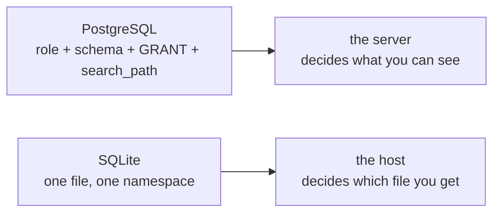

# Users, schemas and permissions do not exist

## The catalog collapses to one namespace

PostgreSQL is built out of identity objects: roles own things, schemas qualify names, `search_path` decides what an unqualified name means, and `GRANT` hands out privileges. SQLite has none of that. A database file is one namespace, its catalog is `sqlite_schema` (also spelled `sqlite_master`), and a table's name is its name — no `dataset.customers`, no `public.`, no `search_path` to fall back on.

That is why this course addresses tables unqualified while the PostgreSQL courses write `FROM dataset.orders`. It is not style: the qualifier is a syntax error here, and `orders` is the only spelling there is.

The whole catalog is one table-valued pragma:

```sql
SELECT name, type, ncol, wr, strict
FROM pragma_table_list
WHERE schema = 'main'
ORDER BY name;
```

| name | type | ncol | wr | strict |
| --- | --- | --- | --- | --- |
| customers | table | 5 | 0 | 0 |
| dataset_meta | table | 2 | 0 | 0 |
| order_items | table | 5 | 0 | 0 |
| orders | table | 4 | 0 | 0 |
| products | table | 6 | 0 | 0 |
| sqlite_schema | table | 5 | 0 | 0 |

The `schema` column only ever says `main`, and the catalog lists itself as a row. `wr` and `strict` are the `WITHOUT ROWID` and `STRICT` flags — both zero, which is this dataset being an ordinary dynamic-typed file. In PostgreSQL the same information is spread across `information_schema.tables`, `pg_class`, `pg_namespace` and `pg_roles`.

## `ATTACH` is a second database, not a schema

The nearest thing to a schema is `ATTACH 'other.db' AS other`, and it is not one: it opens a *second database file* in the same connection so one statement can read both. There is no ownership, no `CREATE SCHEMA`, no `SET search_path`, and the attached file has its own schema, its own pragmas and its own journal.

## Who enforces read-only?

Nobody, at the engine level. There is no role to grant, no `REVOKE`, no `SET ROLE`, and no `current_user` or `session_user` to check. The boundary is the host: the file's permissions, opening it read-only, `PRAGMA query_only = 1` (a connection switch the engine does honour), or an authorizer callback that refuses statements before they run. The read-only dataset these lessons run on is a file the gateway never opens for writing — a filesystem property, not a privilege.



## The rest of the absence list

A port needs the honest list, not only the happy path. Measured against this engine, these PostgreSQL constructs do not exist: `DATE '…'` literals and `INTERVAL` arithmetic (there is no date or interval type), `TO_CHAR` and `DATE_TRUNC` as functions, `generate_series` (not compiled in; the recursive CTE replaces it), `ILIKE` (LIKE is already case-insensitive for ASCII), `DISTINCT ON`, `GROUPING SETS`/`ROLLUP`/`CUBE`, `LATERAL`, `MERGE`, ordered-set aggregates such as `percentile_cont(…) WITHIN GROUP`, and the `OFFSET … FETCH FIRST … ROWS ONLY` spelling — `LIMIT`/`OFFSET` is the only paging syntax, and `LIMIT -1` means "no limit".

What does port: joins (`CROSS`, `INNER`, `LEFT`, and since 3.39 `RIGHT` and `FULL OUTER`), `WITH` and `WITH RECURSIVE`, window functions, `CASE`, `COALESCE`, `NULLIF`, set operations, `LIMIT`/`OFFSET`, `EXISTS`/`IN`, and the upsert. `concat()` exists from 3.44, `->`/`->>` from 3.38 and `RETURNING` from 3.35, all present here. The real constraint is version floors: a query that uses `MERGE` has no replacement at all, while one that uses `FULL OUTER JOIN` only needs a build above 3.39.

## Check yourself

**1. What replaces the `dataset.` schema qualifier?**

<details>
<summary>Answer</summary>

Nothing — that is the point. There is one namespace, so tables are unqualified, and `ATTACH` adds a second *file* rather than a namespace inside the database.

</details>

**2. Where does read-only enforcement live?**

<details>
<summary>Answer</summary>

In the host: file permissions, a read-only open, `PRAGMA query_only`, or an authorizer callback. There is no role or `GRANT` in the engine to do it.

</details>

**3. Which of `MERGE`, `LATERAL`, `GROUPING SETS` and `FULL OUTER JOIN` has a SQLite replacement?**

<details>
<summary>Answer</summary>

Only `FULL OUTER JOIN`, and only on 3.39+. The other three are syntax errors and must be rewritten — as an upsert, a correlated subquery, or separate grouping queries.

</details>
