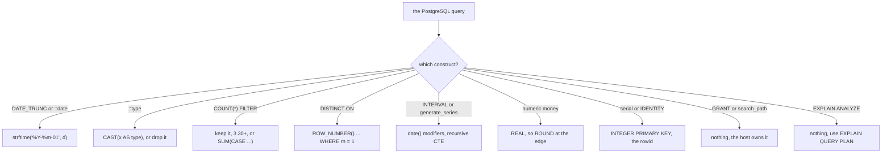

# Porting the capstone

## The same query, one dialect down

The `m8` capstone asks: for each month, the top category by net revenue from completed orders, and the number of distinct customers who bought in it. Its four-stage CTE chain survives: `lines`, `by_cat`, `ranked`, final the port intact, because every construct in it exists in both dialects: joins, `SUM`, `COUNT(DISTINCT …)`, a window function, a CTE. What moves is small, and this chapter is the checklist of where.

The chain, ported:

```sql
WITH lines AS (
    SELECT strftime('%Y-%m-01', o.ordered_at) AS month,
           p.category,
           o.customer_id,
           oi.quantity * oi.unit_price AS revenue
    FROM orders o
    JOIN order_items oi ON oi.order_id = o.id
    JOIN products p ON p.id = oi.product_id
    WHERE o.status = 'completed'
),
by_cat AS (
    SELECT month, category,
           ROUND(SUM(revenue), 2) AS net_revenue,
           COUNT(DISTINCT customer_id) AS buyers
    FROM lines
    GROUP BY month, category
),
ranked AS (
    SELECT month, category, net_revenue, buyers,
           ROW_NUMBER() OVER (
               PARTITION BY month
               ORDER BY net_revenue DESC, category
           ) AS rn
    FROM by_cat
)
SELECT month, category, net_revenue, buyers
FROM ranked
WHERE rn = 1
ORDER BY month;
```

| month | category | net_revenue | buyers |
| --- | --- | --- | --- |
| 2026-01-01 | Outdoor | 824.4 | 4 |
| 2026-02-01 | Electronics | 891.5 | 4 |
| 2026-03-01 | Electronics | 868.05 | 5 |
| 2026-04-01 | Electronics | 708.55 | 4 |
| 2026-05-01 | Outdoor | 589 | 3 |

Five months, one row each, and the same winners as the PostgreSQL capstone: Outdoor in January and May, Electronics from February to April. Three things changed in the text. `DATE_TRUNC('month', o.ordered_at)::date` became `strftime('%Y-%m-01', o.ordered_at)`. `SUM(revenue)` gained a `ROUND(…, 2)`, because the sum is REAL arithmetic now and the contract must not carry an artifact: the unrounded running total reaches `8703.640000000001` by April. And the result columns kept their names while changing their values: `month` is text, `net_revenue` is a REAL (`589`, not `589.00`), `buyers` is an integer.

## The aggregation stage is where the port is checked

Porting a chain means porting each link, and the aggregation link is the one to verify first, because that is where the types move:

```sql
WITH lines AS ( … )
SELECT month, category,
       ROUND(SUM(revenue), 2) AS net_revenue,
       COUNT(DISTINCT customer_id) AS buyers
FROM lines
WHERE month = '2026-01-01'
GROUP BY month, category
ORDER BY net_revenue DESC;
```

| month | category | net_revenue | buyers |
| --- | --- | --- | --- |
| 2026-01-01 | Outdoor | 824.4 | 4 |
| 2026-01-01 | Electronics | 717.55 | 3 |
| 2026-01-01 | Home | 518.6 | 5 |
| 2026-01-01 | Kitchen | 72 | 2 |

The same four rows as the PostgreSQL worked example, with the decimals in SQLite's hands: `518.6` is the real that `518.60` would have been in a `numeric` column, and `72` is an integer because `72.00` is exactly representable as one. A harness that expected the string `"518.60"` would fail here, correctly, because the two engines really are reporting different values. Compare the shape of the answer and let each dialect own its own values; that is the whole reason the two courses exist.

## Upserts and the rest of the checklist

The capstone is read-only. A write-side port has its own short list, and the upsert is the one worth naming: PostgreSQL's `INSERT … ON CONFLICT (key) DO UPDATE SET …` is already SQLite's syntax (3.24+), so it copies verbatim. What does not copy is `ON CONFLICT ON CONSTRAINT name`, naming a constraint object, and `MERGE`; SQLite's conflict target has to be the indexed columns themselves.



Two rules make the list usable. First, port the read side mechanically and then re-check the values, because a SQLite type is an affinity and the column that used to be a `numeric` now arrives as a number. Second, treat every version floor as a design decision: `STRICT` 3.37, `RETURNING` 3.35, `FULL OUTER JOIN` 3.39, `->`/`->>` 3.38, `FILTER` 3.30, `NULLS FIRST/LAST` 3.30, `unixepoch()` 3.38, `concat()` 3.44. A query is portable exactly when its floor is met by every engine in the fleet, and that floor is a number to know rather than a guess.

What has no port at all, and should be rewritten rather than transliterated: roles and grants, `search_path`, plan reading with actual row counts, ordered-set aggregates, `MERGE`, `LATERAL`, and any query whose correctness depends on a locale collation. Those are not gaps in the port: they are the point of the two dialects being different.

## Check yourself

**1. What changes in the capstone's first CTE, and what does not?**

<details>
<summary>Answer</summary>

`DATE_TRUNC('month', o.ordered_at)::date` becomes `strftime('%Y-%m-01', o.ordered_at)`; that is the only change. The join, the `status = 'completed'` filter and the `quantity * unit_price` revenue expression port verbatim.

</details>

**2. Why does the ported capstone need `ROUND(…, 2)` when the PostgreSQL one did not?**

<details>
<summary>Answer</summary>

Because the sum is REAL arithmetic now, and a binary float can carry an artifact such as `1803.6200000000001` into a result that is compared cell for cell. PostgreSQL's `numeric` was exact; `ROUND` restores that guarantee at the edge.

</details>

**3. Which upsert clause copies verbatim, and which does not?**

<details>
<summary>Answer</summary>

`ON CONFLICT (cols) DO UPDATE SET …` copies verbatim. `ON CONFLICT ON CONSTRAINT name` and `MERGE` are PostgreSQL-only; in SQLite the conflict target names the indexed columns.

</details>
