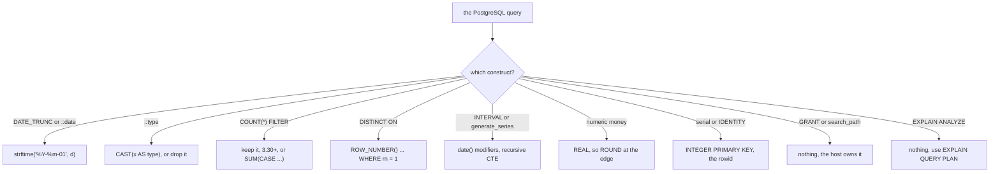

# Porting the capstone

A February total reads `334.09999999999997` where `334.10` belongs. The query runs, returns five rows, and every winner is right. Getting there took one fix: SQLite has no `DATE_TRUNC`, so the first run errored and you replaced the function. The report answers which category brought in the most revenue each month, and how many customers bought from it. You wrote it against PostgreSQL, and the team now runs it on SQLite from the same file and the same 80 orders.

Three parts are the plan, and they survive: the grain of one row per month, the order of the four stages, and the tie-break. Four parts are spelling, and they move: the month expression, the money type, the rounding, and the cast. A port goes wrong when both lists get edited at once.

## What moves and what does not

The capstone names four things that differ between the engines. None of the four errors once you edit it, so a wrong move here leaves a query that runs and a total that is wrong.

| part of the query | PostgreSQL | SQLite |
| --- | --- | --- |
| month key | `DATE_TRUNC('month', o.ordered_at)::date` | `strftime('%Y-%m-01', o.ordered_at)` |
| money column | `numeric(10, 2)`, an exact decimal | `NUMERIC` affinity, integer or REAL |
| revenue total | `SUM(revenue)` | `ROUND(SUM(revenue), 2)` |
| cast | `::date` | none, the format string did the work |

Everything else copies verbatim: the joins, the `status = 'completed'` filter, `oi.quantity * oi.unit_price`, `GROUP BY month, category`, `COUNT(DISTINCT customer_id)`, and the whole `ROW_NUMBER() OVER (PARTITION BY month ORDER BY net_revenue DESC, category)`.

`COUNT(DISTINCT customer_id)` copies because it counts distinct values inside one group, and both engines ignore NULL there. `ROW_NUMBER()` copies because SQLite has had window functions since 3.25.0 in 2018.

## DATE_TRUNC becomes strftime

The first stage as module 8 wrote it:

```sql
WITH lines AS (
    SELECT DATE_TRUNC('month', o.ordered_at)::date AS month,
           p.category,
           o.customer_id,
           oi.quantity * oi.unit_price AS revenue
    FROM orders o
    JOIN order_items oi ON oi.order_id = o.id
    JOIN products p ON p.id = oi.product_id
    WHERE o.status = 'completed'
)
SELECT * FROM lines
ORDER BY month, customer_id, category, revenue
LIMIT 6;
```

Two lines change in the port.

```sql
WITH lines AS (
    SELECT strftime('%Y-%m-01', o.ordered_at) AS month,
           p.category,
           o.customer_id,
           oi.quantity * oi.unit_price AS revenue
    FROM orders o
    JOIN order_items oi ON oi.order_id = o.id
    JOIN products p ON p.id = oi.product_id
    WHERE o.status = 'completed'
)
SELECT * FROM lines
ORDER BY month, customer_id, category, revenue
LIMIT 6;
```

`strftime` means string format time. It takes a format string and a time value, and returns text. `%Y` is the four-digit year, `%m` the two-digit month, and `-01` is literal text where the day goes.

PostgreSQL splits those jobs: `DATE_TRUNC` drops the day and returns a timestamp, then `::date` changes the type to a date. SQLite does both in one call, and `month` becomes TEXT. The same six rows come back:

| month | category | customer_id | revenue |
| --- | --- | --- | --- |
| 2026-01-01 | Electronics | 1 | 118 |
| 2026-01-01 | Home | 1 | 84 |
| 2026-01-01 | Outdoor | 1 | 139 |
| 2026-01-01 | Home | 2 | 127.5 |
| 2026-01-01 | Kitchen | 2 | 24 |
| 2026-01-01 | Outdoor | 2 | 94 |

Module 8 printed those rows as `118.00`, `84.00`, `139.00`, `127.50`, `24.00` and `94.00`. The rows agree and the rendering does not. `revenue` is computed per row, so SQLite stores `59.00` as the integer 59 and `42.50` as the real 42.5, and one column holds both kinds of number.

Text sorts by character, and a fixed-width `YYYY-MM-DD` string sorts in date order, so `ORDER BY month` still works. The format string now carries the sort order too. Keep the `-01`: with `'%Y-%m'` the month column reads `2026-01` and disagrees with the report the team already reads.

## Money stops being exact

`unit_price` is `numeric(10, 2)` in PostgreSQL, an exact decimal with a declared scale, so `SUM` adds exact decimals.

The SQLite declaration is an affinity, not a scale: it decides how a value is stored, not how exactly it is computed. A whole price lands as an integer, 42.50 lands as REAL, and REAL is binary floating point. Most decimal fractions have no exact binary form, so a chain of additions can leave a visible tail.

The port moves the rounding to the edge, into `by_cat`, the stage that names the column:

```sql
ROUND(SUM(revenue), 2) AS net_revenue
```

`ROUND` returns a REAL, so 72 arrives as `72` and 824.4 without a trailing zero. Formatting is the client's job, and the contract compares numbers, so round the value the contract reads and not the intermediates.

## January, one stage at a time

The aggregation stage is where the port gets checked, because the day is gone, the money has been added and the buyers counted.

```sql
WITH lines AS (
    SELECT strftime('%Y-%m-01', o.ordered_at) AS month,
           p.category,
           o.customer_id,
           oi.quantity * oi.unit_price AS revenue
    FROM orders o
    JOIN order_items oi ON oi.order_id = o.id
    JOIN products p ON p.id = oi.product_id
    WHERE o.status = 'completed'
)
SELECT month, category,
       ROUND(SUM(revenue), 2) AS net_revenue,
       COUNT(DISTINCT customer_id) AS buyers
FROM lines
WHERE month = '2026-01-01'
GROUP BY month, category
ORDER BY net_revenue DESC;
```

| month | category | net_revenue | buyers |
| --- | --- | --- | --- |
| 2026-01-01 | Outdoor | 824.4 | 4 |
| 2026-01-01 | Electronics | 717.55 | 3 |
| 2026-01-01 | Home | 518.6 | 5 |
| 2026-01-01 | Kitchen | 72 | 2 |

Eighteen completed lines fall in January, and `GROUP BY month, category` puts them in four buckets. The Outdoor bucket holds five lines from four customers: customer 1 spent 139, customer 2 spent 94, customer 3 spent 96.4 and 354, customer 9 spent 141. Those five numbers add to 824.4.

Customer 3 is why `DISTINCT` is there. Two Outdoor lines from one person, so `COUNT(customer_id)` would say 5 for a bucket of four. Revenue stays correct because it is summed at line grain.

The buyer column goes wrong in a way that looks like an ordinary count.

Home has six lines from five customers, the largest buyer count in January, and third place on revenue. Ranking by buyers would crown Home, so the metric is part of the question.

## The whole chain and what must not change

The port is the module 8 chain with the four substitutions applied.

```sql
WITH lines AS (
    SELECT strftime('%Y-%m-01', o.ordered_at) AS month,
           p.category,
           o.customer_id,
           oi.quantity * oi.unit_price AS revenue
    FROM orders o
    JOIN order_items oi ON oi.order_id = o.id
    JOIN products p ON p.id = oi.product_id
    WHERE o.status = 'completed'
),
by_cat AS (
    SELECT month, category,
           ROUND(SUM(revenue), 2) AS net_revenue,
           COUNT(DISTINCT customer_id) AS buyers
    FROM lines
    GROUP BY month, category
),
ranked AS (
    SELECT month, category, net_revenue, buyers,
           ROW_NUMBER() OVER (
               PARTITION BY month
               ORDER BY net_revenue DESC, category
           ) AS rn
    FROM by_cat
)
SELECT month, category, net_revenue, buyers
FROM ranked
WHERE rn = 1
ORDER BY month;
```

| month | category | buyers | PostgreSQL revenue | SQLite revenue |
| --- | --- | --- | --- | --- |
| 2026-01-01 | Outdoor | 4 | 824.40 | 824.4 |
| 2026-02-01 | Electronics | 4 | 891.50 | 891.5 |
| 2026-03-01 | Electronics | 5 | 868.05 | 868.05 |
| 2026-04-01 | Electronics | 4 | 708.55 | 708.55 |
| 2026-05-01 | Outdoor | 3 | 589.00 | 589 |

The shape must not change. Five rows, because five months hold completed orders. One row per month. Months ascending. The result has four columns: month, category, net_revenue and buyers, in that order. Outdoor takes January and May, Electronics takes February through April.

The exercise compares column names, column order, row order and each cell, so drift in any of them fails the port.

The exercise keeps this chain and changes the ranking metric to the buyer count. The port is identical; only the window's `ORDER BY` moves from `net_revenue DESC` to `buyers DESC`, and the winner changes with it.

The revenue columns differ in trailing zeros. `824.40` and `824.4` are one number written by two engines, one of which kept the declared scale. Read as text the port looks broken. Read as numbers they agree to the cent.

Then run the module 8 checks: five rows, each month once, winners moving as the data supports.

## A wrong turn: a sum without the rounding

The mistake looks like tidying. The PostgreSQL query had no `ROUND`, so you port `SUM(revenue)` as written.

```sql
WITH lines AS (
    SELECT strftime('%Y-%m-01', o.ordered_at) AS month,
           p.category,
           oi.quantity * oi.unit_price AS revenue
    FROM orders o
    JOIN order_items oi ON oi.order_id = o.id
    JOIN products p ON p.id = oi.product_id
    WHERE o.status = 'completed'
)
SELECT category,
       SUM(revenue) AS net_revenue,
       ROUND(SUM(revenue), 2) AS rounded
FROM lines
WHERE month = '2026-02-01'
GROUP BY category
ORDER BY net_revenue DESC;
```

| category | net_revenue | rounded |
| --- | --- | --- |
| Electronics | 891.5 | 891.5 |
| Outdoor | 684 | 684 |
| Kitchen | 401.47 | 401.47 |
| Home | 334.09999999999997 | 334.1 |

Only Home shows the tail. The other three landed on values that binary floating point holds exactly, so the wrong version and the right one agree there. The bug is not consistently wrong, and that is why a review can miss it.

January has no tail at all: without `ROUND` it still returns `824.4`, `717.55`, `518.6` and `72`. A check against January passes the broken query. February shows `334.09999999999997` where `334.10` belongs.

Try this: change the filter to `WHERE month = '2026-01-01'` and run the same unrounded query. The four sums match the rounded column. Put February back and the Home row grows its tail.

The fix is `ROUND(SUM(revenue), 2)` on the sum in `by_cat`, because the sum is the value that column reports. `printf('%.2f', …)` also gives two places and returns text, so the cell fails a number comparison.

A port is done when the values match the contract, not when the SQL stops erroring.

## The rest of the port checklist

The capstone reads, so it exercises the smallest part of a port. On the write side, the upsert is the entry worth naming: `INSERT … ON CONFLICT (key) DO UPDATE SET …` is already SQLite syntax from 3.24, so it copies. `ON CONFLICT ON CONSTRAINT name` and `MERGE` do not, because SQLite's conflict target names the indexed columns.



Two habits make the diagram usable. Port the read side mechanically, then re-check the values, because an affinity says how a value is stored and not how exact it is. Treat every version floor as a design decision: window functions 3.25, `FILTER` and `NULLS FIRST/LAST` 3.30, `RETURNING` 3.35, `STRICT` 3.37, `->`, `->>` and `unixepoch()` 3.38, `FULL OUTER JOIN` 3.39, `concat()` 3.44.

What has no port: roles and grants, `search_path`, plan reading with actual row counts, ordered-set aggregates, `MERGE`, `LATERAL`, and any query that depends on a locale collation.

## Recap

**What I would do** port the plan first and the spelling second. Diff the five rows against the PostgreSQL output before you call the port done, and put `ROUND(SUM(...), 2)` in the stage that names the column. Read the trailing zeros as rendering, and read the five-row shape as the contract.

- A port keeps the plan and changes the spelling: grain, stage order and tie-break survive, while the month expression, the money type, the rounding and the cast move.
- `DATE_TRUNC(…)` plus `::date` becomes one `strftime('%Y-%m-01', …)`, and its format string decides what is kept, how it prints and how the column sorts.
- `numeric` becomes REAL, so the revenue total needs `ROUND(…, 2)` in the stage that names the column.
- `COUNT(DISTINCT customer_id)` and `ROW_NUMBER()` copy unchanged.
- The shape is the contract: five rows, one per month, months ascending, four named columns. Only the digits differ.

## Check yourself

**1. Which lines of the capstone change when you port it, and why those?**

<details>
<summary>Answer</summary>

The month expression, the money type, the rounding and the cast. Each names something the engines implement differently. The rest means the same thing in both dialects.

</details>

**2. Why does `ROUND` sit in `by_cat` rather than on each line's revenue?**

<details>
<summary>Answer</summary>

Because `by_cat` names `net_revenue`, the value the contract compares. A line total and a category total are different numbers, so rounding both would round twice.

</details>

**3. January comes back correct after you drop the `ROUND`. Why is that not evidence the port is right?**

<details>
<summary>Answer</summary>

Because all four January sums happen to be values binary floating point holds exactly. February's Home bucket sums to `334.09999999999997`, which is the same bug showing.

</details>

**4. The PostgreSQL report says `589.00` and the SQLite port says `589`. Did the port lose precision?**

<details>
<summary>Answer</summary>

No. Both hold the same number. `numeric` prints its declared scale, while `ROUND` in SQLite returns a REAL, which prints the shortest form that round-trips.

</details>
